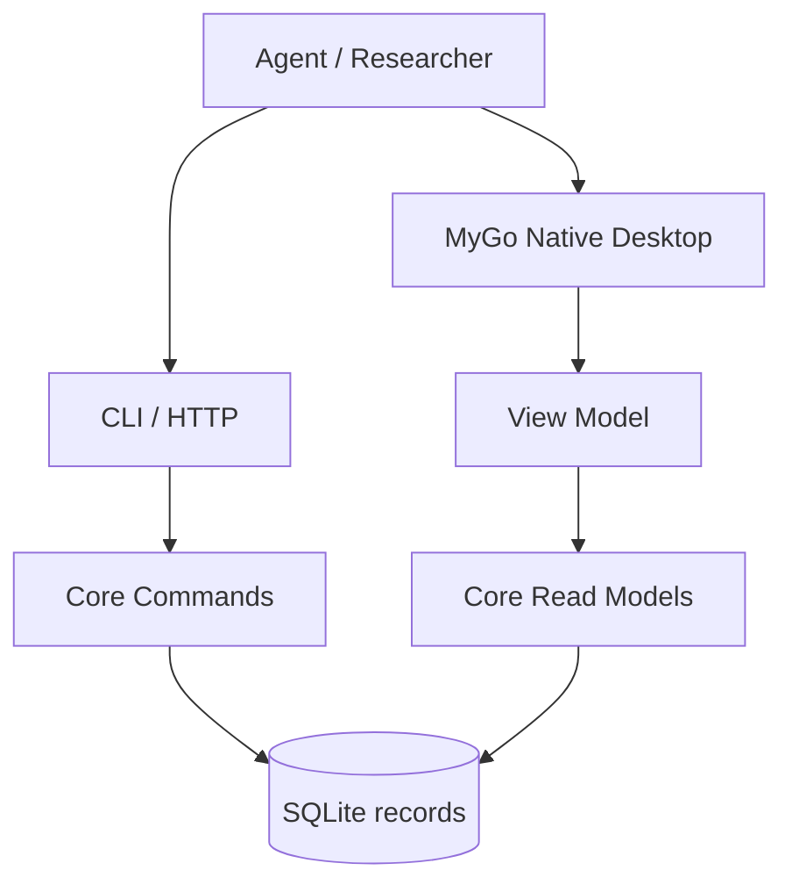
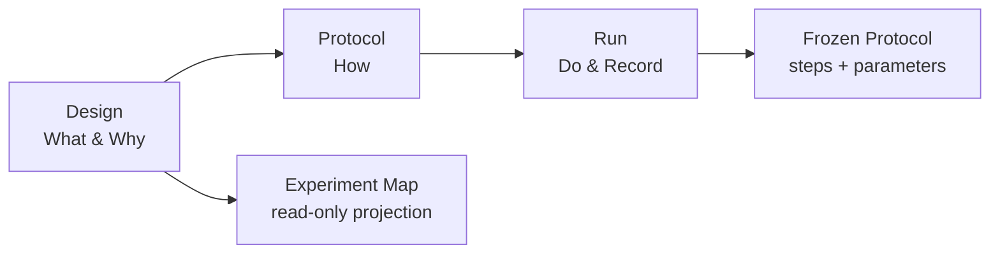
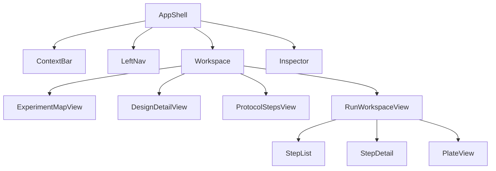
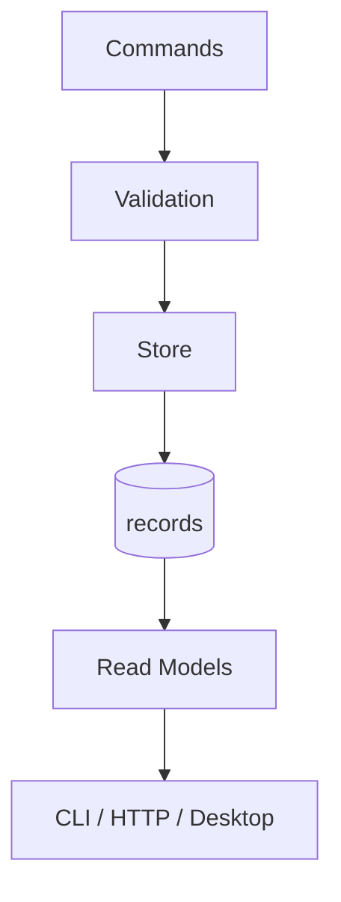
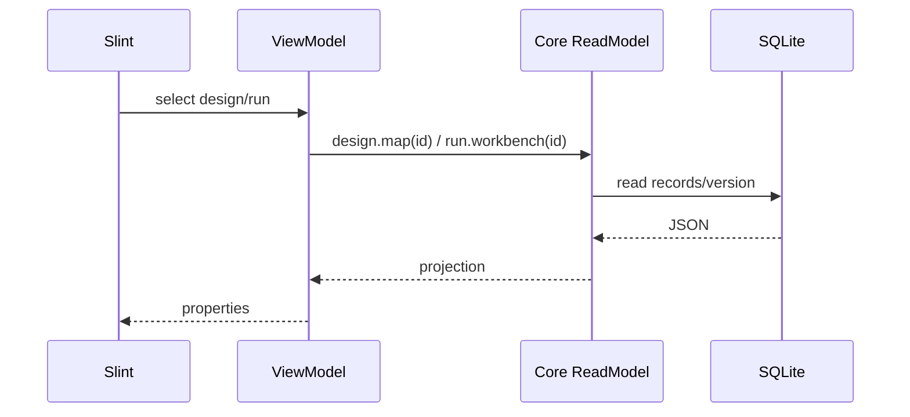
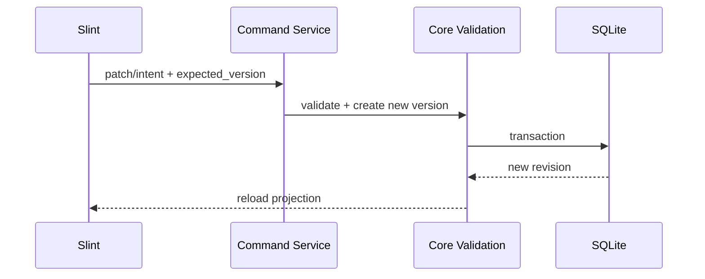

# AsterLab 架构设计

- 日期：2026-11-05
- 状态：权威（模块依赖、分层与迁移方向）· 生效日期 2026-11-13
- 交付前端：MyGo Native（`prototypes/mygo-run`）。Web 包与 Slint 原型是历史/研究资产；§3、§6 的 Slint 前端内容保留为历史记录。
- 文档权威登记：[`release/doc-authority.md`](release/doc-authority.md)；Beta 交付范围：[`release/beta-scope.md`](release/beta-scope.md)。
- 关联：[实验地图契约](prototypes/2026-11-05-experiment-map-and-agent-contract.md)、[协议知识](research/2026-11-05-protocol-knowledge-and-related-projects.md)、[仪器步骤模块](prototypes/instrument-step-modules.md)、[K0 审计](research/2026-11-05-k0-knowledge-coverage-audit.md)、[OperationModule v1](contracts/operation-module-v1.md)、[Semantic Component S0](contracts/semantic-component-contract.md)。

## 0. 一句话

AsterLab 是一个**读模型驱动**的实验工作台：设计、Protocol、Run 三层各有稳定对象和读模型；前端（Beta 为 MyGo Native，历史原型为 Slint）只负责呈现与交互，Rust 核心负责语义、校验、版本和投影，Agent 使用同一套读模型和命令契约。



## 0.1 阶段边界（历史：P0 契约冻结）

本文件给出模块方向；具体类型、身份和兼容规则以 [`contracts/core-v1.md`](contracts/core-v1.md) 为准，当前交付范围与实施阶段以 [`release/beta-scope.md`](release/beta-scope.md) 与 Kandev 卡片为准；历史路线见 [`implementation-plan.md`](implementation-plan.md)。

> 历史（P0/P1 阶段约束，2026-11-05）：以下限制记录当时的 Slint 原型路线，不是当前交付计划；当前范围见 [`beta-scope.md`](release/beta-scope.md)。

P0 结束前不拆 Slint、不实现 `StepMeta`、不移动 `src/cli.rs`。当前 Slint 的原生界面和 `design.map` 是可运行原型，不是已完成 Core 的证据。

## 1. 系统边界

| 层 | 负责 | 不负责 |
|---|---|---|
| MyGo Native Desktop（历史 Slint 原型同职责） | 导航、地图、设计详情、Protocol 步骤、Run 执行、选择与展开 | SQL 查询、科学推断、自动补值 |
| View Model | 把领域对象投影成当前界面需要的短文本/节点/状态 | 修改数据库、重新定义科学关系 |
| Core | 领域类型、校验、版本、冻结、读模型、命令 | 绘制界面 |
| SQLite | 记录、版本、Run 快照、执行事件 | 业务规则 |
| Agent | 读取地图/Protocol、提出字段级 patch、调用确定性工具 | 绕过 Core 直接写记录 |

**Beta 交付面是 MyGo Native 桌面应用 + Rust 本地 Core。** Web 包是历史交付物，Slint `apps/desktop` 保留为研究分支；不同时维护多套前端（[`beta-scope.md`](release/beta-scope.md) §1、§3）。

## 2. 三层对象



| 对象 | 主键/版本 | 读模型 | 写命令 |
|---|---|---|---|
| Design | `design` + `design_version` | `design.map` | `design.create/revise` |
| Protocol | `protocol` + `protocol_version` | `protocol.block.preview` | `protocol.create/revise` |
| ProtocolBlock | `protocol_block` + `protocol_block_version` | block get/list/preview | `protocol.block.create/revise` |
| Run | `run` | Run workbench projection | `run.create`, `execution_event.create` |

设计回答“为什么、比较什么、对什么做、何时测、样本怎么流、还缺什么”；Protocol 回答“具体怎么做”；Run 回答“这一次实际做了什么”。三者共享引用，但默认不混排。

## 3. 前端架构（历史 Slint 原型）

> 历史（2026-11-05）：本节记录 Slint 原型的组件树与状态划分，保留原文用于追溯，不代表当前交付方向。Beta 前端是 MyGo Native，六个表面见 [`product/ux-contract.md`](product/ux-contract.md) §1。

### 3.1 组件树



目标不是继续把 `AppWindow.slint` 堆大，而是按主对象拆组件：

- `AppShell`：顶栏、左导航、右侧检查器、模式切换。
- `ExperimentMapView`：只读地图；组别、检测、时间、样本关系、待确认。
- `DesignDetailView`：设计依据、组别编辑、证据/冲突、检查。
- `ProtocolStepsView`：步骤列表、步骤模块、参数、对照/判定/读数边界。
- `RunWorkspaceView`：冻结版本、当前步骤、目标、参数、记录入口、事件。
- `PlateView`：实际孔位；只从真实 `well` 记录绘制。

### 3.2 状态

- `Selection`：project / design / run / assay / group / step / plate / well / mode。
- `UiState`：展开的面板、筛选、选中的步骤、当前时间点、本地草案。
- `ViewModel`：由 Core 读模型生成，不保存科学事实。
- Slint 不直接查 SQLite；只消费已投影好的属性和回调。

### 3.3 导航与模式

```text
项目
└─ 实验设计
   ├─ 地图（默认，只读）
   ├─ 设计（详情/编辑）
   └─ Protocol（步骤）
└─ 实验运行
   ├─ 准备
   └─ 执行
```

- 进入设计先看地图，不先看长表单。
- 地图点击检测 → 聚焦该检测；点击 Protocol → 步骤视图。
- 地图点击 Run → 执行视图；执行顶部保留“返回地图”。
- 编辑动作只从详情/步骤视图进入，地图本身只读。

### 3.4 当前实现与目标差距

当前 Slint 是 P1 单体原型：

- `ReadModel` 已能读设计/assay/run/plate/event。
- 设计模式已有组别、检测、样本分配和检查，但地图摘要是在 `main.rs` 临时计算。
- 执行模式只有 `ManifestDetail` 摘要，尚未把冻结步骤拆成可点击的 StepList。
- 目标：把投影逻辑移到 Core/ViewModel，Slint 拆成上述组件；先保持只读，下一步再接写入。

## 4. 后端架构

### 4.1 逻辑分层



- **Commands**：`design.create/revise`、`protocol.block.create/revise`、`run.create`、`execution_event.create`。
- **Validation**：结构完整性、操作可行性、科学建议三层；只有前两层可阻断。
- **Store**：`records(id, kind, parent_id, revision, data_json, created_at, updated_at)`。
- **Read Models**：`design.map`、Protocol preview/manifest、Run workbench、Reading Facts（见 5.4）；只读、可重算、不落库。
- **Adapters**：CLI（Agent）、HTTP（Web/外部）、Slint 直接调用（未来 shared core）。

### 4.2 版本与冻结

- 设计修改生成新的 `design_version` 快照。
- Protocol/ProtocolBlock 版本不可变；修改追加新版本。
- Run 创建时冻结设计版本、Protocol 版本、展开步骤和材料清单。
- `execution_event` 只追加，不覆盖；偏差链接到具体步骤/样本/结果。
- 同一孔位/指标再次录入追加新的 `measurement` 事件，事实表修订号递增；不更新旧事件（见 5.4）。
- 旧记录没有新字段时按默认值读；不自动迁移已冻结内容。

### 4.3 共享 Core 的债务

P1-A 已新增 `crates/asterlab-core`，先共享 `design_map::CurrentDesignMap`：

- CLI/HTTP 调用同一 `build_current` 投影，保持扁平 JSON 兼容。
- Slint 的实验地图摘要/待确认改用 Core 投影；设计详情仍使用现有 `data.rs` 解析。
- 尚未共享 ProtocolPreview/RunWorkspace；桌面端仍保留 `data.rs` 读适配器。

后续 P1-B/P1-C：

- P1-B 已共享 Protocol 展开为 `OperationStep`；
- P1-C 已共享 `RunWorkspace`（steps/tasks/occurrences/frozen_design）；
- P3-C 已建立 `DesignDraft` / `DesignCommands` 共享命令契约和桌面 `DesignEditorPresenter`/`CliDesignWriter`；Slint editor 与保存后重载尚未接入。
- 最终让 CLI/HTTP/Slint 只依赖 Core 读模型，UI 不复制“组别覆盖/时间关系/样本数”的推导。

当前 CLI/HTTP 与 Slint 地图摘要已使用同一 `CurrentDesignMap`；Protocol/Run 仍待迁移。

## 5. 数据契约

### 5.1 Design Map

只读投影，不写数据库：

```json
{
  "design_id": "...",
  "revision": 3,
  "title": "...",
  "objective": "...",
  "experimental_unit": null,
  "groups": [],
  "assays": [],
  "sample_links": [],
  "planned_outputs": [],
  "conflicts": [],
  "unresolved": [
    {
      "key": "experimental_unit",
      "question": "独立实验单位和生物学重复数是什么？",
      "affects": ["组别 n", "统计", "Run 计划"],
      "source": "missing"
    }
  ]
}
```

规则：只复制已有字段；缺失项显式列出；不补造 n、对照、剂量、时间点、孔位。

当前设计和冻结设计共享 `DesignMapContent`；`CurrentDesignMap` 读当前 revision，`FrozenDesignView` 读 Run 指向的 DesignVersion。Run 缺少冻结快照时明确报错，不回退当前设计。

### 5.2 Protocol Step Module

步骤的正式读模型是 `OperationStep`，字段/身份见 [`contracts/core-v1.md`](contracts/core-v1.md)。P0 只冻结以下边界：

- `Step` 是块内可读操作；`OperationStep` 是展开后的有序读模型；`StepOccurrence` 是 Run 中的实际执行实例。
- `meta`（purpose/instrument/controls/decision/failure/readout）是**可选**语义补充；正式 Schema 尚未冻结，P4 前不实现。
- 没有 `meta` 的旧步骤仍可预览、冻结和执行；不得自动补 purpose/control/readout。
- 不得用 `ManifestItem {title, detail}` 代替结构化步骤。
- `RunWorkspace` 分开返回 `steps`（定义）、`tasks`（计划）和 `occurrences`（实际）；不得从步骤列表推断执行实例，也不生成时间点 × 样本 × 孔位的笛卡尔积。

### 5.3 Instrument Module

仪器模块不是独立一级页面，而是步骤模块的语义：

- `meta.instrument.class`：移液、离心、孵育、洗板、读板、成像、qPCR、流式等。
- `meta.instrument.profile_id`：可选型号能力档案；未知时只留 class。
- 步骤的参数、对照、判定、失败模式、读数边界仍属于同一个步骤。
- 插入入口在 Protocol 步骤列表的“+”菜单；不弹“是否使用该仪器”，不建全局工具中心。
- 仪器能力档案只描述能力边界，不自动填转速/波长/通道/体积。

### 5.4 Reading Facts（读数/观察事实表）

读数只有一个事实表，由 `crates/asterlab-core::reading_facts` 从 `RunWorkspace`
的事件派生；它不落库、不是新的记录类型，也不允许 UI 维护第二份读数副本。

事实字段（`ReadingFact`）：

| 字段 | 含义 |
|---|---|
| `run_id` | 所属 Run；跨 Run 不合并。 |
| `step_path` | 冻结 Protocol 中的步骤 path；空值不进入事实表。 |
| `assay_id` / `timepoint` | 事件声明的检测和时间点；不按名称猜。 |
| `endpoint` | 测量指标字段（如 `od450`、`cq`）。 |
| `target` | `well { plate_id, coordinate }` 或 `unit { unit_id }`；孔位坐标只在所属孔板内唯一。 |
| `value` | 数值；显式缺失为 `null`，不写成 `0`。 |
| `unit` | 事件记录的原始单位；未知为 `null`，不由 schema 反推。 |
| `status` | `raw` 或 `missing`。 |
| `source_event_id` | 产生该事实的执行事件；事实只追加。 |
| `revision` | 同一 key 的 1 起递增修订号；不是记录 revision。 |
| `supersedes_event_id` | 被本次记录取代的上一事件；首个修订为 `null`。 |
| `recorded_at` | 事件 `recorded_at`，缺失时回退 `occurred_at`。 |

唯一 key 是 `step_path + assay_id + timepoint + endpoint + target`。`revision`
按 `recorded_at`（缺失时 `occurred_at`）归一化后的时间顺序计算，不依赖调用方传入
的事件数组顺序；同一 key 的旧修订保留在 `history` 中。

统一查询是 `query_readings(workspace, ReadingQuery)`，按 step/assay/timepoint/
endpoint/plate 过滤，返回：

- `facts`：每个 key 的最新修订；
- `history`：仅在 `include_history = true` 时包含被覆盖的修订；
- `overwrites`：旧事件、新事件、前后修订号；
- `issues`：不能进入事实表的数据问题。

`project_table` 与 `project_plate` 只消费同一个 `ReadingQueryResult`，分别产出
扁平表格单元格和按行列排序的孔板井位；两者返回完全相同的 cell 集合，禁止各自
再查事件或推导数值。

写入契约 `plan_reading_batch(batch, workspace)`：批次必须能唯一解析到本次 Run
的一块孔板，否则事实表无法归属孔位、提交被拒绝；校验通过时一次批次只构造**一个**
`measurement` 执行事件（`measurements` 存数值、`result_cells` 存含 `missing`
的完整网格），同时报告该批次会覆盖哪些已有事实。同一 well/step/endpoint 再次
录入时追加新事件并令 `revision` 递增；旧事件永不修改、删除或回写。查询在事后
从事件序列重建 `overwrites`，因此覆盖历史可查。

拒绝猜测的边界（`ReadingIssue.code`）：

- `missing_step`、`missing_endpoint`、`missing_target`：不生成匿名 key；
- `unresolved_plate`、`ambiguous_plate`：Run 内无法唯一确定孔板时不生成孔位事实；
- `invalid_position`：行列超出孔板、无法转换为坐标，或写入批次位置越界；
- `unsupported_cell_status`、`status_value_mismatch`：结构化读数的 `status` 只接受 `raw`/`missing`；
  未知状态或状态与数值矛盾时跳过该读数并记 issue，不静默改成 raw/missing；写入批次遇到同类
  矛盾直接拒绝；
- `wrong_run`、`missing_plate`、`unknown_plate`、`duplicate_position`：写入批次在校验层直接拒绝。

兼容规则：批次事件同时带 `result_cells` 与派生 `measurements` 时，先读结构化数组
并按 key 去重；只有两者都缺失时才读旧 `readouts`，且只有 `result_kind = "raw"`
（旧事件缺字段按 raw）的读数进入数值事实表；`derived` 结果保留在事件中，不作为
原始事实。非数值观察保留在事件正文，不进入数值事实表。

### 5.5 Execution Events 与时间线

执行事件仍只以 `execution_event` 追加记录保存；`crates/asterlab-core::execution_timeline`
只定义事件词汇、写入计划和 Run/step 时间线，不新增事实表，也不回写旧事件。

写入以 `EventIntent` 表达用户实际发生的事，Core 负责映射到存储字段：

| intent | `event_type` | 必需内容 |
|---|---|---|
| `operation` | `operation` | `content`；可选步骤引用 |
| `material_use` | `material_use` | 至少一项 `materials` |
| `measurement` | `measurement` | 关联冻结步骤；至少一项数值 `measurements` |
| `check` | `operation` | 关联冻结步骤；至少一项 `checks` |
| `completion` | `operation` | 关联冻结步骤；`step_status = completed`，blocking 检查必须为 `passed` |
| `failure` | `deviation` | 非空 `deviation`；带步骤时 `step_status = blocked` |
| `observation` | `observation` | `content` |

`plan_event(draft, workspace)` 只校验并返回 `execution_event.create` 的 payload，不写库。
校验范围：

- `run_id` 必须是当前 Run；`content` 非空且不超过 5000 字符；`occurred_at` 必须是无歧义的
  RFC 3339 时间，未知时留空；
- `step_path` 必须同时匹配本次 Run 冻结的步骤、作用域和 `protocol_version_id`；步骤 path
  在多个作用域重复时必须给出 `assay_id` 或 `planned_output_id`；
- `timepoint` 必须同时给 `assay_id`，且必须是该步骤的计划时间点；`task_key` 必须匹配
  步骤、作用域和时间点；
- 检查项状态只接受 `passed` / `failed` / `blocked` / `skipped`，同一事件不得重复
  `check_id`；完成事件不得忽略冻结步骤的 blocking 检查；
- 材料、测量、检查只允许出现在对应 intent，材料 `planned_output_id` 必须属于本次 Run；
- 未关联步骤时不得携带步骤字段、检查或 `task_key`。

时间线查询 `query_timeline(workspace, TimelineQuery)`（或 `query_step_timeline`）按
`recorded_at`（缺失时 `occurred_at`）排序，不依赖调用方传入的事件顺序；可按
`step_path`、`task_key`、`assay_id`、`occurrence_id` 和事件贡献过滤，并返回：

- `events`：每个事件的显式贡献 `contributions`（`operation`、`material_use`、
  `measurement`、`check`、`completion`、`deviation`、`observation`）和结果
  `outcome`（`recorded`、`succeeded`、`failed`、`blocked`、`skipped`）；
- `failures`：`failed` / `blocked` 记录；失败检查、`blocked` 步骤、偏差事件和带
  `deviation` 的事件都被视为失败，不压成正文文字；
- `retries`：显式重试链。重试事件用现有 `lineage` 表达，不需要新字段：
  `{from_kind:"execution_event", from_id:"<被重试事件>", to_kind:"step",
  to_id:"<步骤 path>", relation:"retry"}`；存储层直接写 `retry_of_event_id` 时也接受。
  `attempt` 从显式链计算，首个事件为 1；不按“最近一次同名步骤”猜重试；
- `issues`：`missing_event_type`、`unknown_event_type`、`missing_event_id`、
  `invalid_check_status`、`check_without_step`、`completion_without_step`、
  `unknown_retry_target`、`retry_cycle`、`retry_target_not_failed`、
  `retry_step_mismatch`、`multiple_retry_edges`、`duplicate_event_id`、
  `invalid_retry_edge`。

写入拒绝与查询 issue 都不静默修正数据：失败的要求整批拒绝，已存储的异常事件保留并在
`issues` 中说明，不补造事件、不推断执行实例。

### 5.6 Sample Execution Identity 与 `workflow.progress`

执行事件可以只描述“这一步做了一次”，但真实执行还区分**样本**和**第几次尝试**。
`crates/asterlab-core::sample_progress` 定义样本级执行身份：

```text
run_id + step_path + timepoint? + sample_id + attempt
```

- `timepoint` 是可空的 Run 冻结设计标签；缺失时保持 `null`，共享制备步骤不绑定时间点。
  `execution_event.create` 的可选 `attempt` 显式声明身份，必须同时提供冻结
  `protocol_step_path` 和至少一个 `sample_ids`。
- 同一身份的重复完成不会产生第二条事实：存储层按
  `step_path + timepoint + sample_ids[] + attempt` 比较，已存在则返回原事件记录。
- 重试必须追加新 attempt：`attempt` 只能是当前最高 attempt 或 `最高 + 1`，跳跃被拒绝
  （`INVALID_INPUT`）。attempt 连续性按精确 `(step_path,timepoint,sample_id)` 隔离。
  旧 attempt 的事件永不修改，仍可在结果中查。
- 未写 `attempt` 的旧事件保持兼容：读取时若存在显式 retry 链（`retry_of_event_id`
  或 `lineage.relation = "retry"`）则按链深度推导，否则为 attempt 1。

`workflow.progress` 是只读投影，输入 `{run_id, step_path?, timepoint?, sample_id?, sample_ids?}`，
按事件实际携带的 `(step_path,timepoint)` 分组返回；缺失时间点作为 `null` 组，不推断归属。
不筛选时间点时只返回事件实际存在的分组，不构造 Run 全局样本 × 时间点笛卡尔积：

- `steps[]` 显式包含 `step_path` 和可空 `timepoint`；每组的 `samples[]` 含
  `status`（`not_started` / `in_progress` / `completed` / `failed` / `skipped`）、
  当前 `attempt`、`attempt_count` 和完整 `attempts[]` 历史；
- 组内样本集合来自该组事件；只有同时指定 `step_path` 和具体 `timepoint` 时，
  `sample_ids[]` 才补入该组的 `not_started` 样本，不扩散到其他时间点或共享步骤；
- 步骤汇总计数和 `last_event_at` 也仅按该 `(step_path,timepoint)` 组计算。

聚合规则是硬性的：

- `complete = true` 当且仅当该步骤所有样本都是 `completed`；某个事件声明
  `step_status = "completed"` 只代表**该事件的样本**，不代表整步完成。
- 任一样本当前状态为 `failed` → 步骤 `failed`；全部样本 `skipped` → 步骤 `skipped`；
  仅部分样本有进展 → 步骤 `in_progress`。重试成功后步骤可回到 `completed`，旧的
  失败 attempt 仍保留在 `attempts[]`。
- 事件时间取 `recorded_at`，缺失时回退 `occurred_at`；排序按归一化时间，不依赖
  调用方事件数组顺序。

`issues` 只报告无法进入矩阵的数据：`missing_step`（事件没有冻结步骤）、
`unknown_step`（步骤不在本次冻结 Run）、`invalid_attempt`（attempt 为 0）、
`retry_cycle`（重试链成环）。不确定时保留事件、标出问题，不推断样本状态。

## 6. 读/写流程

> 历史（2026-11-05）：时序图中的 `Slint` 参与者指当时的桌面原型；现行前端为 MyGo Native，读写方向与命令/版本规则不变。

### 6.1 读



### 6.2 写（后续）



Slint 不直接执行 SQL，不整体替换记录 JSON；写入必须走字段级命令和版本检查。

## 7. 设计决策

| 决策 | 选择 | 理由 |
|---|---|---|
| 交付前端 | MyGo Native 桌面应用（`prototypes/mygo-run`） | Windows x64 单机；Slint 原型仅作研究资产，Web 包为历史交付物（[`beta-scope.md`](release/beta-scope.md) §1） |
| 首次视图 | 实验地图 | 先理解科学结构，再进入操作 |
| 地图读写 | 只读投影 | 避免地图变成第二个编辑器 |
| StepMeta | 可选语义 | 不阻塞地图/Run；有则展示，无则留空 |
| 仪器 | 步骤模块 | 不建全局工具中心，不把仪器从实验中抽离 |
| 校验 | 结构/操作/科学建议分层 | 不锁死创造性实验 |
| 版本 | 不可变版本 + Run 冻结 | 历史可追溯 |
| 标准 | 借 ISA/PROV/SiLA/MIQE 模式 | 不实现完整本体 |

## 8. 非目标

- 不做通用工作流/脚本引擎。
- 不自动生成完整实验方案。
- 不用模型记忆补造剂量、时间、温度、转速、波长、孔位。
- 不把技术重复当独立 n。
- 不把动画、预览、计划记录当实际完成。
- 不在第一版实现完整 ISA/OBI/RO-Crate 导出。

## 9. 实施顺序

> 历史（2026-11-05）：以下阶段属于 Slint 路线，保留原文；当前交付范围与阶段以 [`release/beta-scope.md`](release/beta-scope.md) 与 Kandev 卡片为准。

以 [`implementation-plan.md`](implementation-plan.md) 为历史路线记录：

1. P0：冻结 Core 契约、身份、兼容规则。
2. P1：抽共享 Core，迁移 `design.map`，建立 `run.workspace`。
3. P2：通过 Core 命令构建可执行 Run Fixture（结构化步骤/参数/时间点/板图/事件）。
4. P3：拆 Slint，做地图、步骤、执行台。
5. P4：可选 `StepMeta`、Protocol 编辑/组合器、上下文仪器模块。
6. P5：写入闭环与性能验收。

P0/P1 不拆 Slint，不实现 StepMeta；每一步都以同一 L929 冻结案例验收。

## 10. 移动端运行边界与双端同步决策记录（2026-11-20 架构讨论）

本节记录针对 `prototypes/mygo-run` 在手机端实际执行实验以及桌面⇄手机双端同步的架构评估与边界决策（非任务待办表；具体开工卡片仍以 Kandev 为准）：

### 10.1 手机端 UX 分工定位
- **桌面端**承担实验设计编排、多窗格分屏对照、复杂 96/384 孔板因子梯度映射与 PDF 导出。
- **手机端**定位为湿实验台边的**单手记录本 + 计时器 + 试剂速查卡**：默认优先浏览执行细节（查看试剂盒位 `PantryLocationMap`、勾选 `checklist`、启停 `timer`、在 `param_table` 用「记偏离」录入实测值、现场拍照粘贴到 `./assets/`），高频导航全量收敛在拇指单手舒适区（底部居中纯图标浮岛 `< > 🔍 + [N] ≡`、左滑实验库三层控制岛抽屉、右滑步骤大纲与速算器）。

### 10.2 是否需要改造后端？
- **结论：以本地 Obsidian 式 `.asterml` Vault 工作区运行，无需架设中心服务器后端；但启动与 FFI 边界需要做双轨适配**：
  1. **纯 Go Vault 层已完全独立闭环**：`.asterml` 解析与回写（`internal/asterdoc`）、本地文件夹扫描与树状组织（`internal/vault`）、100 步撤销环与原子落盘（`vault.LiveDocument` / `WriteFileAtomic`）、日历与储藏室均为纯 Go 本地文件引擎，零 SQLite/网络依赖。
  2. **当前启动卡点**：`prototypes/mygo-run/main.go`（`runs.NewRunService()` / `runs.NewDesignService()`）在初始化时会尝试加载原生 Rust FFI 动态库（桌面为 `runs.dll`）；未携带原生动态库时将产生 `syncErr` 报错条。
  3. **两条可行演进路径**：
     - **路径 A（轻量立即可跑 · 纯 Go Vault 模式）**：移动端或无原生动态库环境下对 `NewRunService` 报错做非致命降级处理，直接以纯 Go `.asterml` 单库引擎运行，零后端改造。
     - **路径 B（完整冻结 Run 审计能力）**：将 `crates/asterlab-core` 交叉编译为 `libruns.so`（Android NDK）或静态库 `.a`（iOS），沿用既有 FFI 接口即可。

### 10.3 桌面 ⇄ 手机双端同步策略
基于单文件自包含 `.asterml` + `./assets/` 透明目录结构，优先采用**文件级透明同步 + 结构化冲突兜底**，而非另起数据库行同步协议：

1. **零服务期（Phase 1 · 兼容通用云盘/P2P）**：直接复用 iCloud Drive / Syncthing / WebDAV / OneDrive 同步整个 `<Vault>` 目录，客户端补齐三项守护即可：
   - **前后台热重载监听**：App 切回前台与定时轻检调用既有 `LiveDocument.ReloadIfExternalChanged()`（比对 `DiskMtime` 与规范化文本），自动刷新左树、日历与当前视图。
   - **按块唯一 `id` 的三路合并与冲突副本**：利用 `.asterml` 内 `frontmatter`、`step.id` 及块 `id` 的强结构性，不同步骤分别在桌面与手机修改时优先按块合并；仅在同块同字段撞车时保留本地变更并另存 `*.conflict-<device>.asterml` 提示对比，严禁静默覆盖实验记录。
   - **`assets/` 大图按需/缩略图分层策略**：避免手机端同步大体积显微原始照片拖慢文字方案热开。
2. **自托管同步演进（Phase 2 · 可选增强）**：若后续需要跨团队实时同步或无云盘同步，可在不改变本地 `.asterml` 引擎的前提下，于外部增加薄层内容寻址对象同步（按 `sha256` 切分 `.asterml` / `assets/` Blob 上传 S3/WebDAV + 推送 `path + hash + mtime` 元清单），保留完全离线可读可写能力与同等结构化合并逻辑。
