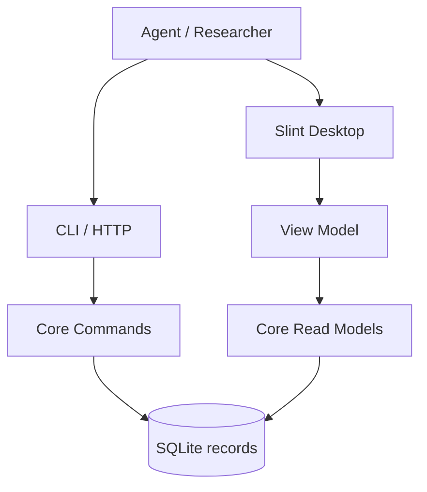
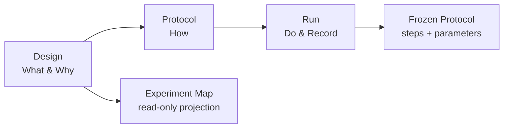
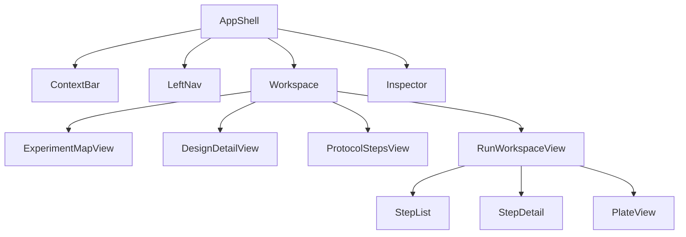
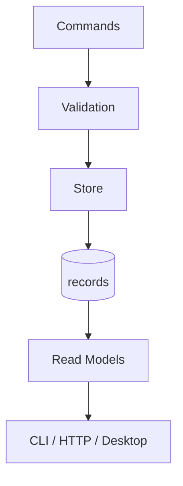
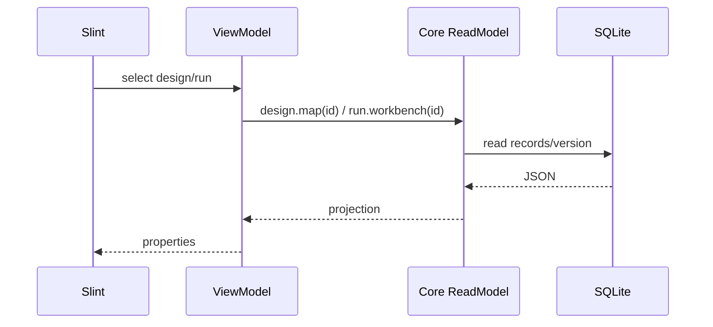
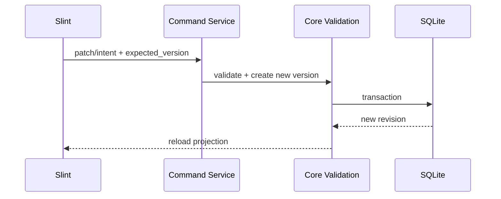

# AsterLab 架构设计

- 日期：2026-11-05
- 状态：目标架构；Slint 是交付前端，Web 是过渡原型。
- 关联：[实验地图契约](prototypes/2026-11-05-experiment-map-and-agent-contract.md)、[协议知识](research/2026-11-05-protocol-knowledge-and-related-projects.md)、[仪器步骤模块](prototypes/instrument-step-modules.md)。

## 0. 一句话

AsterLab 是一个**读模型驱动**的实验工作台：设计、Protocol、Run 三层各有稳定对象和读模型；Slint 只负责呈现与交互，Rust 核心负责语义、校验、版本和投影，Agent 使用同一套读模型和命令契约。



## 1. 系统边界

| 层 | 负责 | 不负责 |
|---|---|---|
| Slint Desktop | 导航、地图、设计详情、Protocol 步骤、Run 执行、选择与展开 | SQL 查询、科学推断、自动补值 |
| View Model | 把领域对象投影成当前界面需要的短文本/节点/状态 | 修改数据库、重新定义科学关系 |
| Core | 领域类型、校验、版本、冻结、读模型、命令 | 绘制界面 |
| SQLite | 记录、版本、Run 快照、执行事件 | 业务规则 |
| Agent | 读取地图/Protocol、提出字段级 patch、调用确定性工具 | 绕过 Core 直接写记录 |

**交付面是 Slint exe。** 当前 Web `index.html` 保留为快速验证和 Agent/浏览器对照，不是最终产品外壳。

## 2. 三层对象



| 对象 | 主键/版本 | 读模型 | 写命令 |
|---|---|---|---|
| Design | `design` + `design_version` | `design.map` | `design.create/revise` |
| Protocol | `protocol` + `protocol_version` | `protocol.block.preview` | `protocol.create/revise` |
| ProtocolBlock | `protocol_block` + `protocol_block_version` | block get/list/preview | `protocol.block.create/revise` |
| Run | `run` | Run workbench projection | `run.create`, `execution_event.create` |

设计回答“为什么、比较什么、对什么做、何时测、样本怎么流、还缺什么”；Protocol 回答“具体怎么做”；Run 回答“这一次实际做了什么”。三者共享引用，但默认不混排。

## 3. 前端架构（Slint）

### 3.1 组件树



目标不是继续把 `AppWindow.slint` 堆大，而是按主对象拆组件：

- `AppShell`：顶栏、左导航、右侧检查器、模式切换。
- `ExperimentMapView`：只读地图；组别、检测、时间、样本关系、待确认。
- `DesignDetailView`：设计依据、组别编辑、证据/冲突、检查。
- `ProtocolStepsView`：步骤列表、步骤模块、参数、对照/判定/读数边界。
- `RunWorkspaceView`：冻结版本、当前步骤、目标、参数、记录入口、事件。
- `PlateView`：实际孔位；只从真实 `well` 记录绘制。

### 3.2 状态

- `Selection`：project / design / run / assay / group / step / plate / well / mode。
- `UiState`：展开的面板、筛选、选中的步骤、当前时间点、本地草案。
- `ViewModel`：由 Core 读模型生成，不保存科学事实。
- Slint 不直接查 SQLite；只消费已投影好的属性和回调。

### 3.3 导航与模式

```text
项目
└─ 实验设计
   ├─ 地图（默认，只读）
   ├─ 设计（详情/编辑）
   └─ Protocol（步骤）
└─ 实验运行
   ├─ 准备
   └─ 执行
```

- 进入设计先看地图，不先看长表单。
- 地图点击检测 → 聚焦该检测；点击 Protocol → 步骤视图。
- 地图点击 Run → 执行视图；执行顶部保留“返回地图”。
- 编辑动作只从详情/步骤视图进入，地图本身只读。

### 3.4 当前实现与目标差距

当前 Slint 是 P1 单体原型：

- `ReadModel` 已能读设计/assay/run/plate/event。
- 设计模式已有组别、检测、样本分配和检查，但地图摘要是在 `main.rs` 临时计算。
- 执行模式只有 `ManifestDetail` 摘要，尚未把冻结步骤拆成可点击的 StepList。
- 目标：把投影逻辑移到 Core/ViewModel，Slint 拆成上述组件；先保持只读，下一步再接写入。

## 4. 后端架构

### 4.1 逻辑分层



- **Commands**：`design.create/revise`、`protocol.block.create/revise`、`run.create`、`execution_event.create`。
- **Validation**：结构完整性、操作可行性、科学建议三层；只有前两层可阻断。
- **Store**：`records(id, kind, parent_id, revision, data_json, created_at, updated_at)`。
- **Read Models**：`design.map`、Protocol preview/manifest、Run workbench；只读、可重算、不落库。
- **Adapters**：CLI（Agent）、HTTP（Web/外部）、Slint 直接调用（未来 shared core）。

### 4.2 版本与冻结

- 设计修改生成新的 `design_version` 快照。
- Protocol/ProtocolBlock 版本不可变；修改追加新版本。
- Run 创建时冻结设计版本、Protocol 版本、展开步骤和材料清单。
- `execution_event` 只追加，不覆盖；偏差链接到具体步骤/样本/结果。
- 旧记录没有新字段时按默认值读；不自动迁移已冻结内容。

### 4.3 共享 Core 的债务

当前根 crate 是二进制，桌面端有自己的 `data.rs` 读适配器。目标架构应抽出 `asterlab-core` 库：

- 领域类型、验证、读模型、命令入口共享；
- CLI/HTTP 和 Slint 都依赖它；
- UI 不复制“组别覆盖/时间关系/样本数”的推导。

在抽取前，桌面端的读模型必须与 Core 的 `design.map` 形状保持一致，避免两套语义。

## 5. 数据契约

### 5.1 Design Map

只读投影，不写数据库：

```json
{
  "design_id": "...",
  "revision": 3,
  "title": "...",
  "objective": "...",
  "experimental_unit": null,
  "groups": [],
  "assays": [],
  "sample_links": [],
  "planned_outputs": [],
  "conflicts": [],
  "unresolved": [
    {
      "key": "experimental_unit",
      "question": "独立实验单位和生物学重复数是什么？",
      "affects": ["组别 n", "统计", "Run 计划"],
      "source": "missing"
    }
  ]
}
```

规则：只复制已有字段；缺失项显式列出；不补造 n、对照、剂量、时间点、孔位。

### 5.2 Protocol Step Module

```json
{
  "kind": "text",
  "use_id": "read_od450",
  "title": "读取 OD450",
  "instruction": "按已确认的读板设置测量。",
  "parameter_refs": ["wavelength"],
  "visualization": "measurement",
  "meta": {
    "purpose": "获得可比较的吸光度信号。",
    "instrument": {
      "class": "plate_reader",
      "profile_id": "multiskan_skyhigh",
      "required": true
    },
    "controls": ["无细胞空白"],
    "decision_points": ["读数是否在线性范围？"],
    "failure_modes": ["气泡", "蒸发", "饱和"],
    "readout": "OD450 不是活细胞数。",
    "sample_constraints": ["repeatable_measurement"]
  }
}
```

`meta` 是可选语义补充，不是 Design 的核心模型。没有 `meta` 的旧步骤仍可执行、仍可显示 title/instruction/parameters。

### 5.3 Instrument Module

仪器模块不是独立一级页面，而是步骤模块的语义：

- `meta.instrument.class`：移液、离心、孵育、洗板、读板、成像、qPCR、流式等。
- `meta.instrument.profile_id`：可选型号能力档案；未知时只留 class。
- 步骤的参数、对照、判定、失败模式、读数边界仍属于同一个步骤。
- 插入入口在 Protocol 步骤列表的“+”菜单；不弹“是否使用该仪器”，不建全局工具中心。
- 仪器能力档案只描述能力边界，不自动填转速/波长/通道/体积。

## 6. 读/写流程

### 6.1 读



### 6.2 写（后续）



Slint 不直接执行 SQL，不整体替换记录 JSON；写入必须走字段级命令和版本检查。

## 7. 设计决策

| 决策 | 选择 | 理由 |
|---|---|---|
| 交付前端 | Slint exe | 原生桌面、单进程、低资源；Web 仅对照 |
| 首次视图 | 实验地图 | 先理解科学结构，再进入操作 |
| 地图读写 | 只读投影 | 避免地图变成第二个编辑器 |
| StepMeta | 可选语义 | 不阻塞地图/Run；有则展示，无则留空 |
| 仪器 | 步骤模块 | 不建全局工具中心，不把仪器从实验中抽离 |
| 校验 | 结构/操作/科学建议分层 | 不锁死创造性实验 |
| 版本 | 不可变版本 + Run 冻结 | 历史可追溯 |
| 标准 | 借 ISA/PROV/SiLA/MIQE 模式 | 不实现完整本体 |

## 8. 非目标

- 不做通用工作流/脚本引擎。
- 不自动生成完整实验方案。
- 不用模型记忆补造剂量、时间、温度、转速、波长、孔位。
- 不把技术重复当独立 n。
- 不把动画、预览、计划记录当实际完成。
- 不在第一版实现完整 ISA/OBI/RO-Crate 导出。

## 9. 实施顺序

1. **稳定架构**：抽出 Core 读模型；Slint 只消费 `design.map`/Run view model。
2. **Slint 地图**：地图作为设计默认视图；组别/检测/时间/样本/待确认。
3. **Slint Run**：冻结步骤列表、步骤详情、记录入口；仪器步骤显示 class/profile。
4. **StepMeta**：可选语义字段与校验；步骤编辑器中按需展开。
5. **Protocol 组合器**：插入、排序、绑定；仪器模块从上下文菜单进入。
6. **写入闭环**：Slint → Command Service → Core → SQLite → reload。

每一步都以同一个 L929 合成案例验收；未跑通前不扩展动物/临床专属页面。
