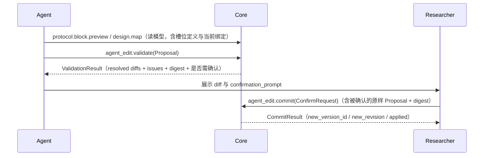

# Agent Edit v1（AG-01）

- 日期：2026-11-13
- 状态：**已实现（validate / commit）**。类型在 `crates/asterlab-core` 编译并有 wire 测试；`agent_edit.validate` 由 AG-02 实现（PR #10，merge `8363d1c`），`agent_edit.commit` 由 AG-03 实现（PR #17，merge `2423959`）。仍未落地的部分见 §11。
- 代码：[`crates/asterlab-core/src/agent_edit.rs`](../../crates/asterlab-core/src/agent_edit.rs)、[`agent_edit_validate.rs`](../../crates/asterlab-core/src/agent_edit_validate.rs)、[`agent_edit_commit.rs`](../../crates/asterlab-core/src/agent_edit_commit.rs)
- 权威关系：领域术语与对象边界见 [`CONTEXT.md`](../../CONTEXT.md)；已实现 CLI/HTTP 字段与通用错误信封见 [`AGENT_API.md`](../../AGENT_API.md)；Core 查询/命令边界见 [`core-v1.md`](core-v1.md)；语义变更集见 [`semantic-component-contract.md`](semantic-component-contract.md) §4。
- 索引登记：`docs/README.md` 与 `docs/contracts/core-v1.md` 不在 AG-01 的 write 范围，本文件暂由任务卡与 PR 引用；索引补齐留给文档卡。

## 0. 目标与边界

Agent 修改实验内容必须可审阅、可回滚、不能绕过版本检查。本契约把这件事固定成四段：

```text
propose（Agent 组稿） → validate（Core 只读校验） → confirm（人工确认） → commit（单事务写入一个新版本）
```

明确不做：

- 不新增第二套 Design/Protocol/Run 写入路径；`commit` 只产生**一个新版本**，旧版本与已冻结 Run 不变。
- 不允许整份对象替换；只允许字段级 diff。
- 不实现 `object-list` 行编辑、不编辑 `renderers.static`、不编辑 Run 事实。
- 不做跨对象原子提交（一份 proposal 只对一个 target 产生一个版本）。
- 不做电子签名。`confirmed_by` 只是记录标签（Beta 范围见 [`beta-scope.md`](../release/beta-scope.md) §3.3）。
- AG-01 只定义契约与类型；`validate` / `commit` 行为分别在 AG-02（PR #10）与 AG-03（PR #17）落地，实现文件见页首。

## 1. 四段流程



| 阶段 | 谁执行 | 是否写库 | 输入 | 输出 |
|---|---|---|---|---|
| propose | Agent | 否 | 读模型 + 槽位定义 | `Proposal` |
| validate | Core | 否（只读） | `Proposal` | `ValidationResult` |
| confirm | 研究者 | 否 | `ValidationResult` | `ConfirmRequest` |
| commit | Core | 是（单事务，一个新版本） | `ConfirmRequest` | `CommitResult` 或 `AgentEditError` |

规则：

1. **propose 没有 Core 命令。** Agent 用现有读模型组稿；摘要与槽位定义只能来自 `protocol.block.preview`、`protocol.block.get`、`design.map`，不得自行推测槽位、单位或默认值。
2. **validate 是只读的**，不占锁、不预留版本，所以其结果在 commit 前可能过期；commit 必须在事务内重新核对版本（§6.2）。
3. **confirm 是人工动作**，其产物 `ConfirmRequest` 原样携带被确认的 `Proposal`，因此 commit 不依赖服务端会话，可重放、可审计。
4. **语义拒绝不是传输错误。** validate 遇到非法绑定、单位错误、失效引用、版本冲突、越权字段时返回 `ok=true` + `status:"blocked"` + `issues[]`；只有 JSON 解析失败、参数用法错误和 I/O 失败使用错误信封。
5. Agent 不能声明自己的 `invalidated_refs`、`requires_confirmation`、`proposal_digest` 或 `confirmed` 标志；这些字段只由 Core 产出，或不存在于输入类型中。

## 2. 类型

```rust
pub const AGENT_EDIT_SCHEMA_VERSION: u32 = 1;

pub enum AgentEditErrorCode {
    InvalidProposal, InvalidBinding, UnitMismatch, StaleReference, ForbiddenField,
    VersionConflict, ConfirmationRequired, ConfirmationMismatch, IdempotencyMismatch,
}
pub enum IssueSeverity { Blocking, NeedsConfirmation, Advisory }
pub enum ValidationStatus { Valid, NeedsConfirmation, Blocked }
pub enum EditOrigin { User, Agent, Tool }

pub struct ProposalOrigin {
    pub source: EditOrigin,
    pub rationale: Option<String>,      // 给确认人看的原因，不是证据
}

pub struct FieldDiff {
    pub path: String,
    pub operation: FieldOperation,      // 复用 semantic_changeset::FieldOperation（set | unset）
    pub before: Option<Value>,          // Agent 声称读到的值：声明，不是权威
    pub after: Option<Value>,
}

pub struct Proposal {
    pub schema_version: u32,            // 缺省 1
    pub proposal_id: String,
    pub target: ChangeTarget,           // 复用 semantic_changeset::ChangeTarget
    pub base_version_id: String,        // diff 计算依据的确切不可变版本记录
    pub expected_version: i64,          // target 记录的 revision
    pub origin: ProposalOrigin,
    pub diffs: Vec<FieldDiff>,
}

pub struct ResolvedFieldDiff {
    pub path: String,
    pub operation: FieldOperation,
    pub current: Option<Value>,         // 权威当前值（不是 Agent 的 before）
    pub requested: Option<Value>,       // 将被写入的值
    pub changed: bool,
}

pub struct AgentEditIssue {
    pub code: AgentEditErrorCode,
    pub severity: IssueSeverity,
    pub path: String,
    pub message: String,
    pub affects: Vec<String>,
    pub next_action: String,
}

pub struct ValidationResult {
    pub schema_version: u32,
    pub proposal_id: String,
    pub proposal_digest: String,        // Core 计算的 sha256:<64 hex>
    pub target: ChangeTarget,
    pub current_version_id: String,     // 本次校验使用的权威 head
    pub current_revision: i64,
    pub status: ValidationStatus,
    pub diffs: Vec<ResolvedFieldDiff>,
    pub issues: Vec<AgentEditIssue>,
    pub invalidated_refs: Vec<String>,  // Core 所有，Agent 不可声明
    pub requires_confirmation: bool,    // Core 策略，Agent 不可关闭
    pub confirmation_prompt: Option<String>,
}

pub struct ConfirmRequest {
    pub schema_version: u32,
    pub proposal: Proposal,             // 被确认的原样 proposal
    pub proposal_digest: String,        // 必须等于 validate 返回的 digest
    pub idempotency_key: String,
    pub confirmed_by: String,           // 记录标签，非签名
    pub acknowledged: Vec<String>,      // 被接受 needs_confirmation 问题的 path 集合
    pub note: Option<String>,
}

pub struct CommitResult {
    pub schema_version: u32,
    pub proposal_id: String,
    pub proposal_digest: String,
    pub target: ChangeTarget,
    pub previous_version_id: String,
    pub new_version_id: String,
    pub new_revision: i64,
    pub applied: Vec<ResolvedFieldDiff>, // requested 为写后值（confirmed 由 Core 置位）
    pub invalidated_refs: Vec<String>,
    pub confirmed_by: String,
    pub committed_at: String,            // RFC 3339，Core 时钟
    pub idempotency_key: String,
    pub replayed: bool,                  // 幂等重放：没有生成第二个版本
}

pub struct AgentEditError {
    pub code: AgentEditErrorCode,
    pub message: String,
    pub path: Option<String>,
    pub current_version: Option<i64>,
    pub current_version_id: Option<String>,
    pub issues: Vec<AgentEditIssue>,
}
```

`target` / `operation` 复用 `semantic_changeset`，不另建第二套目标寻址：`ChangeTarget { kind, object_id, location? }`，`ChangeLocation { protocol_version_id, scope, step_path }`，`scope` 为 `{"kind":"assay","assay_id":…}` / `{"kind":"planned_output",…}` / `{"kind":"unscoped"}`。

封闭 schema：上述所有结构 `deny_unknown_fields`。新增输入字段必须保留旧 payload 可读；新增输出字段需要 `schema_version` 提升。

`ValidationStatus` 是 `issues` 与 `requires_confirmation` 的投影：

| 条件 | status |
|---|---|
| 存在 `severity = blocking` 的 issue | `blocked` |
| 无 blocking issue，且 `requires_confirmation = true` | `needs_confirmation` |
| 无 blocking issue，且 `requires_confirmation = false` | `valid` |

v1 的 validate 只产生 `blocking` issue；`needs_confirmation` / `advisory` 是 `CONTEXT.md` 三级检查项的完整词汇。AG-02（PR #10）与 AG-03（PR #17）合入后仍没有代码产生这两级 issue（`agent_edit_validate.rs` 的 `issue()` 固定 `IssueSeverity::Blocking`），留给后续上下文校验卡。

## 3. 字段级 diff

字段级 diff 是唯一允许的修改表达。禁止整份替换对象，禁止不经过 diff 的 `data_json` 写入。

| 规则 | 说明 |
|---|---|
| `operation = set` | `after` 必需，`before` 可选 |
| `operation = unset` | `after` 必须缺省或 `null`；`before` 可选，但若给出必须与权威当前值一致 |
| 重复 path | 同一 proposal 内同一 path 出现两次 → `INVALID_PROPOSAL` |
| 父子冲突 | `params` 与 `params.x` 同时出现 → `INVALID_PROPOSAL` |
| 路径语法 | 点分、无空段、无前导/尾随点、无通配、无数组下标（v1 不支持 object-list） |
| 有效变更 | 全部 diff 解析后 `changed` 均为 false → `INVALID_PROPOSAL`（`path: "diffs"`）；不生成空版本 |
| 未解析路径 | `current = null`、`changed = false`，并附 blocking issue；不得把未解析当成“值相同” |

`before` 只用于**并发诊断**：它不是权威值。validate 的 `current` 由 Core 在本次读取时解析。若 `before` 与 `current` 同时存在且不相等，说明 Agent 的读取已过期，validate 追加 `STALE_REFERENCE`（`path` 指向该 diff，`next_action` 要求重新读取后重新组稿）。Agent 可以省略 `before` 来跳过这项诊断。

`current` 与 `requested` 的值形状由 path 决定（§4），Core 在写入前后都用同一形状序列化，`applied[]` 与 validate 的 `diffs[]` 因而可直接对照。

## 4. 目标与路径授权

`target.kind` 的 v1 授权：

| `target.kind` | 需要 `location` | v1 可编辑 path 根 | 说明 |
|---|---|---|---|
| `protocol` | 是 | `params.<slot_key>` | 修改一次 `BlockUse` 的本次参数绑定；不复制步骤块 |
| `block_version` | 否 | `params.<slot_key>` | 修改步骤块自身的参数槽默认绑定 |
| `design` | — | — | 拒绝：`FORBIDDEN_FIELD`，`path: "target.kind"`，改用 `design.revise` |
| `run` | — | — | 拒绝：`FORBIDDEN_FIELD`，`path: "target.kind"`；事实只经 Run 命令写入 |

其余 path 根一律 `FORBIDDEN_FIELD`，包括 `title`、`steps.*`、`blocks.*`、`module_contract`、`catalog`、`frozen`、`identity`、`design_version_id`、`protocol_version_id`、`created_at`、`updated_at`、`events.*`、`occurrences.*`。`format(module)` 契约与冻结快照只能通过新版本命令修改，不能借 Agent 编辑路径绕过。

`params.<slot_key>` 的值形状是既有 `ParameterBinding`（`operation_module.rs`），不新增第二套值/单位编码：

```json
{
  "parameter_key": "volume_per_sample",
  "value": 250.0,
  "unit": "uL",
  "source": "protocol_fixed",
  "source_reference": "rna-kit-ifu@2026-03#step-2",
  "confirmed": false
}
```

槽位定义来自 `protocol.block.preview` / `protocol.block.get` 展开的 `OperationStep.parameters`（`OperationParameter`：`key` / `value_type` / `unit` / `required`）。

逐项校验：

| 检查 | 失败码 |
|---|---|
| `*.parameter_key` 与 path 的 `<slot_key>` 不一致 | `INVALID_BINDING`（`path: "params.<key>.parameter_key"`） |
| `<slot_key>` 在展开步骤中不存在 | `INVALID_BINDING` |
| `value` 类型与 `value_type` 不符（如整数槽位给小数） | `INVALID_BINDING` |
| `source = unknown` 却带非空 `value` | `INVALID_BINDING` |
| Agent 在 `after` 中写 `confirmed: true` | `FORBIDDEN_FIELD`（`path: "params.<key>.confirmed"`） |
| 槽位声明单位而值缺 `unit`，或值带单位而槽位无单位 | `UNIT_MISMATCH` |
| `unit` 与槽位单位不精确相等 | `UNIT_MISMATCH` |
| `location` 的 scope / `step_path` / `protocol_version_id` 解析不到 | `STALE_REFERENCE` |

单位规则：

- 精确匹配，**不做隐式换算**；`mL` 不能写入 `uL` 槽位。
- 唯一允许的别名是体积微升写法 `µL` / `μL` / `ul` → `uL`，与 `AGENT_API.md` 的 `view.data_preview` 一致；别名在比较前归一化，写入时存 `uL`。
- 单位错误不会自动改槽位单位。要改槽位定义单位，必须另提 `block_version` 提案并生成新版本。

`invalidated_refs` 格式（Core 产出，供调用方决定重读范围）：

- `protocol` target：`core:binding:<scope-key>:<step_path>/<slot_key>`，`<scope-key>` 为 `assay:<id>` / `planned_output:<id>` / `unscoped`。
- `block_version` target：`core:slot:<block_version_id>/<slot_key>`。

## 5. 错误码

错误码是封闭词汇，wire 字符串稳定（`SCREAMING_SNAKE_CASE`），后续卡片直接引用，不得改名或复用。

| 码 | 卡片要求对应 | 阶段 | 默认严重级 | CLI 退出码 | 触发条件 | 恢复动作 |
|---|---|---|---|---|---|---|
| `INVALID_PROPOSAL` | 结构非法 | validate | blocking | 2 | 空 diff、重复/父子冲突 path、`set` 缺 `after`、`unset` 带 `after`、解析后无有效变更、`unset` 目标本来未绑定 | 修正 diff 后重新 validate |
| `INVALID_BINDING` | 非法绑定 | validate | blocking | 2 | 槽位不存在、`parameter_key` 不匹配、值类型不符、`source=unknown` 带值、绑定 owner 不是 plan/run 实例 | 按展开槽位重写绑定 |
| `UNIT_MISMATCH` | 单位错误 | validate | blocking | 2 | 单位缺失/多余/不精确相等 | 用槽位单位重新提交；改单位定义开新版本 |
| `STALE_REFERENCE` | 失效引用 | validate / commit | blocking | 3 | Protocol 版本、scope、`step_path`、槽位解析失败；`before` 与权威值不一致 | 重新读取读模型后重新组稿 |
| `FORBIDDEN_FIELD` | 越权字段 | validate / commit | blocking | 2 | path 越出 v1 授权、`target.kind` 不受支持、Agent 写 `confirmed` | 改用对应正式命令（`design.revise`、Run 命令、新版本命令） |
| `VERSION_CONFLICT` | 版本冲突 | validate / commit | blocking | 4 | `expected_version` 或 `base_version_id` 与 head 不一致 | 重读、重新组稿、重新确认；不合并、不覆盖 |
| `CONFIRMATION_REQUIRED` | 确认缺失 | commit | — | 2 | 需确认但 `acknowledged` 缺项，或策略要求确认而确认字段不完整 | 补齐确认；重新给研究者看 diff |
| `CONFIRMATION_MISMATCH` | 确认失效 | commit | — | 2 | digest 与 `ConfirmRequest.proposal` 不符、确认针对别的基版本、`acknowledged` 含未报告的 path | 重新 validate 并重新确认 |
| `IDEMPOTENCY_MISMATCH` | 幂等冲突 | commit | — | 2 | 同一 `idempotency_key` 已用于不同 digest | 换新 key 或复用原确认 |

规则：

- `issues[]` 只承载 validate 阶段的五个内容码（前五行）；`CONFIRMATION_*` / `IDEMPOTENCY_MISMATCH` 只出现在 `agent_edit.commit` 的错误信封里。
- 退出码沿用 `AGENT_API.md` 固定集合：`0` 成功、`2` 输入/用法、`3` 目标不存在、`4` 版本冲突、`5` 内部错误。
- 错误信封沿用 `AGENT_API.md` 的 `{"ok":false,"tool":"…","error":{"code","message"}}`；`path` / `current_version` / `current_version_id` / `issues` 是本契约新增的**可选**字段，仍需由 AG-04 在 `AGENT_API.md` 登记。截至 DOC-05 核对，`AGENT_API.md` 尚无 `agent_edit` 条目（`grep -n 'agent_edit' AGENT_API.md` 无输出），因此该登记仍是缺口。旧的 `code`/`message` 不得删除。
- 不得用 `message` 文案判断结果；以 `code` 为准。

## 6. 版本、并发、幂等、回滚

### 6.1 版本身份

| 字段 | 含义 | 冲突判定 |
|---|---|---|
| `expected_version` | target 记录（`records.revision`）的 revision | 与 commit 时 head 的 revision 不相等 → `VERSION_CONFLICT` |
| `base_version_id` | diff 所依据的确切不可变版本记录（如 `protocol_version_id`、`block_version_id`） | 不是当前 head 指向的版本 → `VERSION_CONFLICT` |
| `proposal_digest` | Core 对 proposal 规范化 JSON 计算的 `sha256:<64 hex>` | commit 重算不一致 → `CONFIRMATION_MISMATCH` |

两个版本字段都要检查：revision 捕获“记录被改过”，version id 捕获“版本指针换了”。缺一不可。

digest 规范化：对象 key 字典序、数组保持顺序、无多余空白、UTF-8 字节；只由 Core 计算，Agent 传入的 digest 只用于比对。

### 6.2 并发

- validate 只读、无锁、不预留版本；其结果随时可能过期。
- commit 在**单个事务**内重新读取 head、重新解析全部引用与单位、重新核对 `acknowledged`；任何一项不通过即整体失败，不写任何记录。
- 确认后 head 前移 → `VERSION_CONFLICT`。**不静默重校验、不自动 rebase、不把确认套用到新版本。**
- 单机单用户仍按并发处理：CLI、GUI、HTTP 可能同时写同一记录。

### 6.3 幂等

- `idempotency_key` 作用域是一次 commit；成功提交后把 `proposal_id`、`proposal_digest`、`confirmed_by`、`committed_at` 写入新版本的 provenance。
- 相同 key + 相同 digest 重放：返回**原** `CommitResult`，`replayed: true`，不生成第二个版本。
- 相同 key + 不同 digest → `IDEMPOTENCY_MISMATCH`。
- 相同 digest + 不同 key：视为新的提交尝试，仍按版本检查处理（head 已变则 `VERSION_CONFLICT`）。

### 6.4 回滚

- commit 是全有或全无：任一 diff 失败、任一引用失效、确认不完整 → 事务回滚，旧版本、旧 revision、Run 冻结内容均不变。
- 不存在“部分字段已写入”的中间态；也不存在需要撤销的预写记录。
- 客户端 proposal 不被销毁，Agent 可修正后重新 propose。

## 7. 确认规则

- v1 策略：**每次 commit 都需要人工确认**（`requires_confirmation = true`）。参数绑定会进入 Protocol 冻结与 Run，属于高影响写入。策略由 Core 决定并写入 `ValidationResult`，Agent 无法关闭，`Proposal` 也没有该字段。
- 研究者看到的是 `diffs[]`（权威当前值 vs 请求值）、`invalidated_refs` 与 `confirmation_prompt`；`proposal_digest` 绑定“确认的就是这份 diff”。
- `confirm` 的产物是 `ConfirmRequest`：原样 proposal + digest + `confirmed_by` + `idempotency_key` + `acknowledged` + 可选 `note`。
- `acknowledged` 必须**恰好等于** validate 返回的 `needs_confirmation` issue path 集合。缺项 → `CONFIRMATION_REQUIRED`；多出未报告的 path → `CONFIRMATION_MISMATCH`。v1 validate 不产生此类 issue，因此 v1 中它应为空数组。
- `confirmed` 标志只由 Core 置位：commit 只对本次写入的槽位置 `true`，未触碰的绑定保持原值。Agent 提交 `confirmed: true` 属于越权字段（`FORBIDDEN_FIELD`）。
- `confirmed_by` 是记录标签，不是认证，也不是电子签名；不得据此宣称审计级签名链。

## 8. RNA 参数绑定 dry-run

场景：`rna_reagent_usage@1` 的参数绑定在 RNA 提取流程的裂解步骤上。改三处、移除一处，全部落在 `params.*`。示例中的 `proposal_digest` 是占位值，不是真实计算结果。

### 8.1 propose

```json
{
  "schema_version": 1,
  "proposal_id": "ae-rna-lyse-001",
  "target": {
    "kind": "protocol",
    "object_id": "protocol-rna-lyse",
    "location": {
      "protocol_version_id": "protocol-rna-lyse-v3",
      "scope": { "kind": "assay", "assay_id": "assay-rna-extraction" },
      "step_path": "root/lyse/lyse"
    }
  },
  "base_version_id": "protocol-rna-lyse-v3",
  "expected_version": 3,
  "origin": {
    "source": "agent",
    "rationale": "按 rna-kit-ifu@2026-03 第 2 步覆盖每样本体积，并补上样本数与目标浓度绑定。"
  },
  "diffs": [
    {
      "path": "params.volume_per_sample",
      "operation": "set",
      "before": {
        "parameter_key": "volume_per_sample",
        "value": 200.0,
        "unit": "uL",
        "source": "protocol_fixed",
        "source_reference": "rna-kit-ifu@2026-03#step-2",
        "confirmed": true
      },
      "after": {
        "parameter_key": "volume_per_sample",
        "value": 250.0,
        "unit": "uL",
        "source": "protocol_fixed",
        "source_reference": "rna-kit-ifu@2026-03#step-2",
        "confirmed": false
      }
    },
    {
      "path": "params.sample_count",
      "operation": "set",
      "after": {
        "parameter_key": "sample_count",
        "value": 8,
        "source": "design_variable",
        "source_reference": "design-42:groups[g1].independent_n",
        "confirmed": false
      }
    },
    {
      "path": "params.target_concentration",
      "operation": "set",
      "before": {
        "parameter_key": "target_concentration",
        "value": 50.0,
        "unit": "ng/uL",
        "source": "protocol_fixed",
        "source_reference": "rna-kit-ifu@2026-03#step-2",
        "confirmed": true
      },
      "after": {
        "parameter_key": "target_concentration",
        "value": 20.0,
        "unit": "ng/uL",
        "source": "protocol_fixed",
        "source_reference": "rna-kit-ifu@2026-03#step-2",
        "confirmed": false
      }
    },
    {
      "path": "params.extra_ratio",
      "operation": "unset",
      "before": {
        "parameter_key": "extra_ratio",
        "value": 0.1,
        "source": "example_only",
        "confirmed": false
      }
    }
  ]
}
```

`sample_count` 省略 `before`：未绑定的槽位没有历史值，不伪造。`extra_ratio` 是可选槽位，`unset` 表示移除既有覆盖值，未给 `after`。

### 8.2 validate（`agent_edit.validate`，只读）

```json
{
  "schema_version": 1,
  "proposal_id": "ae-rna-lyse-001",
  "proposal_digest": "sha256:aaaaaaaaaaaaaaaaaaaaaaaaaaaaaaaaaaaaaaaaaaaaaaaaaaaaaaaaaaaaaaaa",
  "target": {
    "kind": "protocol",
    "object_id": "protocol-rna-lyse",
    "location": {
      "protocol_version_id": "protocol-rna-lyse-v3",
      "scope": { "kind": "assay", "assay_id": "assay-rna-extraction" },
      "step_path": "root/lyse/lyse"
    }
  },
  "current_version_id": "protocol-rna-lyse-v3",
  "current_revision": 3,
  "status": "needs_confirmation",
  "diffs": [
    {
      "path": "params.volume_per_sample",
      "operation": "set",
      "current": {
        "parameter_key": "volume_per_sample",
        "value": 200.0,
        "unit": "uL",
        "source": "protocol_fixed",
        "source_reference": "rna-kit-ifu@2026-03#step-2",
        "confirmed": true
      },
      "requested": {
        "parameter_key": "volume_per_sample",
        "value": 250.0,
        "unit": "uL",
        "source": "protocol_fixed",
        "source_reference": "rna-kit-ifu@2026-03#step-2",
        "confirmed": false
      },
      "changed": true
    },
    {
      "path": "params.sample_count",
      "operation": "set",
      "requested": {
        "parameter_key": "sample_count",
        "value": 8,
        "source": "design_variable",
        "source_reference": "design-42:groups[g1].independent_n",
        "confirmed": false
      },
      "changed": true
    },
    {
      "path": "params.target_concentration",
      "operation": "set",
      "current": {
        "parameter_key": "target_concentration",
        "value": 50.0,
        "unit": "ng/uL",
        "source": "protocol_fixed",
        "source_reference": "rna-kit-ifu@2026-03#step-2",
        "confirmed": true
      },
      "requested": {
        "parameter_key": "target_concentration",
        "value": 20.0,
        "unit": "ng/uL",
        "source": "protocol_fixed",
        "source_reference": "rna-kit-ifu@2026-03#step-2",
        "confirmed": false
      },
      "changed": true
    },
    {
      "path": "params.extra_ratio",
      "operation": "unset",
      "current": {
        "parameter_key": "extra_ratio",
        "value": 0.1,
        "source": "example_only",
        "confirmed": false
      },
      "changed": true
    }
  ],
  "issues": [],
  "invalidated_refs": [
    "core:binding:assay:assay-rna-extraction:root/lyse/lyse/volume_per_sample",
    "core:binding:assay:assay-rna-extraction:root/lyse/lyse/sample_count",
    "core:binding:assay:assay-rna-extraction:root/lyse/lyse/target_concentration",
    "core:binding:assay:assay-rna-extraction:root/lyse/lyse/extra_ratio"
  ],
  "requires_confirmation": true,
  "confirmation_prompt": "将 root/lyse/lyse 的每样本体积从 200 uL 改为 250 uL、目标浓度从 50 ng/uL 改为 20 ng/uL、样本数绑定为 8，并移除额外比例。确认后生成 protocol-rna-lyse-v4。"
}
```

### 8.3 confirm

研究者确认后，`confirm` 不产生服务端记录；它把下面这份 `ConfirmRequest` 交给 commit。它是 commit 的唯一输入。wire 形状由 `agent_edit.rs` 的 `confirm_request_embeds_the_validated_proposal` 测试证明。

```text
ConfirmRequest {
  schema_version:    1,
  proposal:          §8.1 的原样 Proposal（不被改写、不被重新序列化）
  proposal_digest:   "sha256:aaaa…"  （与 8.2 的 digest 逐字一致）
  idempotency_key:   "ae-rna-lyse-001-confirm-1"
  confirmed_by:      "researcher:zhang"
  acknowledged:      []              （v1 validate 不产生 needs_confirmation 问题）
  note:              "按试剂盒说明书更新体积与浓度。"   // 可选
}
```

### 8.4 commit（`agent_edit.commit`）

```json
{
  "schema_version": 1,
  "proposal_id": "ae-rna-lyse-001",
  "proposal_digest": "sha256:aaaaaaaaaaaaaaaaaaaaaaaaaaaaaaaaaaaaaaaaaaaaaaaaaaaaaaaaaaaaaaaa",
  "target": {
    "kind": "protocol",
    "object_id": "protocol-rna-lyse",
    "location": {
      "protocol_version_id": "protocol-rna-lyse-v3",
      "scope": { "kind": "assay", "assay_id": "assay-rna-extraction" },
      "step_path": "root/lyse/lyse"
    }
  },
  "previous_version_id": "protocol-rna-lyse-v3",
  "new_version_id": "protocol-rna-lyse-v4",
  "new_revision": 4,
  "applied": [
    {
      "path": "params.volume_per_sample",
      "operation": "set",
      "current": {
        "parameter_key": "volume_per_sample",
        "value": 200.0,
        "unit": "uL",
        "source": "protocol_fixed",
        "source_reference": "rna-kit-ifu@2026-03#step-2",
        "confirmed": true
      },
      "requested": {
        "parameter_key": "volume_per_sample",
        "value": 250.0,
        "unit": "uL",
        "source": "protocol_fixed",
        "source_reference": "rna-kit-ifu@2026-03#step-2",
        "confirmed": true
      },
      "changed": true
    }
  ],
  "invalidated_refs": [
    "core:binding:assay:assay-rna-extraction:root/lyse/lyse/volume_per_sample"
  ],
  "confirmed_by": "researcher:zhang",
  "committed_at": "2026-11-13T09:24:11Z",
  "idempotency_key": "ae-rna-lyse-001-confirm-1",
  "replayed": false
}
```

`applied[0].requested.confirmed` 为 `true`：写后值由 Core 按人工确认置位，proposal 里的 `false` 只表示“Agent 不声称已确认”。

### 8.5 拒绝示例

五类内容错误各一份，均为**合法 wire 形状**，只是 validate 会返回 `status:"blocked"`。

| 场景 | proposal 关键片段 | 期望结果 |
|---|---|---|
| 单位错误 | `"path":"params.volume_per_sample"`，`"value":0.25,"unit":"mL"` | `UNIT_MISMATCH`，`path: "params.volume_per_sample.unit"`，`next_action`: 用 `uL` 提交 250.0，或另提槽位定义新版本 |
| 越权字段 | `"kind":"block_version"`，`"path":"module_contract.title"` | `FORBIDDEN_FIELD`，`affects`: 模块契约，`next_action`: 通过 `protocol.block.revise` 生成新版本 |
| 非法绑定 | `"path":"params.volume_per_well"`（该步骤无此槽位） | `INVALID_BINDING`，`next_action`: 按 `protocol.block.preview` 的 `OperationStep.parameters` 选槽位 |
| 失效引用 | `"step_path":"root/lyse/incubate"`（展开后不存在） | `STALE_REFERENCE`，`next_action`: 重新读取 Protocol 展开结果 |
| 版本冲突 | `"base_version_id":"protocol-rna-lyse-v2"`，`"expected_version":2`，head 已到 v3 | `VERSION_CONFLICT`，`path: "base_version_id"`，`affects`: 全部 diff |

`STALE_REFERENCE` 类与 `VERSION_CONFLICT` 类示例在 validate 时不写库；`diffs[].current` 仍按当前 head 解析，供 Agent 重新起稿，但 `status` 为 `blocked`，不得据此 commit。

## 9. 与其他契约的关系

| 契约 | 关系 |
|---|---|
| [`core-v1.md`](core-v1.md) §4 | 本契约是命令边界里 `propose_patch` / `apply_patch` 的具体化；不新增写入语义，只固定四段与字段级 diff |
| [`semantic-component-contract.md`](semantic-component-contract.md) §4 | 复用其 `ChangeTarget` / `FieldOperation`；`propose_patch` → `Proposal`，`apply_patch` → `commit` |
| [`core-v1.md`](core-v1.md) §5 | 版本与兼容规则不变：写入生成新版本，旧版本与 Run 冻结不变，不迁移已冻结内容 |
| [`AGENT_API.md`](../../AGENT_API.md) | 通用信封、退出码与错误码登记位置；本卡不改该文件 |
| [`beta-scope.md`](../release/beta-scope.md) | L-02 版本与冻结、L-03 写入边界、DS-06 “Tools 送出的是未确认草稿”要求确认后才写 |

## 10. 契约测试

`crates/asterlab-core/src/agent_edit.rs` 的 `#[cfg(test)] mod tests` 只做 wire 形状验证。本文件的 ```json 代码块**直接**由 `include_str!` 读入测试，示例与契约不会各写一份。行为测试在 `crates/asterlab-core/src/agent_edit_validate.rs`、`agent_edit_commit.rs` 与 `src/cli.rs`（如 `agent_edit_commit_appends_a_version_and_keeps_the_frozen_run`）；`validate` / `commit` 的实现与测试随 AG-02（PR #10）、AG-03（PR #17）合入。

| 测试 | 证明 |
|---|---|
| `rna_dry_run_proposal_deserializes` | §8.1 可反序列化为 `Proposal`；Agent 各 diff 的 `confirmed` 为 `false` |
| `validation_result_round_trips` | §8.2 可反序列化并原样序列化；`status`、`requires_confirmation`、`current`/`requested` 形状一致 |
| `parameter_binding_shape_matches_existing_type` | §4 的值形状就是既有 `ParameterBinding`，没有第二套值/单位编码 |
| `confirm_request_embeds_the_validated_proposal` | `ConfirmRequest` 可解析；`acknowledged` 缺省为空 |
| `commit_result_carries_server_confirmed_values` | §8.4 可解析；`applied[].requested.confirmed` 为 `true` |
| `error_codes_are_stable_wire_strings` | §5 的 9 个 wire 字符串逐字固定 |
| `rejected_examples_are_wire_valid_proposals` | §8.5 五份 payload 均为合法 `Proposal` 形状（拒绝发生在 validate，不是 serde） |
| `unknown_fields_are_rejected` | 封闭 schema：`Proposal` 不接受额外字段（如自带的 `requires_confirmation`） |

## 11. 未决项（不阻塞已实现的 validate / commit）

1. 上下文校验（来源等级、`required_at` 生命周期、跨 Assay 冲突）**仍未实现**。AG-02（PR #10）实现的是 §4 表格校验；上述三项不在其合入代码中。
2. `needs_confirmation` / `advisory` 的产出规则**仍未实现**：AG-02/AG-03 之后 validate 仍只产生 `blocking` issue，`requires_confirmation` 固定为 `true`（`agent_edit_validate.rs` 的 `finish`）。
3. **已实现（AG-03，PR #17）**：新版本把 `proposal_id` / `proposal_digest` / `confirmed_by` / `idempotency_key` / `committed_at` / `new_revision` 写入 `records.data_json.agent_edit`；`crates/asterlab-core/src/agent_edit_commit.rs` 的 `next["agent_edit"]` 断言与 `src/cli.rs` 的 `agent_edit_commit_appends_a_version_and_keeps_the_frozen_run` 覆盖该形状。
4. `design` / `run` 目标的字段级编辑不在 v1；需要时另开契约版本（`schema_version` 提升）。
5. 索引登记**仍未实现**：`docs/README.md`、`docs/contracts/core-v1.md` §4 均无 `agent_edit` 指向（`grep -rn 'agent_edit' docs/README.md docs/contracts/core-v1.md` 无输出），留给后续文档卡。
