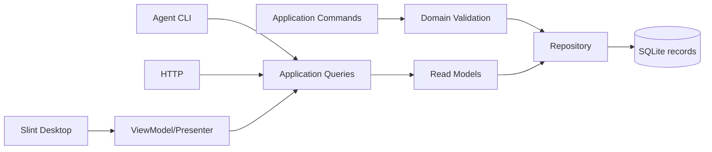

# Core Contract v1（P0 冻结）

- 日期：2026-11-05
- 状态：P0 契约冻结稿；不是已实现代码。
- 基线：`44318b4` + 本文件的语义修订。
- 权威关系：术语见 [`CONTEXT.md`](../../CONTEXT.md)，模块见 [`docs/architecture.md`](../architecture.md)，实施顺序见 [`docs/implementation-plan.md`](../implementation-plan.md)。

## 0. 目标

先冻结 **Core 查询/命令/身份/兼容** 契约，再抽共享 Core，最后拆 Slint。任何 `ManifestItem {title, detail}` 形式的提前压扁都不作为 Run 读模型。



## 1. 模块依赖

目标依赖方向：

```text
UI / CLI / HTTP
       │
       ▼
Application Services (Queries, Commands, Transactions)
       │
       ▼
Domain Core (Design, Protocol, Run, Sample, Validation, Projections)
       │
       ▼
Repository interface
       │
       ▼
SQLite Adapter
```

规则：

- UI 不依赖 SQLite；不直接写 JSON。
- CLI/HTTP 只调用 Application Services，不复制校验。
- Domain 不依赖 Slint/HTTP/具体 SQLite 类型。
- Read Model 可依赖 Domain，但不反向被 Domain 依赖。
- `ToolAction` 是 Application/Core 能力，不是 Domain 设计对象。
- `InstrumentProfile` 是能力声明，不是执行状态。

## 2. 查询契约

### 2.1 `DesignMap`

用于设计工作区与 Agent 验证。读取当前 `Design` revision，不读 Run 实际值。

```rust
pub struct DesignMap {
    pub design_id: String,
    pub revision: i64,
    pub title: String,
    pub objective: String,
    pub experimental_unit: Option<String>,
    pub groups: Vec<DesignGroup>,
    pub assays: Vec<DesignAssay>,
    pub sample_links: Vec<SampleLink>,
    pub planned_outputs: Vec<PlannedOutputSummary>,
    pub conflicts: Vec<ConflictSummary>,
    pub unresolved: Vec<ValidationIssueSummary>,
}

pub struct DesignGroup {
    pub id: String,
    pub name: String,
    pub role: Option<String>,
    pub condition: Option<String>,
    pub independent_n: Option<u32>,
    pub technical_repeats: Option<u32>,
}

pub struct DesignAssay {
    pub id: String,
    pub title: String,
    pub endpoint: Option<String>,
    pub method: Option<String>,
    pub unit: Option<String>,
    pub group_ids: Vec<String>,
    pub group_names: Vec<String>,
    pub timepoints: Vec<String>,
    pub timepoint_timing: Vec<TimepointTimingSummary>,
    pub time_anchor_event: Option<String>,
    pub timepoint_relation: Option<String>,
    pub protocol_version_id: Option<String>,
    pub controls: Vec<String>,
    pub container_type: Option<String>,
    pub container_format: Option<String>,
}

pub struct SampleLink {
    pub assay_id: String,
    pub group_id: Option<String>,
    pub group_name: String,
    pub timepoint_relation: Option<String>,
    pub source_relation: Option<String>,
    pub source_assay_id: Option<String>,
    pub physical_slots_per_group: Option<u32>,
    pub physical_slots_scope: Option<String>,
    pub planned_output_id: Option<String>,
    pub evidence_id: Option<String>,
}

pub struct ValidationIssueSummary {
    pub key: String,
    pub question: String,
    pub affects: Vec<String>,
    pub source: String, // missing | evidence_conflict
}
```

Rules：

- `design_id`/`revision` 决定内容；不返回当前 Run 的实际值。
- `unresolved` 只由显式缺失/未解决冲突产生；不补 n、对照、剂量、时间点、孔位。
- `assays[].protocol_version_id` 指向 ProtocolVersion；不是根块或字符串名称。
- `groups[].independent_n` 未知时为 `null`，不是 0/1。
- `sample_links` 是计划分配，不是实体样本。

### 2.2 `ProtocolPreview`

用于 Protocol 版本/步骤块预览；不表示执行过。

```rust
pub struct ProtocolPreview {
    pub protocol_version_id: Option<String>,
    pub root_block_version_id: Option<String>,
    pub ordered_steps: Vec<OperationStep>,
    pub resolved_parameters: Vec<ResolvedParameter>,
    pub unresolved_parameters: Vec<UnresolvedParameter>,
    pub block_version_ids: Vec<String>,
    pub ready: bool,
}
```

`OperationStep`：

```rust
pub struct OperationStep {
    pub step_path: String,          // stable within the expanded tree
    pub order: u32,
    pub scope: StepScope,          // assay/planned_output; preview may be unscoped
    pub title: String,
    pub instruction: String,
    pub parameters: Vec<ResolvedParameter>,
    pub unresolved_parameter_refs: Vec<String>,
    pub source_block_version_id: String,
    pub visualization: Option<String>,
    pub meta: Option<StepMetaView>, // optional; never invented
}
```

- `step_path` 必须来自展开路径，不由标题生成。
- 顺序来自 Protocol 的有序块引用；不由 Assay 排列推断。
- `meta` 缺失时保持 `None`；不填默认 purpose/control/readout。
- `ready` 只表示必填参数是否解析；不表示科学有效或已执行。

### 2.3 `RunWorkspace`

用于执行/准备。必须读取 Run 冻结的 `design_version_id` 和 `protocol_manifest`，不得读取当前 Design 覆盖。

```rust
pub struct RunWorkspace {
    pub run_id: String,
    pub design_id: String,
    pub design_version_id: String,
    pub design_revision: i64,
    pub frozen_design: DesignMap, // projected from design_version snapshot
    pub protocol_version_id: Option<String>,
    pub status: String,
    pub scopes: Vec<RunScope>,
    pub steps: Vec<OperationStep>, // ordered, with scope + occurrence key
    pub materials: Vec<MaterialManifestView>,
    pub plates: Vec<RunPlateView>,
    pub events: Vec<ExecutionEventView>,
}

pub struct RunScope {
    pub kind: String,       // assay | planned_output
    pub id: String,
    pub title: String,
    pub protocol_version_id: Option<String>,
    pub step_paths: Vec<String>,
}

pub enum StepScope {
    Assay { assay_id: String },
    PlannedOutput { planned_output_id: String },
    Unscoped,
}
```

规则：

- `frozen_design` 必须来自 `design_version_id` 的快照；不是当前 `design` 记录。
- `steps` 不得压成 `{title, detail}`；必须保留 path、顺序、scope、参数、来源版本。
- `plates` 只来自实际 `plate/well` 记录；计划数量不生成坐标。
- `events` 只来自 Run 的 execution events；不把 preview/动画当事件。

### 2.3.1 查询接口

Application Services 暴露稳定查询 trait，Adapter 不各自实现科学语义：

```rust
pub trait ExperimentQueries {
    fn design_map(&self, design_id: &str) -> Result<DesignMap, QueryError>;
    fn protocol_preview(
        &self,
        protocol_version_id: &str,
        bindings: &[RootParameterValue],
    ) -> Result<ProtocolPreview, QueryError>;
    fn run_workspace(&self, run_id: &str) -> Result<RunWorkspace, QueryError>;
}

pub enum QueryError {
    NotFound { kind: String, id: String },
    InvalidReference { path: String, message: String },
    Internal { message: String },
}
```

- CLI/HTTP/Slint 只通过这个接口取读模型。
- `design_map` 只读当前 Design；`run_workspace` 只读冻结 Run；不能互相替代。
- Adapter 可以缓存，但缓存不能改变字段、顺序或未知状态。

### 2.4 `StepOccurrenceKey`

```rust
pub struct StepOccurrenceKey {
    pub run_id: String,
    pub protocol_version_id: String,
    pub scope: StepScope,
    pub step_path: String,
    pub timepoint: Option<String>,
    pub target: Option<TargetRef>, // sample/container/well/animal/subject
    pub occurrence_id: String,     // assigned when first event is recorded
}
```

- 唯一性不能只靠 `step_path`；同一路径可在不同时间点/目标/scope 重复执行。
- `BlockUse` 是定义中的引用位置，不是执行实例。
- `ExecutionEvent` 必须显式关联 `occurrence_id`（或完整 key）；不能按“最近同名步骤”自动归属。
- 当前实现只有 path/version/assay/timepoint，属于过渡状态；P0 需要决定是否增加 target/occurrence 字段。

## 3. 能力契约

### 3.1 `ToolAction`

```rust
pub struct ToolActionSpec {
    pub id: String,
    pub version: String,
    pub input_schema: Value,
    pub output_schema: Value,
    pub side_effects: ToolSideEffects, // none | external | write
    pub requires_confirmation: bool,
}
```

- 确定性计算/预览优先 `side_effects = none`。
- 计算器、板图预览、日程估算属于 ToolAction；不创建 ProtocolStep。
- 外部仪器/设备操作必须显式确认并记录结果；不能把预览写成执行事实。
- ToolAction 不是全局“工具中心”的领域对象；UI 可以在步骤上下文中调用它。

### 3.2 `InstrumentProfile`

```rust
pub struct InstrumentProfile {
    pub id: String,
    pub class: String,          // plate_reader/centrifuge/incubator/...
    pub model: Option<String>,
    pub capabilities: Vec<Capability>,
    pub constraints: Vec<Constraint>,
    pub evidence: Vec<EvidenceRef>,
}
```

- 描述能力和限制，不是具体机器、校准状态、预约或执行记录。
- 未知型号只保留 class；不自动填转速/波长/通道/体积/时间。
- 步骤通过 `meta.instrument.profile_id` 引用；没有 profile 仍可保存步骤。

### 3.3 `StepMetaView`

P0 只冻结“可选、非核心、不得阻塞”的边界；正式字段在 RunWorkspace 稳定后单独审定。

- 可包含 purpose、instrument、controls、decision_points、failure_modes、readout、sample_constraints。
- 没有 `meta` 的旧步骤仍可预览/冻结/执行。
- 不把 `meta` 当 Design 的组别/n/时间来源。
- 不允许用任意字符串绕过结构约束；未知科学判断留空或进入 ValidationIssue。

## 4. 命令边界

| 命令 | 所属 | 输入 | 输出/副作用 |
|---|---|---|---|
| `design.create/revise` | Design | 设计字段/补丁 + expected version | 新 DesignVersion |
| `protocol.block.create/revise` | Protocol | 块内容/参数槽 + expected version | 新 ProtocolBlockVersion |
| `protocol.create/revise` | Protocol | 标题/正文/根块 + bindings | 新 ProtocolVersion |
| `run.create` | Run | design_id + protocol 版本 | 冻结 Run |
| `execution_event.create` | Run | event + occurrence key/target | 追加事件 |

规则：

- 所有写入使用 `expected_version`/幂等标识；冲突返回明确错误，不静默覆盖。
- 命令不能整体替换含科学关系的 JSON；字段级 patch 或明确完整替换必须由命令语义定义。
- UI 不执行 SQL；Agent 不绕过命令直接写 records。

## 5. 版本与兼容

- 设计修改：新 `DesignVersion`；旧 Run 仍读旧版本。
- ProtocolBlock/Protocol 修改：新版本；旧 BlockUse/ProtocolVersion 不变。
- Run 创建：冻结 `design_version_id`、ProtocolVersion、根块/子块版本、解析参数、材料清单。
- ExecutionEvent：追加，不覆盖；更正通过新事件/偏差。
- 新增字段：可选、默认、旧记录可读；不迁移已冻结内容。
- 不承诺新数据被旧二进制读取；单机升级整体替换。
- 当前 `ManifestItem {title, detail}` 是 UI 过渡摘要，不是 Core 契约；新代码不得用它表达步骤。

## 6. 测试矩阵（P0/P1 必须）

| 编号 | 测试 | 必须证明 |
|---|---|---|
| C1 | DesignMap 一致性 | CLI/HTTP/Desktop 对同一 design 得到相同语义 |
| C2 | 冻结版本 | Design 修订后旧 Run 仍读旧快照 |
| C3 | Protocol 递归 | 多级展开顺序、path、参数绑定准确 |
| C4 | 未知语义 | 未填 n/来源/孔位不被补值 |
| C5 | 时间点隔离 | D1 事件不影响 D3 |
| C6 | 检测隔离 | CCK-8 板/事件不出现在活死上下文 |
| C7 | 操作实例 | 同一步骤不同目标/时间点可区分 |
| C8 | 旧数据兼容 | 旧 records 可读，新增字段不破坏 |
| C9 | 版本冲突 | 过期 expected_version 明确冲突 |
| C10 | 并行访问 | Slint/Agent 同时访问时事务一致，无重复 Run/事件 |

案例至少 L929、SA 铜梯度、生物膜，加一个非孔板场景。测试数据不触碰正式数据库。

## 7. P0 验收

- 全部类型、字段、身份、依赖方向、命令归属和兼容规则写清。
- `ToolAction` / `ProtocolStep` / `InstrumentProfile` / `ExecutionEvent` 不再混用。
- `StepOccurrenceKey` 能表达多目标/多时间点重复执行。
- `RunWorkspace` 明确使用冻结版本，不压扁步骤。
- 旧 CLI/HTTP 行为有迁移/兼容说明。
- 未完成项明确列出；不把候选方案写成已实现。

## 8. 未决项

1. `StepOccurrenceKey.target` 的具体目标类型（样本/孔/动物/受试者）和缺失策略。
2. `ExecutionEvent` 是否新增 `occurrence_id` 字段，还是用结构化 key 组合。
3. `StepMetaView` 的正式 Schema（等 RunWorkspace 稳定后再定）。
4. `InstrumentProfile` 的注册/版本/权限来源。
5. `frozen_design` 是否复用 `DesignMap` 类型，还是单独的 `DesignSnapshot`。
