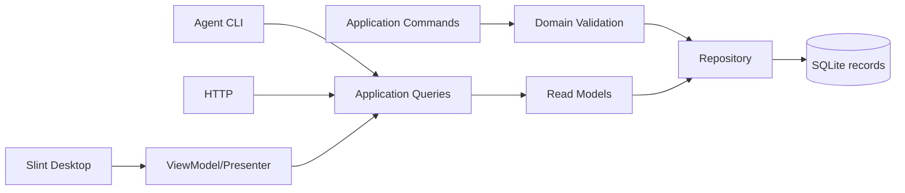

# Core Contract v1（P0 冻结）

- 日期：2026-11-05
- 状态：P0 契约冻结；不是已实现代码。
- 基线：`f214e58` 后的契约修订。
- 权威关系：术语见 [`CONTEXT.md`](../../CONTEXT.md)，模块见 [`architecture.md`](../architecture.md)，实施见 [`implementation-plan.md`](../implementation-plan.md)。

## 0. 目标

先冻结 Core 查询、身份、兼容和命令边界；再抽共享 Core；最后拆 Slint。`ManifestItem {title, detail}` 不是 Run 读模型。



## 1. 模块依赖

```text
UI / CLI / HTTP
       │
       ▼
Application Services (Queries, Commands, Transactions)
       │
       ▼
Domain Core (Design, Protocol, Run, Sample, Validation, Projections)
       │
       ▼
Repository interface
       │
       ▼
SQLite Adapter
```

规则：

- UI 不依赖 SQLite，不直接写 JSON。
- CLI/HTTP 只调用 Application Services，不复制校验。
- Domain 不依赖 Slint/HTTP/具体 SQLite 类型。
- Read Model 可依赖 Domain，不被 Domain 反向依赖。
- `ToolAction` 是 Application/Core 能力，不是领域设计对象。
- `InstrumentProfile` 是能力声明，不是执行状态。

## 2. 查询契约

### 2.1 当前设计与冻结设计

当前地图和冻结设计共享**科学投影逻辑**，但读取来源不同：

```rust
pub struct DesignMapContent {
    pub title: String,
    pub objective: String,
    pub experimental_unit: Option<String>,
    pub groups: Vec<DesignGroup>,
    pub assays: Vec<DesignAssay>,
    pub sample_links: Vec<SampleLink>,
    pub planned_outputs: Vec<PlannedOutputSummary>,
    pub conflicts: Vec<ConflictSummary>,
    pub unresolved: Vec<ValidationIssueSummary>,
}

pub struct CurrentDesignMap {
    pub design_id: String,
    pub revision: i64,
    pub content: DesignMapContent,
}

pub struct FrozenDesignView {
    pub design_id: String,
    pub design_version_id: String,
    pub design_revision: i64,
    pub content: DesignMapContent,
}
```

- `design_map(design_id)` 返回 `CurrentDesignMap`，读取当前 Design revision。
- `run_workspace(run_id).frozen_design` 返回 `FrozenDesignView`，读取 Run 指向的不可变 DesignVersion。
- 找不到冻结快照必须返回明确错误；**不得回退到当前 Design**。
- 现有 `design.map` CLI/HTTP 的扁平 JSON 仍作为兼容序列化保留；内部复用 `DesignMapContent`，不复制关系推导。

`DesignGroup` / `DesignAssay` / `SampleLink` / `ValidationIssueSummary` 沿用 P0 字段；`SampleLink` 的 `physical_slots_per_group` 仍是计划位置数，不是实体样本数/n。

### 2.2 `ProtocolPreview`

```rust
pub struct ProtocolPreview {
    pub protocol_version_id: Option<String>,
    pub root_block_version_id: Option<String>,
    pub ordered_steps: Vec<OperationStep>,
    pub resolved_parameters: Vec<ResolvedParameter>,
    pub unresolved_parameters: Vec<UnresolvedParameter>,
    pub block_version_ids: Vec<String>,
    pub parameters_ready: bool, // 仅表示必填参数绑定完成
    pub ready: bool,            // 兼容别名；等同于 parameters_ready，v1 保留
}
```

- `ready` 不再暗示科学有效或可执行；新代码使用 `parameters_ready`。
- `OperationStep` 的 `meta` 可选；缺失不补默认 purpose/control/readout。
- `OperationStep.time_scope` 显式表达 `once/per_timepoint/per_assay/unresolved`；只有 `per_timepoint` 才按 Assay 时间点展开任务，缺失不等同于每个时间点。
- 步骤数组顺序即执行顺序；`path` 是展开路径，不由标题生成。
- 预览不是执行；不产生 `StepOccurrence`。

### 2.3 `RunWorkspace`

必须从 Run 冻结的 `design_version_id` 和 `protocol_manifest` 读取，不得读取当前 Design 覆盖。

```rust
pub struct RunWorkspace {
    pub run_id: String,
    pub design_id: String,
    pub frozen_design: FrozenDesignView,
    pub protocol_version_id: Option<String>, // 仅可选全局 Protocol
    pub status: String,
    pub scopes: Vec<RunScope>,
    pub steps: Vec<OperationStep>,           // 冻结定义
    pub tasks: Vec<PlannedTask>,             // 计划任务，可尚未执行
    pub occurrences: Vec<StepOccurrence>,    // 已有实际实例
    pub materials: Vec<MaterialManifestView>,
    pub plates: Vec<RunPlateView>,
    pub events: Vec<ExecutionEventView>,
}

pub struct RunScope {
    pub kind: String, // assay | planned_output
    pub id: String,
    pub title: String,
    pub protocol_version_id: Option<String>, // 每个 scope 自己的版本
    pub step_paths: Vec<String>,
}
```

规则：

- `protocol_version_id` 只是可选全局 Protocol；每个 Assay/PlannedOutput 的版本由对应 manifest scope 决定。
- `steps` 是定义；`tasks` 是计划；`occurrences` 是实际。三者不能合并。
- `tasks` 只从明确的时间点/目标/分配关系生成。缺少映射时用 `TargetSelection::Unresolved`，不生成时间点 × 样本 × 孔位的笛卡尔积。
- 未执行步骤没有 `StepOccurrence`；不得从 `steps` 推断执行状态。
- `plates` 只来自实际 `plate/well` 记录；计划数量不生成坐标。
- `events` 只来自 execution events；旧事件缺 occurrence 时标为“未精确绑定”，不自动补。

### 2.4 任务、目标与执行实例

```rust
pub enum TargetRef {
    Sample { sample_id: String },
    Container { container_id: String },
    Well { plate_id: String, coordinate: String },
    Animal { animal_id: String },
    Subject { subject_id: String }, // 研究系统内部假名化 ID
}

pub enum TargetSelection {
    One(TargetRef),
    Many(Vec<TargetRef>),
    NotApplicable,
    Unresolved,
}

pub struct PlannedTask {
    pub task_key: String,       // 计划投影的稳定键
    pub step_path: String,
    pub scope: StepScope,
    pub timepoint: Option<String>,
    pub target: TargetSelection,
}

pub struct StepOccurrenceContext {
    pub run_id: String,
    pub protocol_version_id: String,
    pub scope: StepScope,
    pub step_path: String,
    pub timepoint: Option<String>,
    pub target: TargetSelection,
}

pub struct StepOccurrence {
    pub occurrence_id: String,
    pub context: StepOccurrenceContext,
}

pub enum StepScope {
    Assay { assay_id: String },
    PlannedOutput { planned_output_id: String },
    Unscoped,
}
```

规则：

- 孔位必须同时有 `plate_id` 和 `coordinate`；单独 `A1` 不唯一。
- 样本、容器、孔位是不同对象，不能互相替代。
- `Unresolved`（尚未确定）与 `NotApplicable`（确实不针对物理目标）必须分开。
- 多孔操作可引用明确集合；没有实际映射时不能把“本组 6 孔”转成坐标。
- `occurrence_id` 在首次记录事件时分配并持久化上下文；同一步骤再次执行可以有另一个 occurrence。
- `ExecutionEvent` 新增 `occurrence_id: Option<String>`；旧事件缺失时保留历史并标注，不自动匹配“最近同名步骤”。
- 写入请求另有 `idempotency_key`，用于防网络重试重复追加；不能与 `occurrence_id` 混用。

### 2.5 查询接口

```rust
pub trait ExperimentQueries {
    fn design_map(&self, design_id: &str) -> Result<CurrentDesignMap, QueryError>;
    fn protocol_preview(
        &self,
        protocol_version_id: &str,
        bindings: &[RootParameterValue],
    ) -> Result<ProtocolPreview, QueryError>;
    fn run_workspace(&self, run_id: &str) -> Result<RunWorkspace, QueryError>;
}

pub enum QueryError {
    NotFound { kind: String, id: String },
    InvalidReference { path: String, message: String },
    Internal { message: String },
}
```

CLI/HTTP/Slint 只通过该接口取读模型；Adapter 可缓存但不能改变字段/顺序/未知状态。

## 3. 能力契约

### 3.1 `ToolAction`

```rust
pub struct ToolActionSpec {
    pub action_id: String,
    pub version: String,
    pub input_schema: Value,
    pub output_schema: Value,
    pub side_effects: ToolSideEffects,
    pub implementation_source: String,
    pub requires_confirmation: bool,
}

pub enum ToolSideEffects {
    Pure,           // 计算/预览，不写库
    DatabaseWrite,  // 经 Core Command 写入
    ExternalEffect, // 文件/仪器/服务
}
```

- 确定性计算/预览优先 `Pure`；不产生执行事件。
- `DatabaseWrite` 必须走 Core Command；`ExternalEffect` 必须授权、确认、失败处理，并区分“指令已发送”和“设备报告成功”。
- 计算器、板图预览、日程估算属于 ToolAction；不创建 ProtocolStep。
- 不建全局工具中心；UI 可在步骤上下文中调用。

### 3.2 `InstrumentProfile`

```rust
pub struct InstrumentProfile {
    pub profile_id: String,
    pub version: String,
    pub class: String,
    pub model: Option<String>,
    pub capabilities: Vec<Capability>,
    pub constraints: Vec<Constraint>,
    pub source: ProfileSource, // built_in | lab_imported
    pub evidence: Vec<EvidenceRef>,
}
```

- 首版随应用发布只读、版本化注册表；实验室导入档案必须保留来源与版本。
- 不是具体机器、校准状态、预约或执行记录；选择型号不等于校准/设置已确认。
- 步骤通过 `meta.instrument.profile_id` 引用；未知型号只保留 class。
- 与 ToolAction 分表/分注册；P1 不开发完整注册系统。

### 3.3 `StepMetaView`

P0 只冻结“可选、非核心、不得阻塞”的边界；正式 Schema 在 RunWorkspace 稳定后单独审定。

- 可包含 purpose、instrument、controls、decision_points、failure_modes、readout、sample_constraints。
- 没有 `meta` 的旧步骤仍可预览/冻结/执行；不得自动补语义。
- 不允许任意字符串绕过结构约束；未知判断留空或进入 ValidationIssue。

## 4. 命令边界

| 命令 | 所属 | 输入 | 输出/副作用 |
|---|---|---|---|
| `design.create/revise` | Design | 设计字段/补丁 + expected version | 新 DesignVersion |
| `protocol.block.create/revise` | Protocol | 块内容/参数槽 + expected version | 新 ProtocolBlockVersion |
| `protocol.create/revise` | Protocol | 标题/正文/根块 + bindings | 新 ProtocolVersion |
| `run.create` | Run | design_id + protocol 版本 | 冻结 Run |
| `execution_event.create` | Run | event + occurrence_id（首次可创建）+ idempotency_key | 追加事件/实例 |

规则：

- 所有写入使用 `expected_version`/幂等标识；冲突明确返回，不静默覆盖。
- 命令不能整体替换含科学关系的 JSON；字段级 patch 或明确完整替换必须由命令语义定义。
- UI 不执行 SQL；Agent 不绕过命令直接写 records。
- 首次事件创建 occurrence 时，必须复用现有 `create_execution_event_tx` 的 Protocol 版本/路径/Assay/时间点校验链。

## 5. 版本与兼容

- 设计修改：新 `DesignVersion`；旧 Run 仍读旧版本。
- ProtocolBlock/Protocol 修改：新版本；旧 BlockUse/ProtocolVersion 不变。
- Run 创建：冻结 DesignVersion、ProtocolVersion、根块/子块版本、解析参数、材料清单。
- ExecutionEvent：追加，不覆盖；更正通过新事件/偏差。
- 新增字段：可选、默认、旧记录可读；不迁移已冻结内容。
- 不承诺新数据被旧二进制读取；单机升级整体替换。
- 旧事件缺 `occurrence_id`：可显示，标“未精确绑定”；不自动补 ID。
- 当前 `ManifestItem {title, detail}` 是 UI 过渡摘要，不是 Core 契约。

## 6. 测试矩阵（P0/P1 必须）

| 编号 | 测试 | 必须证明 |
|---|---|---|
| C1 | CurrentDesignMap 一致性 | CLI/HTTP/Desktop 对同一 design 得到相同语义 |
| C2 | 冻结版本 | Design 修订后旧 Run 仍读 FrozenDesignView |
| C3 | Protocol 递归 | 多级展开顺序、path、参数绑定准确 |
| C4 | 未知语义 | 未填 n/来源/孔位不被补值 |
| C5 | 时间点隔离 | D1 事件不影响 D3 |
| C6 | 检测隔离 | CCK-8 板/事件不出现在活死上下文 |
| C7 | 任务/实例分离 | `steps` 不推断 `tasks`/`occurrences`；多目标可区分 |
| C8 | 旧数据兼容 | 旧 records/events 可读，缺失 occurrence 标注不补 |
| C9 | 版本冲突 | 过期 expected_version 明确冲突 |
| C10 | 并行访问 | Slint/Agent 同时访问时事务一致，无重复 Run/事件 |
| C11 | Frozen 失败 | 缺少 DesignVersion 快照时明确报错，不回退当前设计 |
| C12 | 计划不生成笛卡尔积 | 缺目标/时间映射时不产生完整任务矩阵 |

案例至少 L929、SA 铜梯度、生物膜，加一个非孔板场景。测试数据不触碰正式数据库。

## 7. P0 验收

- 当前/冻结设计共享 `DesignMapContent`，读取来源分开。
- `OperationStep` / `PlannedTask` / `StepOccurrence` 类型分离；RunWorkspace 分别返回。
- `TargetRef` / `TargetSelection` 类型化；`Unresolved` 与 `NotApplicable` 分开。
- `ExecutionEvent` 显式 `occurrence_id`；`idempotency_key` 独立。
- `ToolAction` 与 `InstrumentProfile` 独立版本/权责；P1 不开发完整注册系统。
- 旧 CLI/HTTP 行为有兼容说明。
- 测试矩阵 C1–C12 明确。
- 未完成项明确列出；不把候选方案写成已实现。

## 7.1 后续语义组件契约

S0 统一语义接口见 [Semantic Component Contract v1](semantic-component-contract.md):Operation/Composition/ToolAction/Resource/Typed Binding 映射现有对象,不新建第二套运行时。

## 8. 未决项（不阻塞 P0 契约冻结）

1. `TargetRef` 的实体表在 P1/P2 何时落地；P0 只要求类型和引用约束。
2. `occurrence_id` 在 SQLite 中作为事件可选字段还是独立投影；P0 不建表。
3. `StepMetaView` 正式 Schema（P4）。
4. InstrumentProfile 导入/审批流程（设备集成阶段）。
5. Slint 组件拆分细节（P3）。
