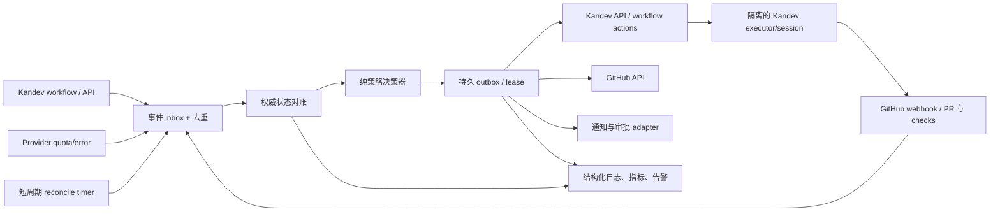

# Kandev 自动化运行架构：现状、故障分类与目标工作流

## 结论

当前自动化已经有队列、配额回退、PR/CI 检查、停滞恢复和人工通知，但控制面分散在 Kandev 工作流、一个 1,417 行 feeder、多个独立回收器、SQLite 直写、GitHub CLI 和 Telegram 回调之间。主要风险不是“提示词不够长”，而是多个系统状态被当成同一种状态、动作没有统一幂等账本、恢复依据依赖自由文本或内部数据库结构。

目标不是重写 Kandev。Kandev 继续拥有任务、工作流、会话和执行器；GitHub 继续拥有分支、PR、checks 和 merge 事实；一个小型 AsterLab controller 只负责本项目的准入策略、配额策略、跨系统对账和有界恢复。controller 不复制 Kandev 的任务数据库，也不直接写 Kandev 内部 SQLite 表。

**无需人工提示即可完全恢复**只适用于输入明确、结果可验证、动作幂等的运维故障。卡片语义矛盾、权限被撤销、冲突的代码意图、未授权审批和执行结果不确定，不能安全地靠更多 prompt 自动解决；系统应停住、保留证据并升级，而不是猜测。

## 1. 官方 Kandev 模型与设计约束

以下以 [Kandev 官方自动化资料摘录](kandev-official-automation-notes.md) 为索引；原始依据：

- [Tasks and Workflows](https://kandev.ai/docs/tasks-and-workflows)：workflow step 是流程位置，不是 agent/runtime 状态；移动任务本身不证明代码已提交、review 已通过或 PR 已合并。依赖会阻止自动启动，但手动启动可能是显式 override。
- [Automation and MCP — workflow events and human gates](https://kandev.ai/docs/automation-and-mcp#workflow-events-and-human-gates)：现有任务用 workflow events 做确定性流转；外部信号创建任务用 workspace automation。审核/审批 step 是支持的人工门，step 进入事件要检查来源和目标两侧，避免循环。
- [Automation and MCP — automatic retries](https://kandev.ai/docs/automation-and-mcp#automatic-retries)：Kandev automation 有有限/无限重试和退避，但 provider 是否已接受任务无法确认时会保留 pending ownership，不会盲目重发；官方不承诺所有 side effect exactly-once。
- [Sessions and Review](https://kandev.ai/docs/sessions-and-review#manage-session-state)：Resume/Restart 依赖保存的 executor/session/runtime；部分失败可自动恢复，不是通用保证。prompt 是否已被 provider 接收不确定时，不应自动重送。文档也明确要求不要通过直接编辑数据库绕过 recovery 检查。
- [Integrations — GitHub](https://kandev.ai/docs/integrations#github)：GitHub API 身份、任务 Git 凭据和 agent 模型凭据是不同凭据路径；PAT/CLI bearer token 交给可信子进程后仍保留其 provider scope。短期 App credential lease 的权限边界更清楚。

因此：使用 Kandev 官方 API、workflow event、session action 和 GitHub integration；缺少受支持写 API 的字段先加 API/产品能力，不用 SQL 直写替代。官方文档未承诺的 webhook、重试和恢复能力一律视为未知，先做故障注入验证。

## 2. 当前部署快照与已确认风险

### 2.1 运行状态

本次只读采样：

- `kandev.service`、`kandev-ready-feeder.service`、`kandev-telegram-callback.service` 均运行；feeder 每 30 秒循环，配置中的 Agent/Review WIP 均为 4。
- Kandev、feeder、Telegram callback 的 systemd `User` 为空/为默认 root；`kandev.service` 明确以 root 运行。仓库既有路线图已把无人值守 root executor 记为风险。
- `kandev-zombie-reaper.timer` 每小时触发；`kandev-session-reaper.timer` 当前 disabled；日报 timer 已启用。callback 的 `Restart=no`，进程异常退出后 systemd 不会自动重启。
- 当前工作流快照：Merged 26 张；Review 4 张（4/4 满）；Inbox 3 张，其中 2 张 `CREATED`、1 张 task state 为 `REVIEW`；Ready/Agent 无卡。Review 满载时 feeder 会停止接收新工作，这是预期背压，不是模型额度问题。
- Kandev DB 中 `automations`、`automation_triggers`、`automation_runs` 均无记录；当前队列控制主要来自自建 feeder，而不是已配置的 workspace automation。

### 2.2 正在运行/等待的任务

以下是本次 Kandev DB 与 PR 快照，不是重新执行 CI：

| 卡 | 当前观察 | 处置含义 |
|---|---|---|
| OPS-01 | Review，无关联 PR；历史 session 为 FAILED/CANCELLED | 不应无限占 Review。先确认是否有该卡分支/未关联 PR；否则记录明确失败原因后回 Agent 或人工 hold。 |
| SCI-04 / PR #33 | Review step，Luna session 正在 RUNNING；PR open、merge state BLOCKED；PR 评论记录 `linux-tests` 与 `windows-build` pending、`scope-check` 通过 | 保持当前运行，不重启/不合并；等本轮 agent 完成后重新核对最新 PR head 和 checks。验收原始输出目前只在证据目录，PR 评论没有原始输出。 |
| SDK-02 / PR #34 | PR open、merge state CLEAN；Kandev DB 的 checks_state 为 success；任务和 PR 描述都明确受 SDK-02-FIX 阻塞 | 不能仅凭 CI success 合并；先等 blocker 进入 Merged，再重新 review。 |
| SDK-03 / PR #32 | PR open、merge state DIRTY；Kandev task 在 Inbox step，但 task state 为 REVIEW | 任务位置、任务状态和 GitHub PR 不一致；先按 task marker/branch 唯一关联后对账，不能再创建第二个 PR。 |
| SDK-05 / PR #28 | PR open、merge state DIRTY；Kandev DB checks_state 为 success | DIRTY 不是 CI 绿灯可覆盖的条件；需处理冲突/基线后重审。 |
| QA-07 | Inbox；被 OPS-01 与 RDO-01 阻塞，RDO-01 已 Merged、OPS-01 尚未完成 | 依赖阻塞本身正确，等 OPS-01 解决。 |

### 2.3 代码和流程问题

1. `scripts/kandev-ready-feeder.py` 把 admission、容量、PR 扫描、session/process 回收、卡片停滞、review verdict、Telegram 通知、retro 创建和归档混在一个循环中。`scripts/kandev_model_quota.py`、session reaper、zombie reaper、callback 又分别承担生命周期动作；没有唯一动作账本。
2. feeder 和 quota handler 直接写 Kandev SQLite：session state、executor state、workflow step profile、labels、task repository 等。这样绕过 Kandev 的 API 校验、事件和 recovery 所需的持久化不变量；官方 session 文档明确禁止通过改 DB 绕过 recovery。
3. 控制决策读取 `VERDICT:` 自由文本、关键词、PR 标题和 DB 聚合状态。模型措辞变化、引用 prompt、旧 session 消息、PR watcher 延迟都可能导致错判。机器动作应依据有 schema 的 outcome 和外部真实状态，而不是自然语言片段。
4. 多个状态被混用：workflow step、task state、session state、executor process、PR state、CI state。SDK-03 当前已经出现 task 在 Inbox、task state 为 REVIEW、PR 仍 open 的可观测分歧。
5. `validate_card()` 只检查 scope 块、证据路径覆盖、非 Docs 验收中是否出现反引号、lane label 和 `{{...}}` 占位符；不检查自然语言自相矛盾、路径是否绝对、命令是否存在/可运行、依赖图是否合理或验收结果是否真实。
6. 配额策略符合当前产品决定：DeepSeek 明确 quota error 时单向切到 `openai-codex/gpt-6-luna`；Luna quota 不切回 DeepSeek。但当前检测依赖错误消息中的固定文本；未识别的错误不能被误当成可恢复 quota。
7. `scan_retro_trigger()` 的 watermark 更新代码位于 `except` 分支的 `return` 之后，成功路径不可达。watermark 不推进时，队列再次排空后可能重复创建覆盖同一批任务的 RETRO 卡。
8. `kandev-telegram-callback.py` 只核对 chat id，不核对 callback 发起人的 allowlist；merge/reject 是有副作用的操作。Telegram 应是通知/带身份校验的审批界面，不应成为无身份约束的权限边界。
9. `tests/test_kandev_model_quota.py` 覆盖配额检测和单向 profile 回退；`tests/test_kandev*` 没有 feeder、PR 状态机、重启恢复或 Telegram 授权测试。

## 3. 故障分类：哪些可以不靠人工 prompt

定义：**是** = 可从结构化事实自动恢复；**部分** = 自动等待/重试/收集证据，但最终决策需人；**否** = 语义、权限或安全判断不能猜。

| 阶段/故障 | 不依赖人工 prompt 的自动处理 | 自动化边界 |
|---|---|---|
| 卡片缺字段、scope 格式错、证据路径越界、命令字段为空 | **是**：静态 validator 给稳定 error code，留在 Inbox/Blocked，通知具体字段 | 可以指出并机械校验；不能自动编造需求、scope 或验收。 |
| 卡片自相矛盾、契约语义不明、范围冲突 | **否**：冻结任务并给出并列冲突证据 | 由任务作者选定权威语义；重写 prompt 不会消除设计歧义。 |
| blocked_by 未完成 | **是**：保持 queued，不启动 | 成功 blocker 完成后自动解除；依赖环能检测，环的方向不能自动猜。 |
| WIP/模型/执行器容量已满 | **是**：排队、按公平顺序等待可用 lease | idle `WAITING_FOR_INPUT` session 不应占计算并发；Review 卡可占业务队列槽，但 human-hold 应进入独立 hold 队列。 |
| Kandev/GitHub HTTP timeout、429、短暂 5xx | **是/部分**：有界指数退避、随机抖动；POST 超时后先 GET 对账，再决定是否重试 | 若对方是否已接收动作不确定，不得盲目重发；先保留 pending ownership。 |
| DeepSeek 明确额度耗尽 | **是**：立即把未来 Agent/Review 启动和兼容的活跃 session 单向切到 Codex Luna；记录 error id 与切换结果 | 不按小时轮换；使用错误事件驱动，短轮询仅作漏事件兜底。 |
| Luna 额度耗尽/模型认证失效 | **部分**：识别并暂停新 turn；有 reset 时间则等待 reset 后尝试原 Luna | 按当前政策绝不回切 DeepSeek。撤销/无额度/未知 provider 错误不能伪装成成功回退，需通知人工。 |
| session 启动/恢复失败 | **部分**：调用 Kandev 支持的 Resume/Restart；只在 Kandev 能证明原 prompt 未被接受或原 runtime 已结束时重试 | prompt 已接收但结果未知时不重送；官方文档不保证任意 executor/profile 都可 Resume。 |
| session/进程僵尸、worktree 孤儿 | **部分**：按 task_id + session_id + lease + worktree + PID/start time 对账；确认没有 owner 后才停止/回收 | 仅凭 cwd、task step 或旧 PID 猜测不够；dirty worktree 隔离保存，不能自动删除。 |
| 验收命令失败 | **部分**：机器判断 exit code、保存原始输出；已知 infra flake 可限次 rerun | 行为/契约测试失败应把结构化 failure 交给 agent 修同一 branch；仍需代码推理，不是纯 prompt-free。 |
| PR 未创建/PR link 丢失 | **部分**：通过唯一 task marker + 固定 branch 查找并恢复关联 | 无 PR 且 agent 结果未知时禁止新建重复 PR；多个候选或无可验证分支时人工裁决。 |
| PR checks pending、workflow approval 等待 | **是（等待）**：记录 pending/approval-required，监听 GitHub 更新并定期对账 | `gh pr checks` 返回 8 不等同失败；未经授权不能自动批准 GitHub workflow。 |
| CI 明确失败 | **部分**：已知可重跑的 runner/network flake 限次重跑；真实测试失败生成结构化 check report | 不把失败“修饰成绿灯”；代码失败交回 agent 修复，重复失败熔断。 |
| PR DIRTY/merge conflict | **部分**：检测 behind-base 与具体冲突文件；若只是可快进且策略允许，可安全更新分支 | 内容冲突/改动丢失风险需人；禁止 force push、丢弃未提交改动或 blind rebase。 |
| Review 输出缺字段/非法 verdict | **是/部分**：拒绝状态转换，要求同一 session 只按 schema 重发一次；失败则 hold | 不能用旧消息/关键词替代结构化结论；语义是否符合设计仍需要独立 review。 |
| PR 已合并但 Kandev event 丢失 | **是**：从 GitHub 权威状态按唯一 task marker 对账，然后通过 Kandev API 补状态 | “已 merged”必须由 GitHub 证实；只按标题猜 PR 不够。 |
| Telegram/邮件通知失败 | **是**：持久 outbox 重试，切换备用 channel，告警去重 | 通知失败不能改变任务或放宽 merge gate。 |
| credential 过期/权限拒绝 | **部分**：可自动续期短期 App lease；标记 provider/auth error | PAT 被撤销、scope 不足、访问策略不明必须人工修权；不能靠 prompt 获取权限。 |
| 数据库满/损坏、磁盘满 | **部分**：探针、停止新派发、保留日志与备份告警 | 恢复数据/判断丢失状态需要人工；不能在状态未知时继续写或清理。 |
| prompt injection、agent 越权、敏感文件误写 | **否（靠设计预防）**：隔离 OS 用户、文件 scope、最小凭据、secret scanning、分支保护 | Prompt 不是安全边界；越权或泄密先暂停 worker、撤销凭据、审计。 |

## 4. 目标架构

### 4.1 控制流



用官方事件时以事件驱动为主；事件未覆盖或可能丢失时，用周期性 reconcile 修复分歧。Kandev 官方文档给出的 scheduler/PR 评估周期分别为 30 秒/60 秒，不应把它们误认为即时通知；quota fallback 使用 provider error 触发，当前 feeder 30 秒扫描只作兜底，不设小时轮换。

### 4.2 权威状态和状态分离

| 事实 | 唯一权威源 | controller 保存什么 |
|---|---|---|
| 任务内容、workflow step、依赖、session id | Kandev API | 最近观察版本与关联 id，不复制任务正文 |
| 运行中的 PID、worktree lease、prompt delivery 状态 | Kandev executor/session API | run/attempt correlation、租约截止时间、最后观察时间 |
| branch、PR、head SHA、required checks、merge 状态 | GitHub API | PR/task 关联、已验证的 head SHA、check snapshot 时间 |
| model quota/profile/error | provider 返回值 + Kandev session snapshot | provider、model、reset time、当前 fallback 决策 |
| 重试/外部副作用 | controller 自己的 durable ledger | event receipt、effect id、outbox、attempt、错误分类 |

不要用一个 `state` 表示上述全部状态。workflow step、task state、session lifecycle、prompt delivery outcome、PR state、CI state 必须分别建模。

### 4.3 深模块和接口

- **Policy Engine（纯决策模块）**：输入 `ObservedSnapshot + PolicyVersion`，输出 `WAIT | RETRY_AT | HOLD | HUMAN | EFFECTS[]` 和稳定 error code；不访问网络、不写 DB、不读 prompt 文本。一个入口覆盖 admission、quota、CI、merge gate、recovery 决策。
- **Adapters（外部接口）**：`KandevAdapter`、`GitHubAdapter`、`ProviderAdapter`、`ExecutorAdapter`、`NotifierAdapter`。只通过官方支持的 API/action 操作外部系统；将厂商状态映射到内部枚举。
- **Durable Inbox/Outbox**：事件先按 `(source, delivery_id)` 去重；决策和待执行 effect 原子落库；每个 effect 带 `task_id, run_id, expected_version, idempotency_key, not_before, attempt`。网络超时后先重新读权威状态，再重试或确认已完成。
- **Reconciler**：不以“脚本上次执行成功”作为事实。按任务/PR/session 对账，检测卡片移步、session 停滞、PR 关联、checks 和 merge 后的状态漂移。
- **Kandev executor**：独立非 root 用户/隔离 worktree；一任务一个写入 lease；agent 得到的 GitHub/API 权限仅限工作需要，不提供 controller 数据库或宿主机凭据。

controller 持久化 event receipt/outbox/audit，不维护第二份 Kanban。若为单 VPS MVP 使用 SQLite ledger，启用事务/WAL/备份并保持单写者；不要直接修改 Kandev 自身 DB。

### 4.4 状态机

```text
Inbox
  -> Preflight
  -> Ready (blocked dependency / capacity 时留队列)
  -> Agent
  -> LocalVerify
  -> PRLinked
  -> CIWait -> Review
  -> Changes -> LocalVerify -> CIWait -> Review
  -> MergeReady -> Merged -> Cleanup

任意运行阶段 -> RetryWait（只含可重试错误）
任意阶段 -> HumanHold（语义冲突、权限、安全、未知执行结果、耗尽重试）
```

session runtime 独立维护：`QUEUED, STARTING, RUNNING, WAITING_FOR_INPUT, QUOTA_BLOCKED, FAILED, CANCELLED, STOPPED, OUTCOME_UNKNOWN`。`WAITING_FOR_INPUT` 可以保留对话但不占 active compute lease；Review WIP 表示待审卡数，不等同于同时运行的 agent 数。HumanHold 单独出队，不能永久吞掉 active review capacity。

### 4.5 自动准入、验收和 PR 契约

1. `Definition of Ready` 解析成版本化 schema：稳定 card id/category、结构化 `scope.write/read/forbid`、证据路径、依赖 id、命令数组/平台、预期输出、风险级别、merge policy。自然语言保留为 agent 上下文，但不是唯一控制字段。
2. 机械校验：路径规范化、scope overlap、forbid 交集、证据路径在 write scope、禁止绝对路径/secret pattern、命令存在、依赖无环、当前 executor 支持该 category。失败返回 code 和字段路径，卡留在 Blocked，不让 agent 猜。
3. 一卡一 branch、一 PR：branch 包含 task UUID；PR body 含唯一 `<!-- kandev-task: <uuid> -->`。同一 task 的 PR 关联先按 UUID/branch 查；title 搜索仅作恢复线索，不能作为唯一身份。
4. agent 以结构化 `TaskOutcome` 结束：`task_id, run_id, attempt, commit_sha, pr_number, tests[], evidence[], status, error_code`。Review 以 `ReviewOutcome` 输出 `APPROVE | CHANGES | HUMAN`、head SHA、finding IDs 和证据链接。解析失败不执行 move/merge。
5. 本地验收保存真实 stdout/stderr、exit code、工具版本、commit SHA、证据 hash；不能只接受 PR 正文里的摘要。

### 4.6 CI 与 merge 安全门

- 状态枚举：`NOT_STARTED / PENDING / WAITING_APPROVAL / SUCCESS / FAILURE / CANCELLED / UNKNOWN`；pending、审批等待、查询错误不算失败也不算成功。
- 任何 merge effect 执行前重新验证：PR open、同一 task UUID、head SHA 未变、required checks 全绿、PR mergeable、scope/evidence gate 通过、无 human hold、审批对当前 SHA 仍有效。
- 默认 merge 需要 GitHub required review。若确需无人值守，只允许显式 allowlist 的低风险类别在独立 review 和所有机器 gate 通过后自动 squash merge；不能用同一个实现 session 的 `VERDICT: APPROVED` 单独授权。CI 配置、credential、权限、发布和破坏性迁移默认人工审批。
- merge 成功由 GitHub 事实确认；再用 Kandev API 完成 task step。事件丢失由 reconciler 补齐。重复 merge 请求必须识别 `already merged`，不能重复执行后假报成功。

## 5. 错误处理协议

每个失败进入有 schema 的 `FailureEvent`：

```text
code, source, task_id, run_id, session_id, pr_number, head_sha,
retry_class, observed_at, retry_after, evidence_refs, redacted_detail
```

动作分类固定为：

- `RETRY`: 暂时错误且副作用可验证/幂等；有次数上限和指数退避。
- `WAIT`: quota reset、WIP、CI pending、workflow approval；带下一次检查时间，不消耗重复 agent turn。
- `HOLD`: 卡片自矛盾、dirty worktree、权限拒绝、无法判断 prompt 是否已接收、PR 多重匹配。
- `HUMAN`: 需要改变语义/权限/风险接受/审批；发送去重通知，保留 Kandev/GitHub 链接和证据。
- `DONE`: 从权威 API 确认 side effect 已完成，即使原始响应超时也不再重做。

未知错误默认 `HOLD`，不默认 `RETRY`。达到 retry budget 后打开 circuit breaker；不能因为 `WAITING_FOR_INPUT` 或没有新消息就无限重发 prompt。

## 6. 权限、审计和告警

- 将 Kandev server、feeder/controller、agent worker 分离为专用 OS 用户；先验证 Kandev 所需目录访问，再去 root。对 agent worker 使用最小可写路径、无宿主机 DB/API 环境变量、限制网络与工具权限。
- GitHub 采用 App/task-repository scoped credential；避免把广域 PAT/CLI bearer token 传给 agent。provider/model secret 与 Git secret 分开，日志只记 secret reference/hash，绝不记录 token。
- Telegram callback 核对 `from.id` allowlist、chat、动作有效期和一次性 nonce；merge/reject 每次都对当前 Kandev/GitHub 状态重新验证。Telegram 仅做通知/显式审批，不承担授权本身。
- 每个结构化日志/通知带 `task_id, run_id, session_id, event_id, attempt, PR, head_sha`；指标至少包括队列年龄、Review backlog、活跃 lease、quota fallback、重试按错误码、CI pending/approval 时长、PR 无关联数、session/worktree 孤儿数、reconciliation drift、notification failure。
- 告警走 durable outbox；Telegram 不可达时仍留在 Kandev/本地日志，并通过备用 channel 升级。通知发送成功不是任务状态改变的证据。

## 7. 分阶段迁移

### P0：先止损，不中断已知有效工作

1. 本次诊断输出曾带出运行凭据；按已泄露处理，撤销/轮换受影响凭据，更新受保护的 service environment 并重启依赖 unit。不要把值粘贴回聊天或 issue。
2. 暂不自动合并 #28/#32/#33；#34 保持被 SDK-02-FIX 阻塞。不中断 SCI-04 当前 Luna session；先等它完成，再按最新 commit/checks 审查。
3. 单独处理当前状态漂移：OPS-01 无 PR、SDK-03 在 Inbox 但 PR #32 open、SDK-02 有未完成 blocker。每项先通过 task UUID/branch/PR 证据对账，不以标题猜测。
4. 修复 retro watermark 不可达逻辑；给 Telegram callback 加异常自动重启和用户 allowlist。未完成这些安全修复前，不扩大无人值守 merge 范围。

### P1：把准入和输出变成机器契约

- 新增版本化 DOR/TaskOutcome/ReviewOutcome schema 和纯静态 validator；自相矛盾仍阻断并要求 task owner 修改。
- 给以上 schema 和失败分类加边界测试：缺字段、scope 交集、路径越权、依赖环、结果不合法、旧 session 消息不能覆盖新 verdict。

### P2：shadow controller

- 先只读 Kandev/GitHub/provider/executor 状态；对每个 task 计算预期动作但不执行，与现有 feeder 日志比较。
- 注入 429、5xx、网络超时后 provider 已接受、重复 webhook、backend restart、session active/idle、PR 已 merge 但 task 未移动、checks pending/approval/failed/dirty 等场景。
- 所有差异解释清楚且恢复决策稳定后，再按 scanner 一项一项切换到 controller；禁止旧 feeder 与新 controller 同时拥有同一副作用。

### P3：单一副作用控制面

- 把 Kandev workflow 位置、GitHub PR/check 状态和 provider quota 接入 adapters；全部写操作经官方 API/action 和 durable outbox。
- 使用 GitHub webhook/现有 Kandev integration 处理可用事件；保留周期 reconcile 处理漏事件。迁移任务时保留 task/session/PR identity，不创建平行 PR。
- 将 model quota 切换改为识别新错误事件后即时决策；30 秒扫描仅兜底；Luna quota 保持等待/人工处理，绝不回切 DeepSeek。

### P4：隔离与退役

- 在非 root worker 和权限隔离通过审计后逐类启用自动 dispatch；确认回滚/备份有效。
- 退役直接改 Kandev DB 的回收和 label 写入；启用统一 session/worktree lease 回收；旧脚本删掉后再更新运行文档和告警。
- 最后才扩大自动 merge allowlist。任何 policy/config 变更都版本化并记录 effect、审批人和目标 head SHA。

## 8. 验收不变量

1. 一 task/branch 同时最多一个有效写入 lease；重启不会重放已接受但 outcome 未知的 prompt。
2. Kandev DB 不被 controller/agent 直接写；所有 mutation 都能从 API 返回值或 GitHub/provider 权威状态对账。
3. 一个 task UUID 最多关联一个活跃 PR；重复事件、重复定时 tick、重复回调不会重复创建 PR、重复 merge 或重复发 prompt。
4. PR head SHA 改变后，旧 CI/review/approval 立即失效；checks pending/approval-required 永远不进入 merge-ready。
5. scope/权限/语义冲突默认 fail closed；通知丢失不会解锁任务。
6. 所有自动恢复有明确 retry budget、证据链接、错误 code、last action 和最终 human escalation。
7. 不受支持的 Kandev behavior 标为 unknown；先验证官方 API/安装版本，再启用无人值守副作用。

## 9. 文档和来源

- [Kandev official automation notes](kandev-official-automation-notes.md)
- [Kandev Tasks and Workflows](https://kandev.ai/docs/tasks-and-workflows)
- [Kandev Automation and MCP](https://kandev.ai/docs/automation-and-mcp)
- [Kandev Sessions and Review](https://kandev.ai/docs/sessions-and-review)
- [Kandev Integrations](https://kandev.ai/docs/integrations)
- AsterLab local policy: [kandev-review-policy.md](kandev-review-policy.md), [kandev-card-template.md](kandev-card-template.md), [kandev-roadmap-reconciliation.md](kandev-roadmap-reconciliation.md)
