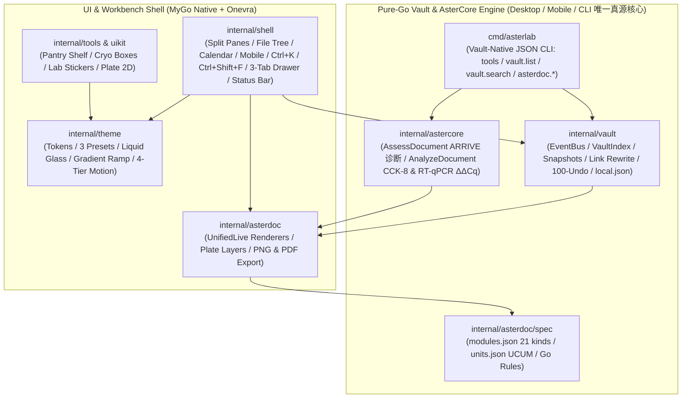

# 分层架构与代码包

AsterLab 采用「**`.asterml` 本地 Vault 单真源 × Pure-Go 统一科学核心（`astercore`）**」架构，由 MyGo Native（`mygo@v0.8.4`）与 `onevra@v0.2026.18` 驱动桌面端与移动端无 WebView 原生运行；原 Rust Core 与 SQLite 路径已正式弃用，不再参与桌面端、移动端及 CLI 的运行与分发。

## 核心架构原则：单真源与统一核心

1. **`.asterml` Vault 是唯一事实源，不引入格式级写锁**：实验文档以开放的 Markdown + YAML 围栏格式直接存于用户目录下，兼容任意文本编辑器、Git、网盘与外部 Agent 协同；任何只读或防误触保护均仅作为软件应用层的可选交互，绝不绑定到 `.asterml` 文件格式本身。
2. **本地索引只是可丢弃重建的加速层**：`.asterlab/cache/index.json` 仅承担全文检索、反向链接、全库计时聚合与跨实验查询的本地加速职责，删除或清空后不损失任何实验记录，软件可自动从 `<Vault>/**/*.asterml` 重建。
3. **Pure-Go `astercore` 统一桌面端、移动端与 CLI**：文档解析、单位校准、ARRIVE 2.0 科学诊断、CCK-8 / RT-qPCR 确定性统计以及 Vault CLI 共用同一套纯 Go 包，消除 Go/Rust 双语维护税与 `Runs.dll` 跨平台分发阻碍。

## `prototypes/mygo-run` 核心包索引

| 包路径 | 核心职责 | 关键源码入口 |
|---|---|---|
| 根目录 (`main`) | 应用启动、`asterlab://` 深度链接分发、Vault ⇄ Shell ⇄ AsterCore 状态联动与 `UnifiedLive` 宿主画布 | [main.go](../../prototypes/mygo-run/main.go)、[vault_host.go](../../prototypes/mygo-run/vault_host.go)、[experiment_page.go](../../prototypes/mygo-run/experiment_page.go) |
| `internal/vault` | 本地 Vault 初始化、事件总线、增量全文/反向链接/计时/Bases 索引缓存、File Recovery 快照、`local.json` 与 `LiveDocument` | [vault.go](../../prototypes/mygo-run/internal/vault/vault.go)、[live_doc.go](../../prototypes/mygo-run/internal/vault/live_doc.go)、[events.go](../../prototypes/mygo-run/internal/vault/events.go)、[index.go](../../prototypes/mygo-run/internal/vault/index.go) |
| `internal/astercore` | Pure Go 统一科学核心：分级结构与 ARRIVE 2.0 诊断、稀释越界拦截、CCK-8 相对活力与 RT-qPCR ΔΔCq 统计投影 | [diagnostic.go](../../prototypes/mygo-run/internal/astercore/diagnostic.go)、[analyze.go](../../prototypes/mygo-run/internal/astercore/analyze.go) |
| `cmd/asterlab` | 无头 Vault-native CLI（`--vault`），输出单行 JSON 与退出码 `0/2/3/4/5` | [cmd/asterlab/main.go](../../prototypes/mygo-run/cmd/asterlab/main.go) |
| `internal/shell` | 左 Ribbon + 文件树、平权分屏、日历、`Ctrl+K` 面板、`Ctrl+Shift+F` 全库搜索、桌面底部状态栏、三页签右抽屉与移动端单手壳 | [shell.go](../../prototypes/mygo-run/internal/shell/shell.go)、[search_modal.go](../../prototypes/mygo-run/internal/shell/search_modal.go)、[hotkeys.go](../../prototypes/mygo-run/internal/shell/hotkeys.go)、[right_drawer.go](../../prototypes/mygo-run/internal/shell/right_drawer.go)、[settings.go](../../prototypes/mygo-run/internal/shell/settings.go)、[mobile.go](../../prototypes/mygo-run/internal/shell/mobile.go) |
| `internal/theme` | 唯一通用设计 Token 源、`LiquidGlass` 材质、`CategoricalPalette` / `GradientRampColor` 科学色板、缩放字体与 `ReduceMotion` 物理动效 | [theme.go](../../prototypes/mygo-run/internal/theme/theme.go)、[motion.go](../../prototypes/mygo-run/internal/theme/motion.go) |
| `internal/asterdoc` | AsterML 解析/编译/校验、21 模块渲染器、无框输入、UCUM 显示映射 `DisplayUnit`、纯 Go 孔板 PNG 与 A4 PDF 导出 | [asterdoc.go](../../prototypes/mygo-run/internal/asterdoc/asterdoc.go)、[view.go](../../prototypes/mygo-run/internal/asterdoc/view.go)、[units.go](../../prototypes/mygo-run/internal/asterdoc/units.go)、[plate_png.go](../../prototypes/mygo-run/internal/asterdoc/plate_png.go)、[inputs.go](../../prototypes/mygo-run/internal/asterdoc/inputs.go) |
| `internal/state` | `asterlab://` URI 深度链接解析（`open` / `pantry` / `run`）与孔板坐标定位 | [deeplink.go](../../prototypes/mygo-run/internal/state/deeplink.go) |
| `internal/tools` & `uikit` | 储藏室货架、冻存盒/离心管架、NIH BioArt 贴纸生成器与 `plate@1` 2D 交互核心（含数值梯度渐变色阶） | `internal/tools/`、[plate.go](../../prototypes/mygo-run/internal/uikit/plate/plate.go)、`internal/uikit/labsticker/` |
| `modules/runs`（已弃用归档） | 原 Rust Core 历史兼容桩代码（纯 Go Vault 模式已完全替代，不构建或加载 `Runs.dll`） | [runs.go](../../prototypes/mygo-run/modules/runs/runs.go) |
