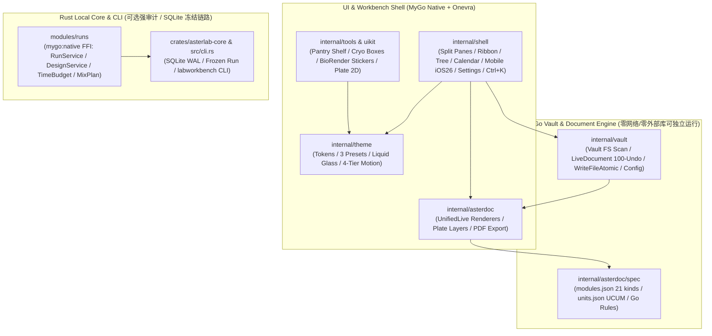

# 分层架构与代码包

AsterLab 采用「**Pure-Go 本地 Vault 工作台 × 可选 Rust Core 审计核心**」的分层架构，前端由 MyGo Native（`mygo@v0.8.4`）与 `onevra@v0.2026.18` 驱动，支持在桌面端与移动端无 WebView 原生运行。

## `prototypes/mygo-run` 核心包索引

| 包路径 | 核心职责 | 关键源码入口 |
|---|---|---|
| 根目录 (`main`) | 应用启动、窗口生命周期、Vault ↔ Shell 状态同步与设计/执行宿主页面 | [main.go](../../prototypes/mygo-run/main.go)、[vault_host.go](../../prototypes/mygo-run/vault_host.go)、[experiment_page.go](../../prototypes/mygo-run/experiment_page.go) |
| `internal/shell` | 左 Ribbon + 文件树、平权 `PaneNode` 分屏树、实验日程 Home、`Ctrl+K` 命令面板、`Ctrl+,` 设置中心、Obsidian iOS 26 移动端自适应壳 | [shell.go](../../prototypes/mygo-run/internal/shell/shell.go)、[tabs.go](../../prototypes/mygo-run/internal/shell/tabs.go)、[file_tree.go](../../prototypes/mygo-run/internal/shell/file_tree.go)、[calendar.go](../../prototypes/mygo-run/internal/shell/calendar.go)、[mobile.go](../../prototypes/mygo-run/internal/shell/mobile.go)、[settings.go](../../prototypes/mygo-run/internal/shell/settings.go)、[right_drawer.go](../../prototypes/mygo-run/internal/shell/right_drawer.go)、[command_palette.go](../../prototypes/mygo-run/internal/shell/command_palette.go) |
| `internal/theme` | 唯一通用设计 Token 源（`Obsidian` / `Zinc` / `Warm`）、`LiquidGlass` 材质辅助器、科学分类 8 色板与 4 档物理动效 | [theme.go](../../prototypes/mygo-run/internal/theme/theme.go)、[motion.go](../../prototypes/mygo-run/internal/theme/motion.go) |
| `internal/vault` | 本地 Vault 根目录初始化、目录树扫描、模板孵化、软删除回收站与多窗格共享 `LiveDocument` | [vault.go](../../prototypes/mygo-run/internal/vault/vault.go)、[live_doc.go](../../prototypes/mygo-run/internal/vault/live_doc.go) |
| `internal/asterdoc` | AsterML 解析/编译/校验、21 模块渲染器、无框文本输入、公式求值、孔板写回与 A4 PDF 导出 | [asterdoc.go](../../prototypes/mygo-run/internal/asterdoc/asterdoc.go)、[view.go](../../prototypes/mygo-run/internal/asterdoc/view.go)、[widget_tables.go](../../prototypes/mygo-run/internal/asterdoc/widget_tables.go)、[widget_ops.go](../../prototypes/mygo-run/internal/asterdoc/widget_ops.go)、[widget_figure.go](../../prototypes/mygo-run/internal/asterdoc/widget_figure.go)、[plate_ops.go](../../prototypes/mygo-run/internal/asterdoc/plate_ops.go)、[inputs.go](../../prototypes/mygo-run/internal/asterdoc/inputs.go)、[pdf_sheet.go](../../prototypes/mygo-run/internal/asterdoc/pdf_sheet.go) |
| `internal/tools` | 储藏室货架、9×9 冻存盒与离心管架网格、独立配液速算台、孔板 Studio 与 SOP 库 | [pantry_shelf.go](../../prototypes/mygo-run/internal/tools/pantry_shelf.go)、[pantry_boxes.go](../../prototypes/mygo-run/internal/tools/pantry_boxes.go)、[bench_calc.go](../../prototypes/mygo-run/internal/tools/bench_calc.go)、[plate_studio.go](../../prototypes/mygo-run/internal/tools/plate_studio.go) |
| `internal/uikit` | 跨表面复用的孔板 2D 交互核心（`plate`）与 NIH BioArt + EDT 白边贴纸生成器（`labsticker`） | `internal/uikit/plate/`、`internal/uikit/labsticker/` |
| `modules/runs` | Go ⇄ Rust `mygo:native` 自动生成绑定，暴露 Run/Design/TimeBudget/MixPlan 原生接口 | [runs.go](../../prototypes/mygo-run/modules/runs/runs.go)、[runs_native.go](../../prototypes/mygo-run/modules/runs/runs_native.go) |
