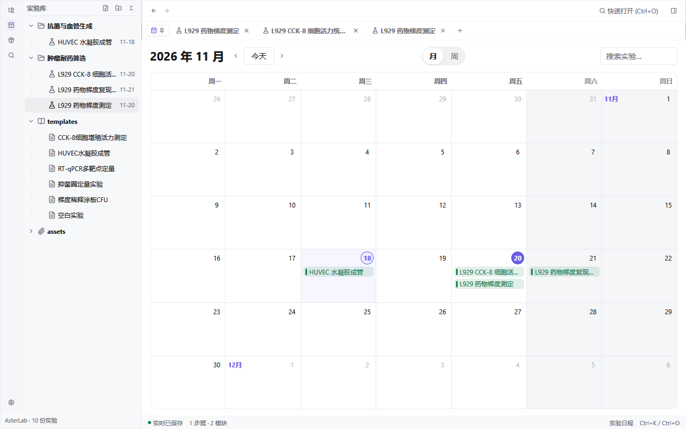
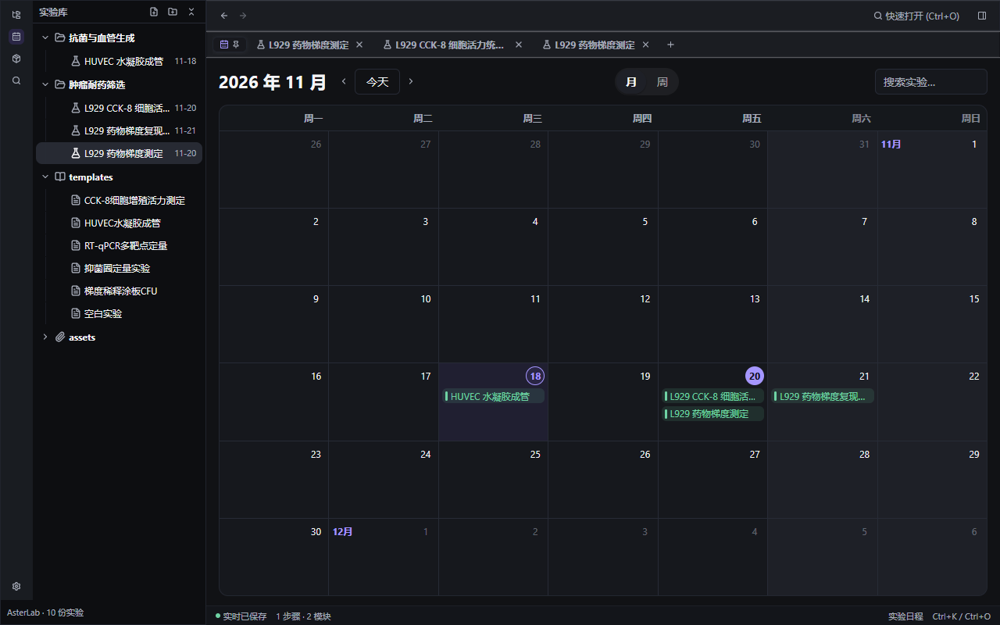
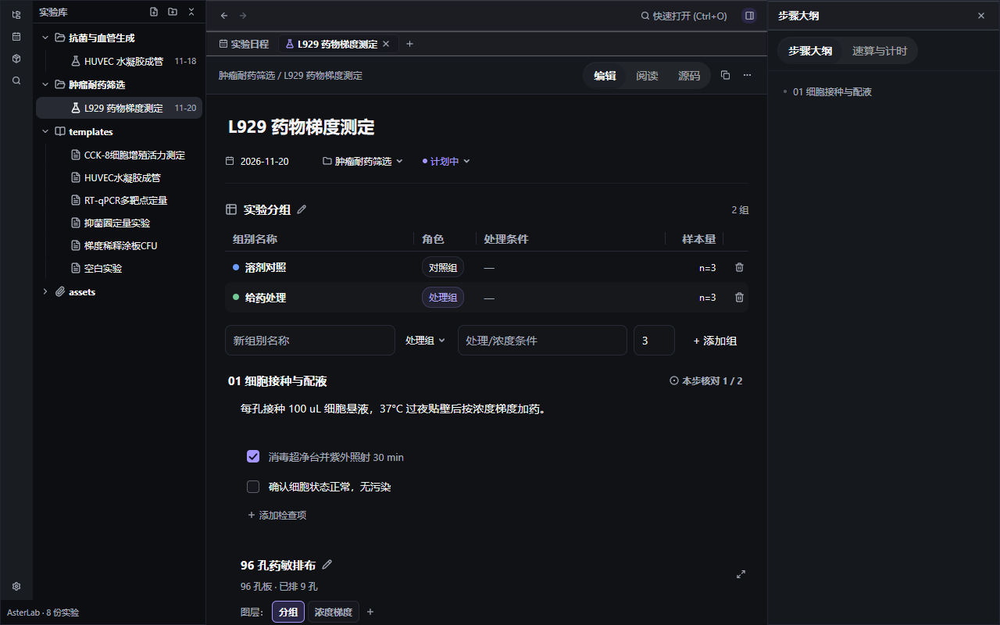
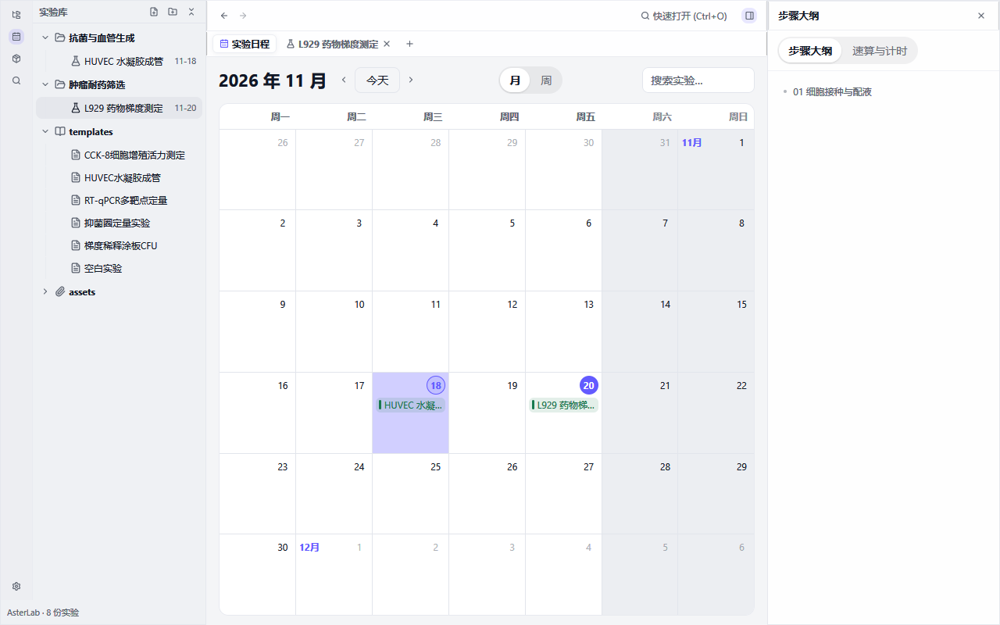
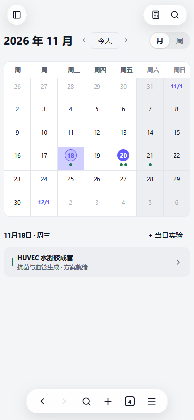

# Liquid Glass 材质与对比度规范

AsterLab 基于 `mygo/plugins/glass` 为顶栏、移动端悬浮胶囊、命令面板与侧滑抽屉提供 Liquid Glass 物理材质，但严格约束浅色与深色模式下的着墨参数，彻底消除早期深色模式透底发灰与文字重影问题。

## Light vs Dark 渲染参数矩阵

定义位于 [theme.go#L196-L274](../../prototypes/mygo-run/internal/theme/theme.go#L196-L274)：

| 表面位置 | Light 模式参数 | Dark 模式参数 | 物理原理说明 |
|---|---|---|---|
| **顶栏 (`ApplyChromeGlass`)** | `glass.Regular` · `Tint: tok.Surface.Alpha(0.76)` | `glass.Clear` · `Tint: RGBA(20, 22, 28, 0.86)` | 浅色保留通透白雾；深色绕过 `glass.Regular` 高亮度抬灰通道 |
| **移动端悬浮胶囊 (`ApplyCapsuleGlass`)** | `glass.Regular` · `Tint: tok.Surface.Alpha(0.76)` + `Border(1, Surface.Alpha(0.95))` + `Shadow(0, 8, 28)` | `glass.Clear` · `Tint: RGBA(24, 26, 33, 0.84)` + `Border(1, RGBA(255, 255, 255, 0.14))` + `Shadow(0, 10, 30)` | 深色采用 84% 烟熏曜石遮罩搭配 14% 亮银内高光边，保证底层亮色孔位透出时不刺眼、前景纯白图标清晰可读 |
| **抽屉与浮层 (`ApplyPanelGlass`)** | `glass.Regular` · `Tint: tok.Surface.Alpha(0.86)` | `glass.Clear` · `Tint: RGBA(20, 22, 28, 0.92)` | 92% 烟熏深灰保证长列表文字与按钮绝对可读 |

## 两项强制禁令

1. **禁止 Glass-on-Glass 多层玻璃叠加**：桌面端左侧导航栏、文件树与主编辑区全部采用纯实底（`tok.RailBackground` / `tok.Canvas`），仅在顶栏与浮动控制层启用玻璃材质。
2. **禁止在暗黑模式直接套用无深色遮罩的 `glass.Regular`**：`glass.Regular` 在暗色调下内置的提亮折射曲线与高饱和度参数会把深灰背景抬成浑浊中灰并涂抹底层色彩。

## 多主题与深浅色 Liquid Glass 实拍对照

| 默认纯白 Light（顶栏浅色半透明质感） | 深空曜石 Dark（日历与烟熏 `glass.Clear` 胶囊） |
|---|---|
|  |  |

| 深空曜石 Dark 实验文档页 | 冷银 Zinc Light 桌面端 | 冷银 Zinc Light 移动端 |
|---|---|---|
|  |  |  |
