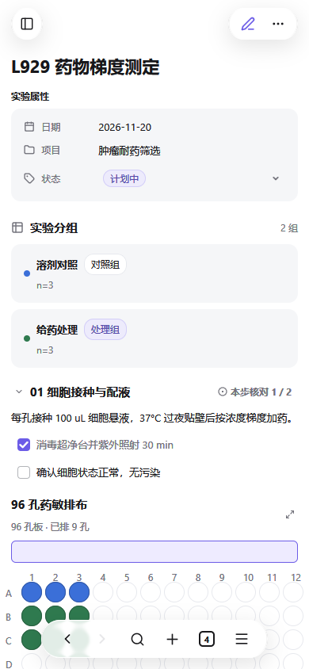
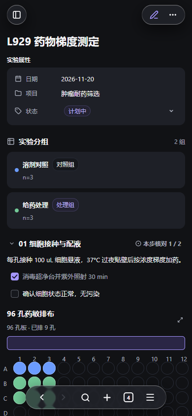
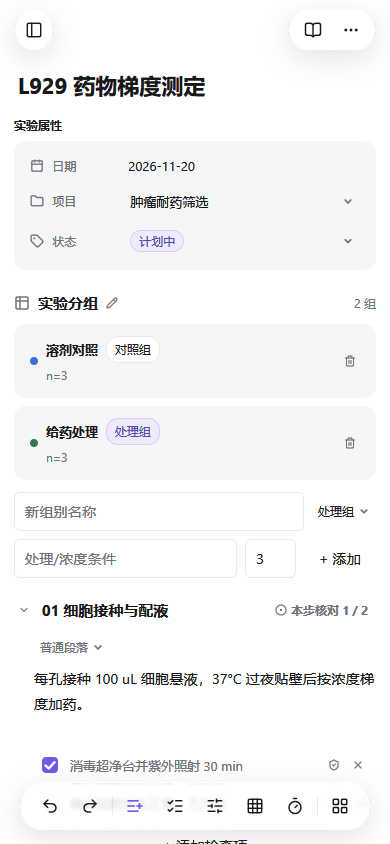
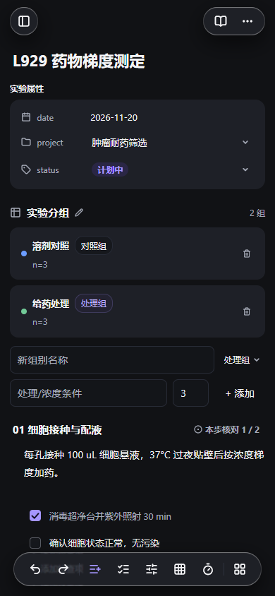
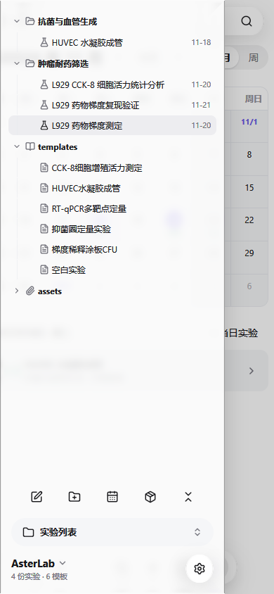
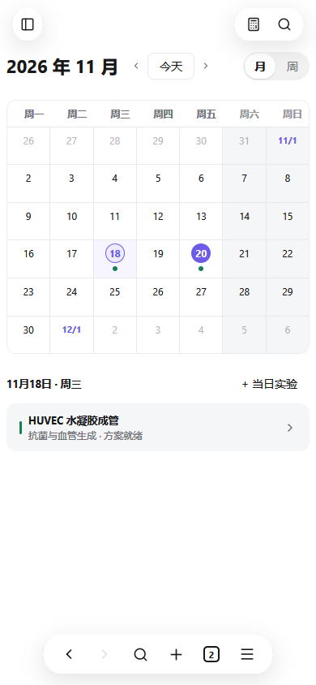
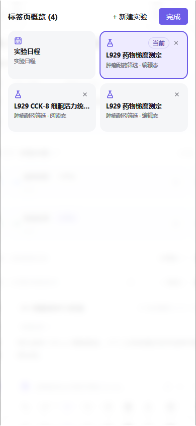

# Obsidian iOS 26 移动端自适应壳

当视口宽度 `< 680dp`、运行于 `android` / `ios`，或用户在设置中开启移动预览模式时，[mobile.go](../../prototypes/mygo-run/internal/shell/mobile.go) 自动切换至对齐 **Obsidian iOS 26** 的单手触控布局。

## 核心人机工程规则

1. **顶部视觉中心留白（Open-Center Top Chrome）**
   - 取消桌面整条横幅栏与文字堆砌，顶部改用 `ScrollEdgeSoft` 柔和羽化滚动内容。
   - 左上角仅悬浮一枚 `40×40` 圆形独立玻璃抽屉钮，右上角仅收拢一枚双图标合并玻璃药丸（文档页为 `[编辑/阅读切态 | ⋯]`，日程页为 `[速算 | 搜索]`），文档大标题自然落在正文首行。
2. **以纯图标取代底栏文字说明**
   - **导航态底部胶囊**：居中悬浮 `48dp` 高（圆角 `24`）Liquid Glass 胶囊，仅安置 6 枚细线图标 **`< · > · 🔍 · + · [N] · ≡`**。
   - **向下滚动自动隐匿**：页面向下滑动 `curY > 36dp` 且偏移 `dy > 6` 时自动平滑收起到底部；反向轻拉 `dy < -4` 或滚动至顶部（`curY <= 12`）或轻触底部提示条立即弹回。
   - **编辑态底浮条**：进入编辑模式后自动平滑变形为同尺度居中纯图标工具条（`↶ ↷ | +步骤 ☑ ⊞ ⬡ ⏱ | ⊞` 切回导航）。
3. **无边框 `Tok.Elevated` 信息卡**
   - 文档前置属性与窄屏 `group_table` 全部渲染为无 1px 外边框的 `Tok.Elevated`（`#f5f6f8` / `#1e2027`）`R14` 软灰卡片，靠柔和背景差而非线条区隔信息层次。
   - 移动端月历网格每格紧凑显示日期与状态圆点，月初首日使用紧凑格式 `11/1`、`12/1`。
4. **边缘跟手侧滑抽屉与三层底部控制岛**
   - 屏幕左右各留 `18dp` 边缘触发热区（`mobileEdgeSwipeZoneWidth = 18`），通过 `Dragged()` 与 `DragVelocity()` 1:1 跟手拉出左文件库（最高宽度 `320dp`）或右大纲/速算抽屉。
   - 文件库抽屉底部复刻 Obsidian 三层控制岛：5 枚纯图标动作按钮 → `[📁 文件列表 ↕]` 模式切换胶囊 → 左下 `Vault / 文件与目录统计` 配右下独立 `40dp` 圆形玻璃 `⚙` 设置按钮。
5. **页签卡片网格概览与阻尼下拉快捷动作**
   - 点击底部 `[N]` 图标弹起双列卡片网格概览，支持单卡点击切换与右上 `×` 关闭。
   - 在页面顶部继续阻尼下拉超过 `56dp`（`mobilePullActionThresh = 56`）触发用户自定义快捷动作（默认唤出命令面板，可在设置中改为「新建今日实验」「速算与计时器」或「展开实验库」）。

## 移动端全流程实拍对比

| 移动端阅读态（Obsidian Light） | 移动端阅读态（Obsidian Dark） | 移动端编辑态底条（Light） | 移动端编辑态底条（Dark） |
|---|---|---|---|
|  |  |  |  |

| 侧滑文件树抽屉与三层底岛 | 移动端实验日程月历与当日卡片 | `[N]` 双列标签页卡片概览 |
|---|---|---|
|  |  |  |
