# 第一层：通用内容模块（11 种）

第一层通用内容模块直接嵌入 `step@1.blocks[]` 或文档正文中，在「编辑」与「阅读」双态共用无外框编辑器与单真源交互控件。以下逐一列出各模块职责与当前真实渲染效果。

## 文本、分组与条件参数

- **`prose@1`（富文本与提示卡）**：承载实验背景、注意事项或安全警告（`tone: plain | note | tip | warning`），正文保持无多余边框。
- **`group_table@1`（实验分组表）**：声明组别 ID、对照角色（`control` / `treatment` / `comparator` / `reference`）、处理条件、独立样本量 `independent_n` 与重复数。移动端窄屏自动切换为无截断行卡片。
- **`param_table@1`（实验条件与偏离录入）**：默认标题「实验条件」；每条参数支持 `value/unit` 计划值与原位点按「记偏离」录入 `actual` 实测值，并向 `@actual.<key>` 暴露引用。
- **`figure@1`（矢量与实拍图）**：支持内联矢量 `<svg>`（完整 `<g transform>` 坐标栈）或 `./assets/` 照片；支持 `Ctrl+V` 贴图与灯箱缩放。

| `prose@1` | `group_table@1` | `param_table@1` | `figure@1` |
|---|---|---|---|
| 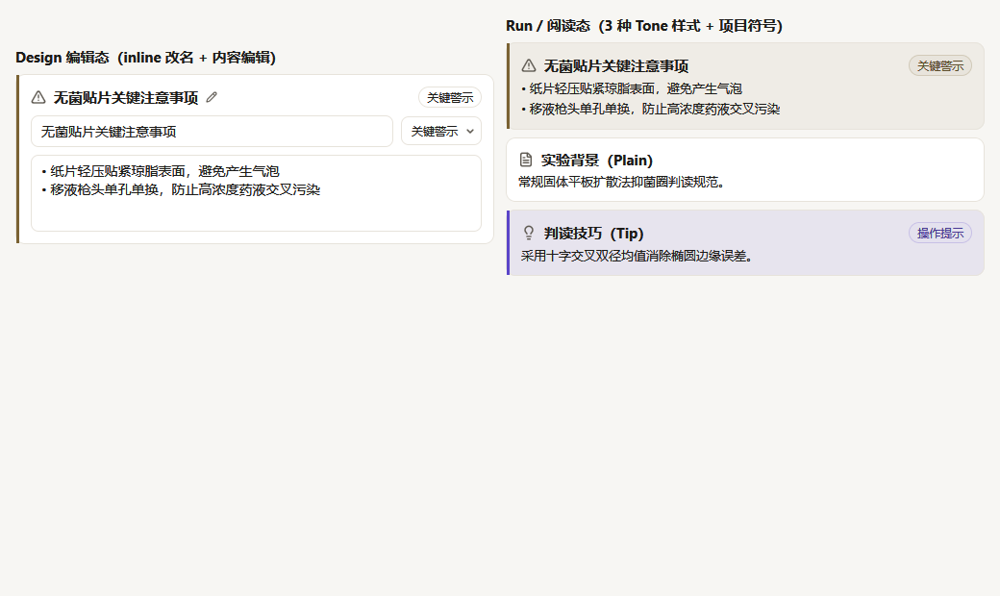 | 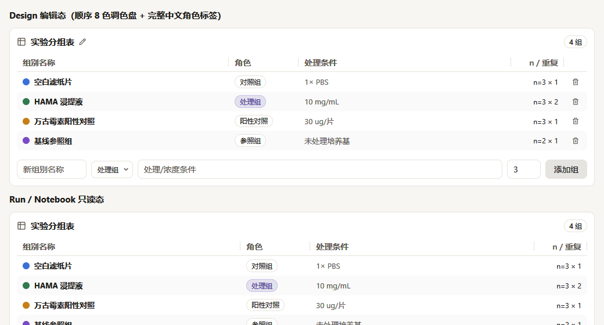 | 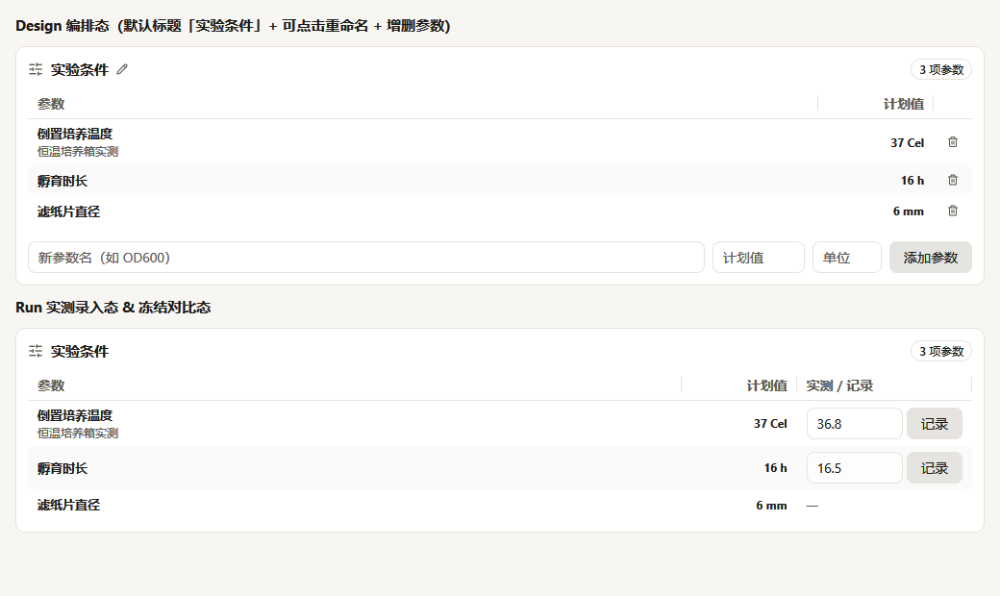 | 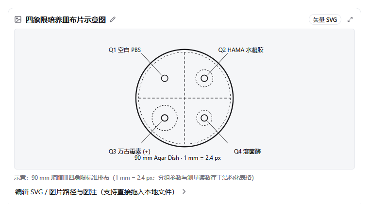 |

## 数据表、检查清单与计算器

- **`data_table@1`（数据表与 2D 孔板矩阵）**：支持 `text`、`number`、`categorical`、`formula` 列类型，配置 `min/max` 质控范围标黄高亮；支持绑定 `source_ref`（`@groups` / `@plate.<id>`）与整板二维 TSV/CSV 一键粘贴导入。
- **`checklist@1`（双态操作检查）**：在编辑态与阅读态均可点击勾选 `done`，支持必检标记与基于表达式的 `skip_rule` 规则豁免。
- **`calculator@1`（配液与稀释计算器）**：统一处理 `dilution`（单步稀释）、`serial_dilution`（梯度稀释）、`group_mastermix`（按组配平）、`sample_normalize`（浓度归一）与 `formula`（自定义公式），支持绑定 `@plate.wells` 与 `@param.<key>` 动态重算。

| `data_table@1` | `checklist@1` | `calculator@1` 稀释与梯度 | `calculator@1` 配平与公式 |
|---|---|---|---|
| 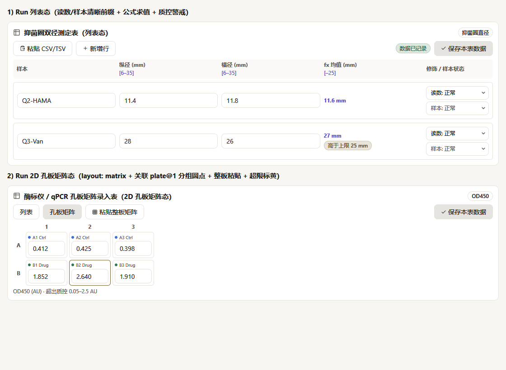 | 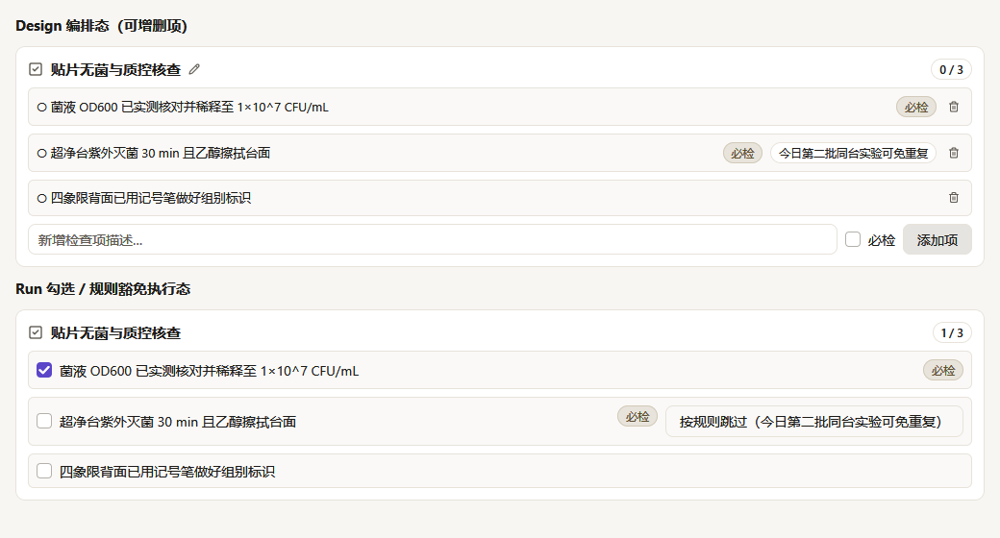 | 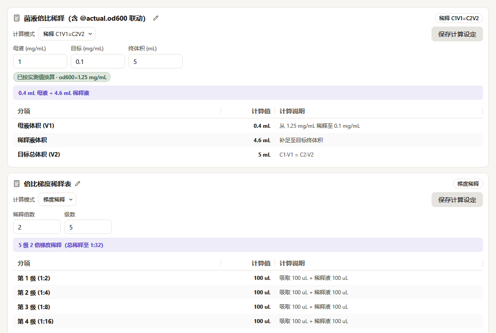 | 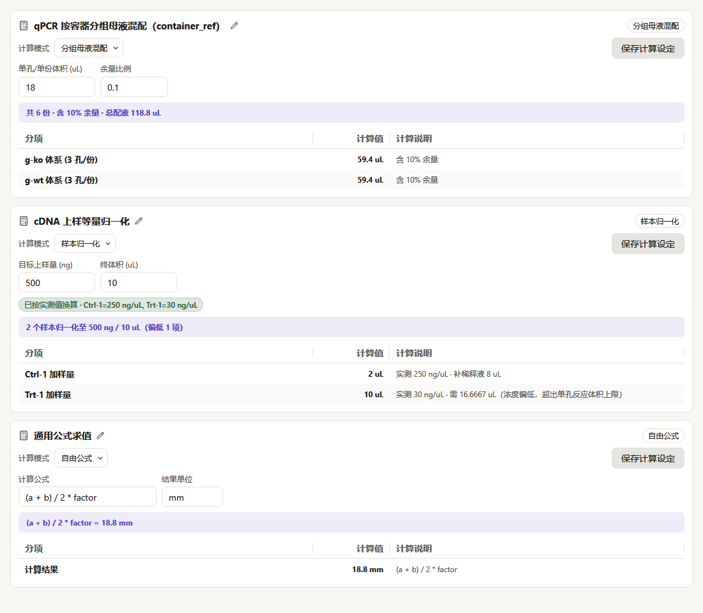 |

## 计时器、附件与折叠子流程

- **`timer@1`（四态计时器）**：提供 `countdown`（倒计时）、`stopwatch`（秒表）、`cycle`（循环阶段）与 `window`（时间窗）四种模式；`▶ / ⏸ / ↺` 操作实时更新内联 `status` 与 `elapsed_sec` 并原子落盘。
- **`attachment@1`（步骤附件与孔位采图网）**：挂载 `./assets/` 照片证据、对应 `design_ref`，并提供按容器孔位跟踪采图完成进度的 `container_grid`。
- **`subflow@1`（折叠子流程）**：在步骤内收纳多步细碎子操作，支持内联展开、增删条目与逐条勾检。

| `timer@1` 四种模式 | `attachment@1` 证据与孔位采图 | `subflow@1` 折叠子流程 |
|---|---|---|
| 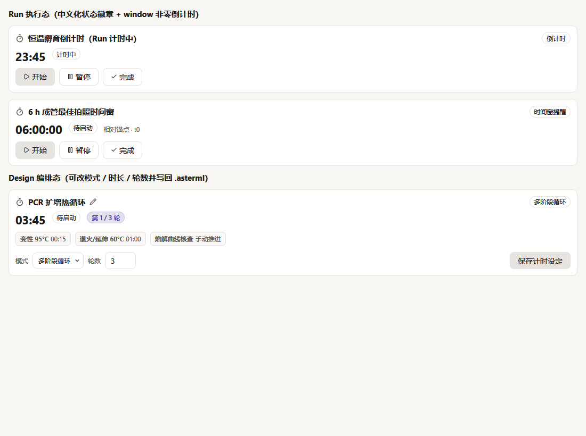 | 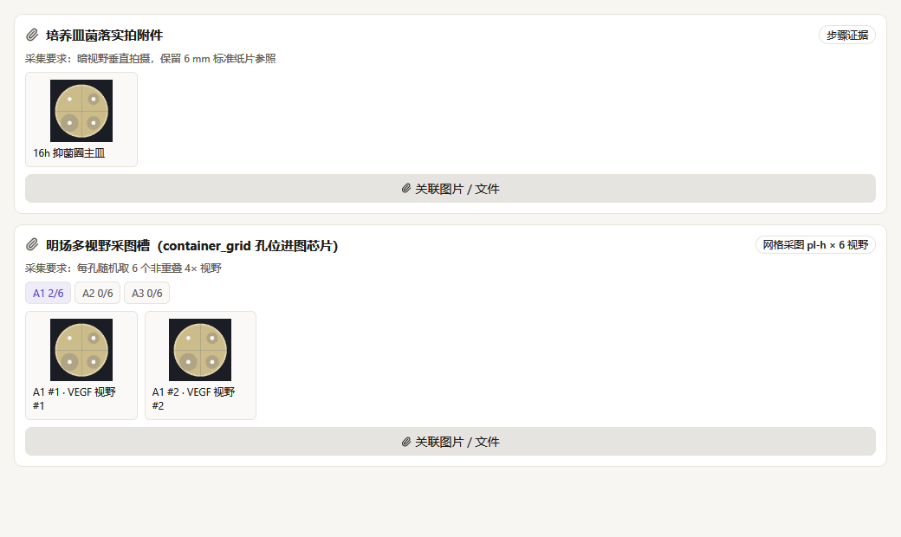 | 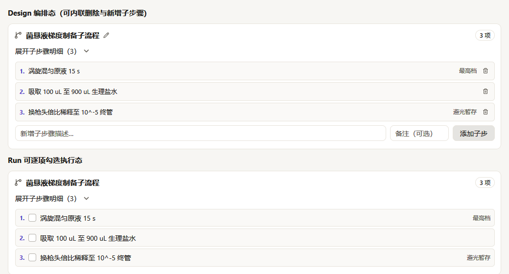 |
