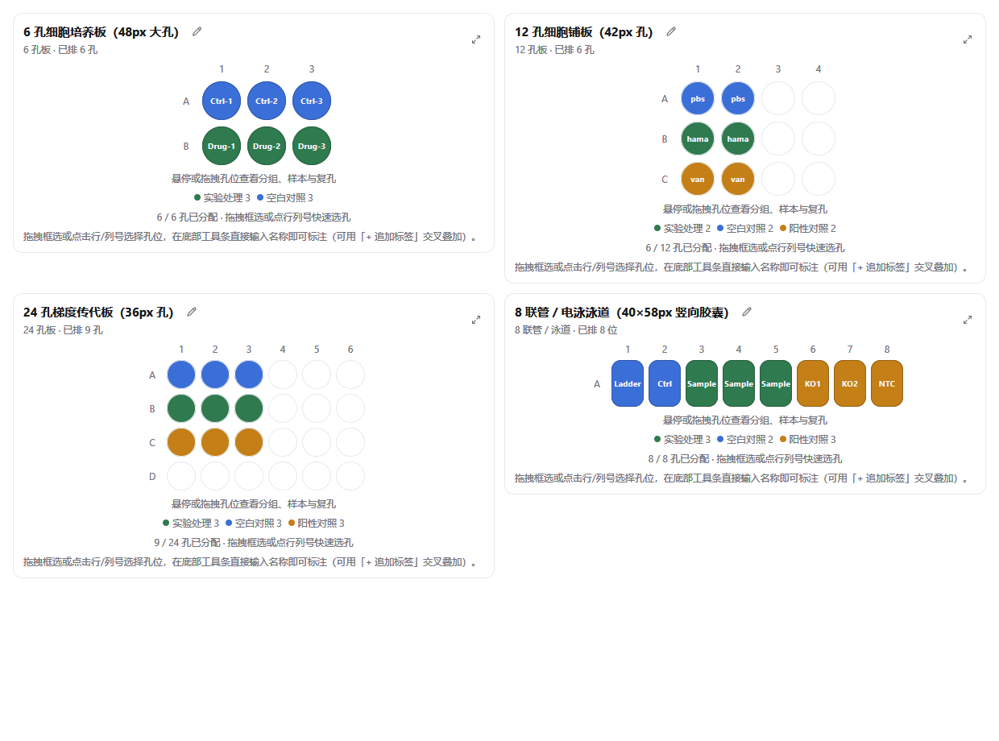
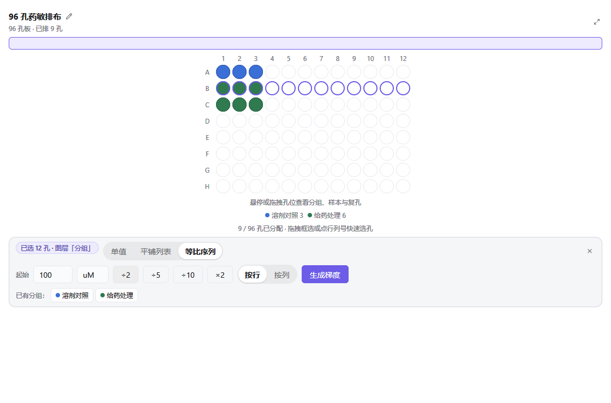
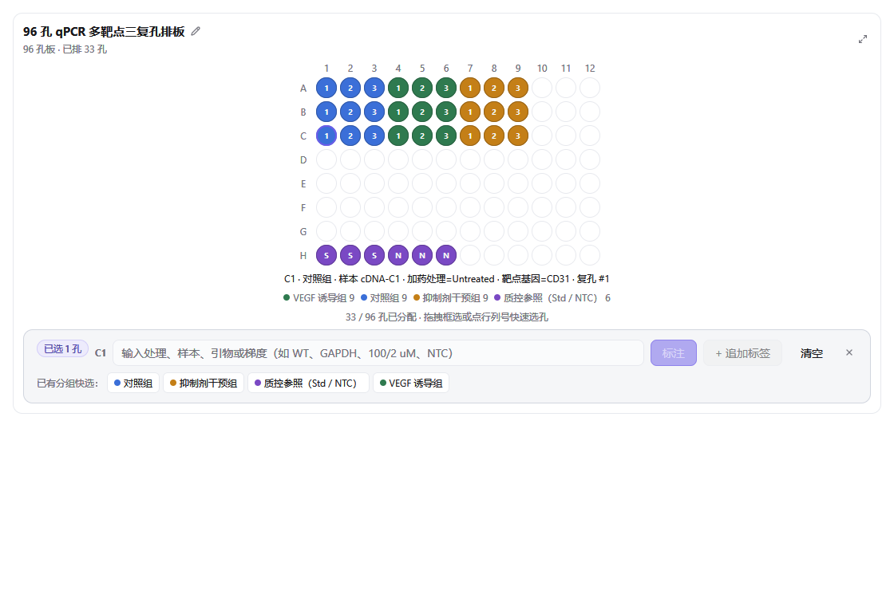
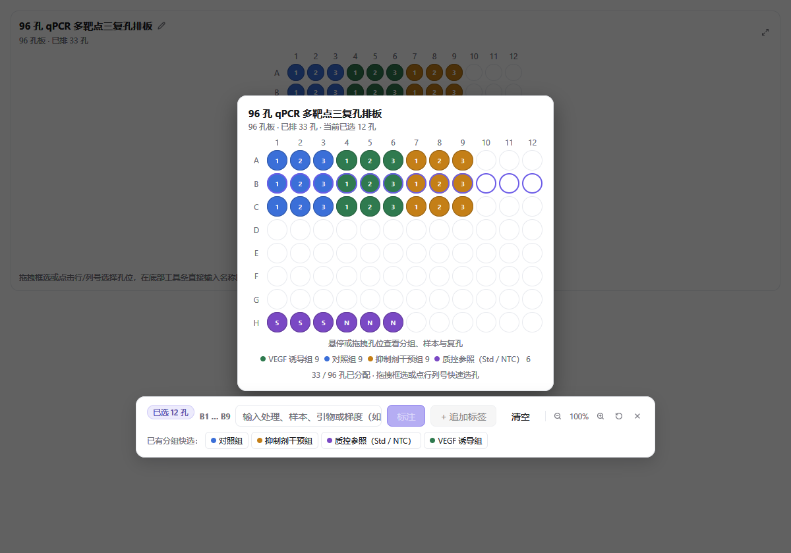
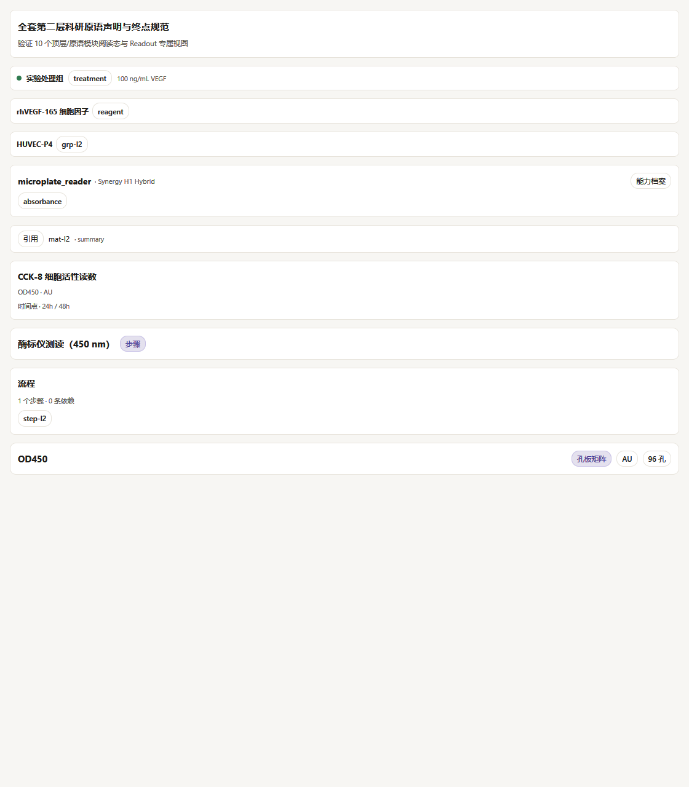
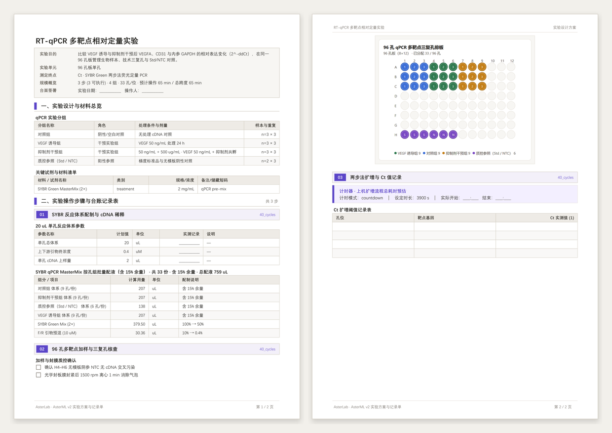
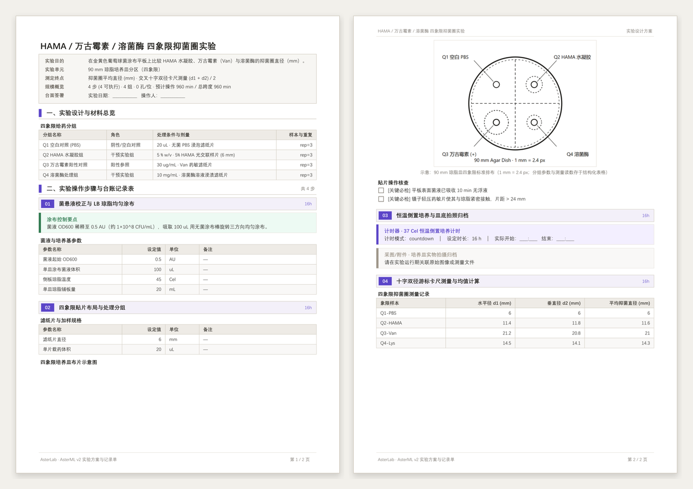
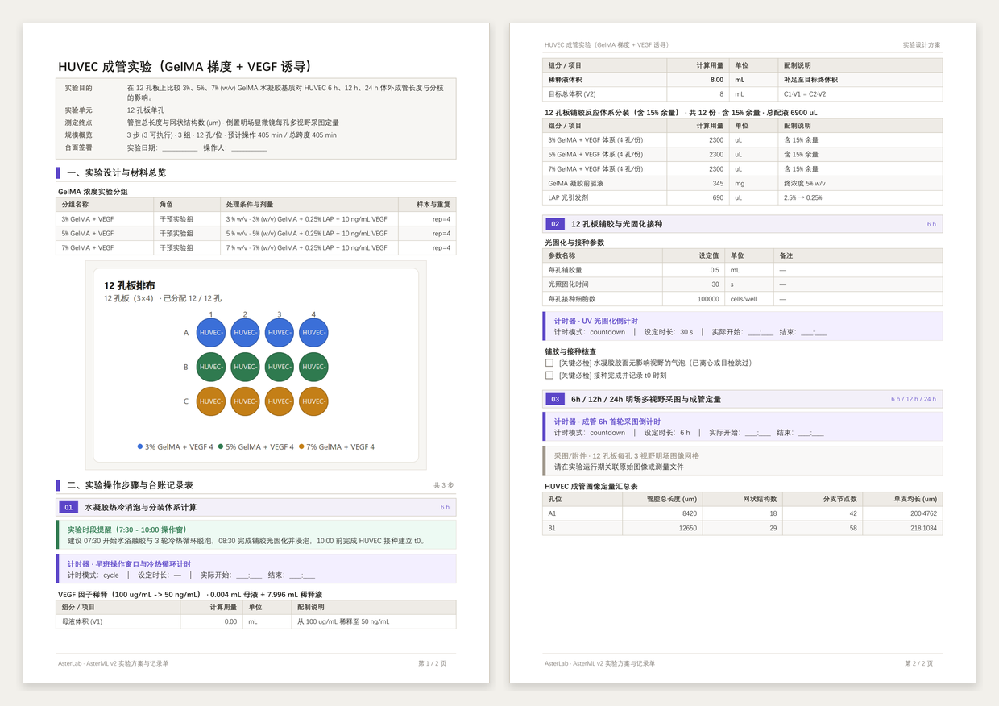
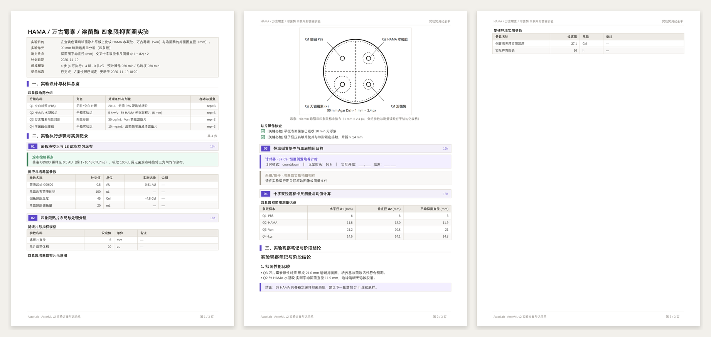

# 容器 `plate@1`、第二层原语与 A4 PDF

本节覆盖实验容器几何模块 `plate@1`、第二层 10 种结构化科学原语，以及从单真源文档直接生成的实验室 A4 纸质执行单。

## 容器原语：`plate@1`

`plate@1` 是全项目唯一的容器标注组件，统一服务于文档内联编排、独立孔板 Studio 与储藏室盒位视图：

- **多拓扑几何支持**：通过 `format`（`4/6/12/24/48/96/384`）与 `topology`（`plate` / `rack_1d` / `dish` / `cohort`）覆盖孔板、1D 离心管架或电泳泳道（编号 `1..N`）、培养皿分区及动物分组队列。
- **多层实验因子（`layers` / `factors`）**：顶部药丸栏支持一键切换 `[分组]` 视图、任意多维因子图层或点击 `[+]` 新建图层。
- **批量填充条与选区操作**：圈选任意连续或跳选孔位后，底部托出动作条，支持 `单值`、`平铺列表` 与 `等比序列`（按倍数递减）批量写入，同时支持标记 `excluded_wells` 排除孔及右键导出 CSV/PNG。

| 6 / 12 / 24 孔板与 1D 管架 | 96 孔板多图层 + 序列填充条 |
|---|---|
|  |  |

| 96 孔板标准视图 | 孔板灯箱展开浮条与图层切换 |
|---|---|
|  |  |

## 第二层科学原语（10 种）

第二层原语描述宏观实验实体与引用关联：

- **流程结构**：`experiment@1`、`group@1`、`assay@1`、`workflow@1`、`step@1`
- **资源与证据**：`instrument_profile@1`（仪器档案）、`material@1`（试剂与储藏室 `pantry_code` 坐标跳转）、`sample@1`（生物样本）、`reference@1`（文献依据）、`readout@1`（结构化结果与 `readout.viewer` 卡片）

| 第二层 10 类科学原语卡片总览 |
|---|
|  |

## A4 纸质执行单与归档 PDF 导出

`internal/asterdoc/pdf_sheet.go` 可将任意 `.asterml` 文档导出为实验台打印就绪的 A4 PDF 执行单或 Run 记录归档，排版保留孔板色彩图例、勾选框、实测偏离留白与二维码/编号锚点。

| RT-qPCR 384 实验台执行单 | 抑菌圈方案执行单 |
|---|---|
|  |  |

| HUVEC 血管生成方案单 | 抑菌圈 Run 实测记录归档 |
|---|---|
|  |  |
