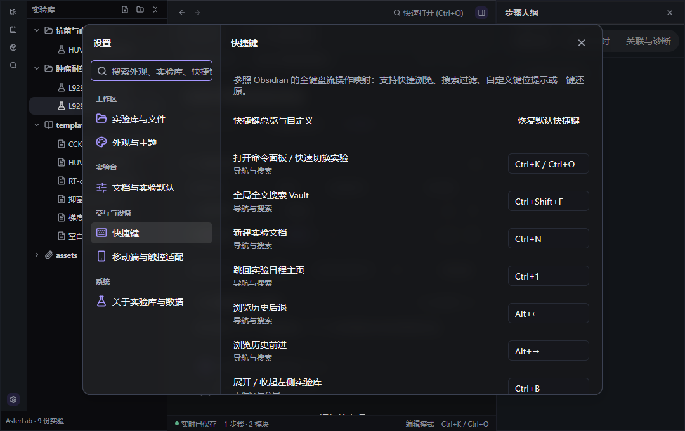

# 自动化校验门禁与已知优化热点

本页汇总日常修改代码与调整 UI 样式后的必跑校验门禁，以及当前代码库中已确认存在、可在后续迭代立项解决的已知优化点。

## 必跑自动化门禁命令

### 1. AsterML v2 双端契约 Parity 校验

```powershell
python scripts/sdk/check.py
```

校验 `modules.json` 清单（21 模块 / 21 kind / `sdk 2.0.0`）、Go 注册一致、规则与端口对齐以及 Go/Rust 双端 parity。

### 2. 全量 Go 单元测试、构建与视觉目录截图刷新

```powershell
$env:ASTERLAB_VISUAL_DIR = "$PWD\docs\sdk\evidence\v2-visual-catalog"
Push-Location prototypes/mygo-run
go test -p=2 -count=1 ./internal/...
go test -p=2 -count=1 .
go build
Pop-Location
```

### 3. Design System 调用点合规扫描

```powershell
rg -n "ui\.Hex\(" prototypes/mygo-run --include=*.go | rg -v "internal/theme/"
rg -n "FontSize\([0-9]" prototypes/mygo-run --include=*.go
```

## 当前已知差距与待优化热点

*(涉及立项排期时须按仓库规则先在 Kandev 建卡，此处只记录代码现状与实图证据：)*

| 热点类别 | 对应源码 / 证据 | 现状描述与优化方向 |
|---|---|---|
| **移动端无原生库降级报错** | [main.go#L4584-L4613](../../prototypes/mygo-run/main.go#L4584-L4613) | 启动缺少 `Runs.dll` / `libRuns.so` 时仍会给 `a.syncErr` 赋值并显示错误条；后续应明确区分「纯 Go Vault 独立模式」与「Core 服务连接异常」。 |
| **双端同步冲突合并 UI** | [live_doc.go#L195-L220](../../prototypes/mygo-run/internal/vault/live_doc.go#L195-L220) | 已有 `ReloadIfExternalChanged()` 基础检测，但尚未接入定时/聚焦轮询触发、基于 `step.id`/`block.id` 的三路结构化合并及 `*.conflict-*.asterml` 冲突对比视图。 |
| **Dark 模态弹窗底色透射** | [settings.go](../../prototypes/mygo-run/internal/shell/settings.go) · `onevra/components/dialog` | 快捷键等弹窗复用上游 `components.Dialog` 的浅色毛玻璃与低不透明度遮罩，在 Dark 模式下会导致底层高对比文本透射出重影（见下方证据图）；需外垫深色 scrim 或收敛 Dark 弹窗材质。 |
| **历史遗留包 Token 债务** | [docs/product/design-system.md](../product/design-system.md) | `UnifiedLive` 新文档路径与 `shell`/`theme` 已收口 `TokensFor`，但遗留包（`internal/runui`、`internal/runworkspace`、`internal/resultgrid` 等）仍保留历史字面值尺寸与色值基线待分批清理。 |
| **真机软键盘 Inset 与真长按** | [mobile.go](../../prototypes/mygo-run/internal/shell/mobile.go) | 编辑底条当前依靠 `ModeEdit` 状态手动切换；待 `mygo/ui` 对 Android/iOS 暴露虚拟键盘安全区高度与原生 `OnLongPress` 回调后，即可自动将编辑工具条抬升至键盘上沿并补全长按菜单。 |
| **移动端 390px 周时间网格** | [calendar.go](../../prototypes/mygo-run/internal/shell/calendar.go) | 月视图已针对窄屏紧凑优化，但 `renderAppleWeekTimeGrid` 七列周网格在 390px 屏宽下的横向排布密度仍有压缩与滑动优化空间。 |

### Dark 模态弹窗底色透射证据图


