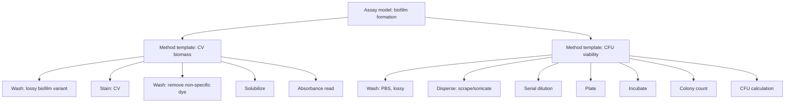

# 粒度与生物膜:什么能作为独立操作

- 日期:2026-11-05
- 状态:研究判断;不新增运行时,不把任何记录升级为 `SourceChecked`
- 依据:[record-standard](../record-standard.md)、[biofilm-cv-cfu.md](biofilm-cv-cfu.md)、O'Toole 2011、Merritt 2005、ASM serial dilution
- 结论:生物膜不能作为一个单独的 `OperationModule`;它是一个 Assay/方法族。只有其中的原子动作(接种、孵育、洗涤、吸光度读取等)可复用。

## 1. 判定一个对象能否单独当操作

采用 [record-standard §1.1](../record-standard.md#11-粒度判定先决定它是不是一个操作) 的五条:

1. 一个主要动作。
2. 一个主要对象变化。
3. 一个完成状态。
4. 跨方法可复用。
5. 边界可封闭。

`biofilm` 同时违反 1、2、3、4:它包含培养、洗涤、染色、溶解、读数,或分散、稀释、铺板、培养、计数;不同菌种/培养基/终点含义不同;完成条件不止一个。因此它是 `assay_model` / `method_template`,不是 `atomic_operation`。

## 2. 生物膜的拆分

### 2.1 可作为独立/变体操作的

| 对象 | 类型 | 理由 | 备注 |
|---|---|---|---|
| 液体转移 | atomic operation | 单一转移动作 | 需要 `transfer_mode` 条件(已做) |
| 孵育/培养保持 | atomic operation | 单一受控保持 | 生物膜培养还需要“表面附着”条件,不能只靠时间 |
| 洗涤 | atomic operation, but loss policy | 单一液体交换动作 | 生物膜洗涤必须是 lossy variant,不能复用“样本不丢失”的默认 |
| 吸光度读取 | atomic operation | 单一测量动作 | 只输出原始 OD;CV 解释属于方法模板 |
| 接种/铺板 | atomic operation/composite variant | 单一分配动作;多孔分配可组合 | 生物膜培养中的接种是其中一步 |
| 离心 | atomic operation | 单一分离动作 | 不应把“取上清”自动算入同一步 |
| 菌落计数 | atomic operation(读数) | 单一计数动作 | 需要图像/人工计数规则,但不等于 CFU 计算 |

### 2.2 不能作为独立操作的

| 对象 | 类型 | 不能单独的原因 |
|---|---|---|
| `biofilm` | assay model | 没有单一动作/完成状态;CV 与 CFU 是不同 measurand |
| `OP-BIOFILM-STATIC-CULTURE` | composite block / method phase | 接种 + 孵育 + 可选换液;含附着/浮游两个 fractions |
| `OP-CV-BIOMASS` | method template | 洗涤 + 染色 + 洗涤 + 溶解 + 读板;CV 染色总生物量,不等于活菌 |
| `OP-CFU-DILUTION-PLATE` | method template | 洗涤 + 分散 + 稀释 + 铺板 + 培养 + 计数 + CFU 计算 |
| `OP-BIOFILM-DISPERSAL` | composite/device-dependent step | 刮取/超声/涡旋等机械组合;需要 kill-control 和 detachment check |
| `OP-BIOFILM-WASH` | lossy washing variant, not generic operation | 它主动丢弃浮游 fraction,并可能带走弱附着生物膜;不能作为通用 washing |
| `OP-CV-BIOMASS` 的“染色”子步 | method-specific operation? | 可以作为 `stain` 原子操作的研究对象,但 CV 浓度/时间/溶剂是方法参数,不是通用默认 |

## 3. 为什么不能把生物膜做成一个 JSON 模块

1. **输入/输出不唯一**:CV 的输入是已洗涤附着生物膜,输出是染色/溶解后的终端样本 + OD;CFU 的输入是分散悬液,输出是菌落板 + CFU 计算。
2. **对象变化不唯一**:培养产生 attached + planktonic 两个 fraction;CV 是总生物量染料结合;CFU 是可培养活菌。一个 `SampleEffect` 无法诚实概括。
3. **完成条件不唯一**:CV 完成于读板;CFU 完成于计数落在 30–300 的板;培养只是中间保持。
4. **方法和仪器混合**:CV 依赖读板机;CFU 依赖培养箱、涡旋/超声、计数器;不是一个 `InstrumentRequirement`。
5. **变体必须保留**:不同菌种、培养基、CV 溶剂、超声能量、稀释窗口。一个模块会把变体压成自由文本。

## 4. 应该怎样落库/落 JSON

| 层 | 生物膜相关对象 | 处理 |
|---|---|---|
| Design | 研究问题:比较材料对生物膜形成/活菌的影响 | Assay 条目,不是 OperationModule |
| Protocol / Method template | `biofilm_cv`、`biofilm_cfu` | 组合多个 `BlockUse`;参数绑定方法差异;不是单一模块 |
| Atomic operations | 接种、孵育、lossy wash、CV stain、solubilize、absorbance read、disperse、dilute、plate、colony count | 分别记录/编号;可复用 |
| Run | 实际菌种、板、时间、超声能量、原始 OD/菌落图 | 实测值,不回写方法默认 |

生物膜 CV 与 CFU **不能合并成一个“biofilm assay”模块**;它们可以共享“培养/洗涤”子步骤,但必须保留不同方法模板和不同 readout。

## 5. 对现有记录的修订建议

| 现有记录 | 建议 |
|---|---|
| `OP-BIOFILM-STATIC-CULTURE` | 标为 `composite_block`/`method phase`,不生成 OperationModule;拆成接种 + 孵育 + 可选换液 |
| `OP-BIOFILM-WASH` | 标为 `lossy washing variant`;不要复用通用 washing;需要“样本损失/浮游去除”语义 |
| `OP-CV-BIOMASS` | 标为 `method_template`;拆成 wash/stain/wash/solubilize/absorbance;CV 解释留在方法层 |
| `OP-BIOFILM-DISPERSAL` | 标为 `composite_block`;设备/能量/时间必须绑定;kill-control 是前置门 |
| `OP-CFU-DILUTION-PLATE` | 标为 `method_template`;拆成 disperse/dilute/plate/incubate/count/CFU;计数窗口 30–300 保留 |

## 6. 契约缺口

1. **附着/浮游 fraction**:当前 `SampleEffect` 没有“同一容器内两个 fraction”的类型;需要方法层表达,不能塞进一个 effect。
2. **lossy wash**:当前 `washing` 用 `state_changed`,但不能表达“样本损失量可能 >0”;需要未来的 loss/quantity 字段或方法层记录。
3. **条件/方法变体**:`biofilm` 的菌种/培养基/终点必须由方法模板绑定,不能作为通用操作默认。
4. **复合块**:现有 `BlockUse` 递归组合可以表达,但需要 method template 层,不是新的 operation 类型。

## 7. 结论

**生物膜不能单独当一个操作使用。** 它是 `assay_model` + 两个 `method_template`(CV、CFU)。可复用/固定的是其中的原子动作:

- 液体转移、接种、孵育、lossy wash、离心、吸光度读取、菌落计数;
- 以及方法模板对参数、对照和 readout 的绑定。

不应把 `biofilm` 或 `biofilm_cv` 作为一个 `OperationModule` JSON;否则会把方法、仪器和样本语义压成一个无法复用、无法验证的“大步骤”。

## 8. 来源

- O'Toole 2011, Microtiter Dish Biofilm Formation Assay, J Vis Exp 47:2437, PMC3182663:https://pmc.ncbi.nlm.nih.gov/articles/PMC3182663/ (protocol sections 1–3)
- Merritt/Kadouri/O'Toole 2005, Growing and Analyzing Static Biofilms, PMC4568995:https://pmc.ncbi.nlm.nih.gov/articles/PMC4568995/ (Basic Protocol 1; Alternate Protocol 1)
- ASM Serial Dilution Protocols:https://asm.org/asm/media/protocol-images/serial-dilution-protocols.pdf (formula, countable window)
- 现有来源审计:[biofilm-cv-cfu.md](biofilm-cv-cfu.md)
