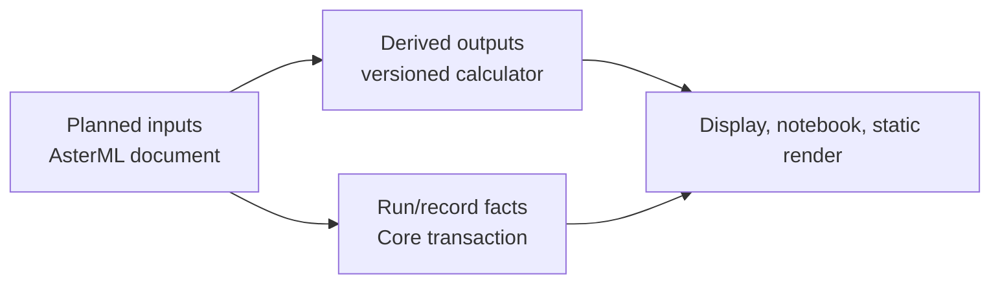

# Unified module contract v1

- Status: contract candidate, frozen for implementation.
- Authoritative source: [`spec/modules.json`](../../prototypes/mygo-run/internal/asterdoc/spec/modules.json). Go and Rust both embed this file; there is no second manifest.
- Shape checked by: [`foundation-v1.schema.json`](../../prototypes/mygo-run/internal/asterdoc/spec/foundation-v1.schema.json).

## 1. The twelve dimensions

Every shipped module declares the dimensions that apply to it. A simple note module may have no derived output; a pure calculator has no editor action; an instrument profile has no hardware connection. The dimensions are a contract checklist, not twelve mandatory YAML blocks.

| # | Dimension | Manifest field(s) | What it answers |
| --- | --- | --- | --- |
| 1 | Identity | `kind`, `schema`, `title`, `sdk` | What module and version is this? |
| 2 | Inputs | `inputs[]` | What may the document author? |
| 3 | Outputs | `outputs[]` with `origin` | What is planned, derived, recorded or viewed? |
| 4 | References | `inputs[].type=reference`, `target` | What existing objects does it point to? |
| 5 | Validation | `rules[]`, validator implementation | What is structurally refused? |
| 6 | Actions | `actions[]` | What business commands can the module invoke? |
| 7 | Permissions | `permissions[]`, `actions[].permission` | Who may run each action? |
| 8 | Bindings | renderer/runtime integration | How does it connect to Design, Run, Notebook or data? |
| 9 | Renderers | `renderers.design`, `.document`, `.static` | Which surfaces can show it? |
| 10 | Lifecycle | `lifecycle.states`, `.freeze` | Draft, validation and immutable freeze. |
| 11 | Provenance | `provenance.origin`, `.record_boundary` | Is this plan, derivation or fact, and where may facts live? |
| 12 | Diagnostics | diagnostic schema, validator messages | What failed, where, how severe, what next? |

## 2. Identity and version

```json
{
  "kind": "dilution",
  "schema": 1,
  "title": "稀释计算",
  "sdk": "1.0.0"
}
```

- `kind` is stable; it is not a display title.
- `schema` is the module structure version.
- `sdk` must equal the manifest's `sdkVersion` for shipped modules.
- A module implementation is registered for exactly one `kind@schema`; duplicates are rejected.
- Unknown versions do not fall back to the latest version.

## 3. Inputs and outputs

A port uses the Foundation types. The manifest adds the constraints that generic JSON Schema cannot express:

```json
{
  "name": "group_refs",
  "type": "list",
  "item_type": "reference",
  "target": "group"
}
```

```json
{
  "name": "stock_volume",
  "type": "quantity",
  "dimension": "volume",
  "origin": "derived",
  "calculator": "dilution.v1"
}
```

Origins:

- `planned`: authored in the document; no measured fact.
- `derived`: computed from declared inputs by a versioned deterministic calculator.
- `recorded`: only from Core's record store; a document module must not write it.
- `view`: a read-only projection over existing data.

A derived output without a `calculator` is rejected by the manifest validator. This is how the contract prevents an unversioned calculation from looking like a recorded result.

### 3.1 The three data locations



- Planned inputs live in the AsterML document.
- Derived outputs carry a calculator ID/version and never become facts by display.
- Recorded outputs are written only through Core commands and record-store transactions.
- A renderer reads; it does not write a record. A module must not open a second write path to SQLite or the Run store.

## 4. Actions and permissions

```json
{
  "id": "assign_wells",
  "title": "将选中孔位归入组别",
  "permission": "document.edit",
  "writes": ["groups"]
}
```

Rules:

1. Every action names exactly one permission.
2. That permission must appear in the module's `permissions[]`.
3. The host checks the permission before running the action.
4. The module's own command API checks it again; a hidden button is not authorization.
5. `writes` names document fields, not Run facts. An action that records an actual measurement is not a document action.

Current permissions: `document.edit`, `run.readout`, `notebook.append`. The renderer's `Mode` and `ReadOnly` flags are presentation context, never authorization.

## 5. Renderers and bindings

`renderers` is an executed contract, not a comment:

```json
{"design": "generic.editor", "document": "dilution.viewer", "run": "generic.run"}
```

- A professional editor and a read-only viewer are separate capabilities.
- `Register` refuses a declared renderer key without an implementation. Module-specific callbacks live in
  `ModuleSpec.Implementations`; reusable callbacks are installed once with `Registry.RegisterRenderer`.
- Different module kinds may share one registered key. Schema versions may share a key when their renderer semantics
  are identical; `step@1` and `step@2` share `step.viewer`.
- The host maps Design to `renderers.design`, Run to `renderers.run`, and protocol/notebook/review to
  `renderers.document`. A missing surface is a visible gap, never a fallback.
- `generic.editor` is an explicit shared Design renderer; `generic.run` is a shared, read-only Run summary.
  `plate` keeps specialized `plate.editor`, `plate.viewer`, and `plate.run` callbacks.
- `workflow` editing belongs to the Workspace canvas and Core semantic commands, not a module-level editor.
  `View.Density` lets a host request `compact`, `inspector`, or `full` presentation.
- A static/PDF renderer must be deterministic from document revision, frozen-run
  revision, referenced IDs and calculator version. `renderers.static` is
  currently declared by no shipped module; static output goes through
  `StaticPreview`, which is a separate plain-text path.
- Notebook uses the same document-viewer capability; it does not get a private
  module implementation.
- Renderer code is Go for the current desktop prototype. The contract is
  language-neutral, but a module is not a dynamic plugin in v1: there is no
  load/unload lifecycle and no third-party loading.

## 6. Lifecycle

```json
{
  "states": ["draft", "validated", "frozen"],
  "freeze": "immutable-revision"
}
```

- Drafts may be incomplete; only blocking structural errors refuse a save.
- Validated means the document passed syntax, type, unit and reference checks, not that the science is correct.
- Freezing a Run pins the exact AsterDoc revision, source hash and compiler version.
- A frozen revision is never mutated. New edits create a new revision; the frozen Run keeps its historical view.
- Module-specific migrations are versioned. Foundation v1 does not silently migrate old fields.

## 7. Provenance and record boundary

```json
{
  "origin": "planned",
  "record_boundary": "run"
}
```

- `origin` describes the module instance, not every output.
- `record_boundary` names where actual facts may live. Document modules use `run`; a pure calculator still does not own a record.
- Actual values, device responses and execution timestamps go through Core event/record commands, preserving actor, time and source.
- A module can display a recorded value through a typed reference, but it must not copy raw measurements into AsterML.

## 8. Diagnostics

The shared shape is in Foundation v1. A module's rule must produce a stable code, a field path, a severity and a next action where possible. A blocking error refuses the write. A `needs_confirmation` item may remain in a draft. An advisory item never pretends to be blocking.

The current CLI error envelope exposes a stable top-level code and readable message. Full diagnostic arrays are a declared gap, not a completed capability.

## 9. Manifest extension rules

New fields are added to the existing manifest, never a parallel manifest:

1. Add the module object to `modules[]`.
2. Add every input/output port and its Foundation type.
3. Add typed targets for references.
4. Add actions and declare their permissions.
5. Add renderer capabilities only when implemented.
6. Add lifecycle/provenance metadata.
7. Add a named rule for cross-field validation.
8. Register the implementation in Go and Rust; run parity tests.
9. Add fixtures and update the development guide.

The shared manifest loader validates duplicate `kind@schema`, SDK version, categories, known port types, reference targets, derived calculators and action permissions. Both Go and Rust reject the same malformed manifest at startup or test time.

## 10. Templates are a separate contract

A **module** is a reusable capability. A **template** is a composition of modules that can be instantiated into a new design. A template declares `template_id`, `version`, `dependencies`, `parameters`, `requirements`, `defaults`, `instantiate` and `provenance`. Instantiation must generate new module IDs and rewrite internal references; copying old IDs wholesale is forbidden.

The template shape is defined in the Foundation schema, but template instantiation is **not implemented** in this phase. Do not expose a template command as available.

## 11. Reference modules

| Module | SDK category | What it proves |
| --- | --- | --- |
| `plate` | Labware | Geometry, group/well validation, document freeze, readout boundary. |
| `dilution` | Measurement | Quantities, units, deterministic calculator, derived output, no record write. |
| `instrument_profile` | Resource | Capability declaration without hardware control or calibration claims. |

These three deliberately exercise spatial, computational and resource objects. If a future module needs a fourth special-case write path, the SDK contract has failed for that case.

## Static renderer capability

Modules may be rendered through `StaticPreview`/`StaticDocumentPreview` for read-only surfaces and PDF export. The `Renderers.Static` field remains the declared capability; implementations use the same registry path as interactive rendering. Static rendering is read-only and must not expose a write handle.
