# AsterLab v2 全量模块真实渲染图鉴与前后端对齐验收总账（21 个 SDK 模块）

状态：已实现（`feat/v2-generic-modules` · 2026-11-18）

> [!NOTE]
> 本文档中的所有截图均于 `2026-11-18` 在分支 `feat/v2-generic-modules`（[design-system.md](../../docs/product/design-system.md) / [asterdoc-contract.md](../../docs/asterdoc-contract.md)）通过无头 MyGo UI 渲染器实时截屏生成。逐个对照**第一层 11 个通用内容模块**、**第二层 10 个声明与文档原语模块**及**「孔板速排」工作台 / 历史与导出闭环**，确认全部优化均已落地并经实图与测试验证。全表面架构复盘与全量测试/构建账本见 [AsterLab v2 通用模块架构演进复盘与全表面实图验收档案](./v2-architecture-retrospective-and-evidence.md)。

---

## 第一部分：第一层通用内容模块（11 类步骤内可自由组合组件）

### 1. `prose@1` — 富文本 / 注意事项提示块

- **核心语义**：纯视觉/文本表达块（不承担结构化参数）；支持 `tone`: `plain` | `note` | `tip` | `warning`，支持段落与项目符号渲染。
- **渲染与闭环实现**：[widget_prose.go](../../prototypes/mygo-run/internal/asterdoc/widget_prose.go)

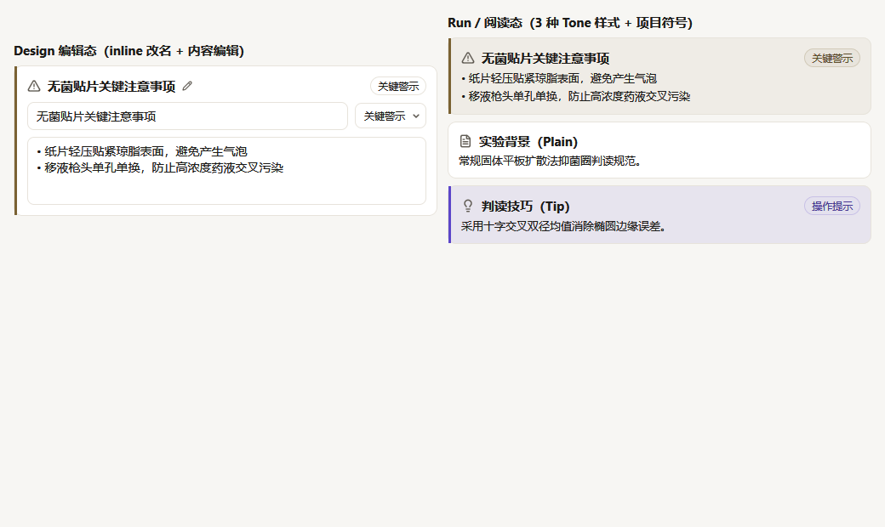

- **验收状态**：
  - ✅ 所有模块卡片顶部统一支持 Design 内联铅笔图标点击重命名（`renderInlineEditableTitle`）并写回 `.asterml` `title`；`prose` 在 Design / Run / Notebook 三端同源渲染。

---

### 2. `group_table@1` — 通用实验分组表

- **核心语义**：集中定义实验组别、科学角色（`control` / `treatment` / `comparator` / `reference`）、处理条件、独立样本数 `independent_n` 与技术重复 `technical_repeats`。
- **渲染与闭环实现**：[widget_tables.go](../../prototypes/mygo-run/internal/asterdoc/widget_tables.go#L17-L165)

- **已修复并实图确认**：
  - ✅ `角色` 列改为纯科研中文徽章（`对照组` / `处理组` / `阳性对照` / `参照组`）并加宽列宽；`n / 重复` 列宽加宽至 `Spacing48 * 1.9`，无任何省略号裁切；
  - ✅ 组别圆点统一使用顺序 8 色 `CategoricalPalette`（`GroupColorIndexed`），各组颜色与关联 `plate@1` 孔板严格一致、绝不撞色。

---

### 3. `param_table@1` — 通用参数表（默认标题「实验条件」）

- **核心语义**：定义操作条件（键、标签、计划值、单位、`record_actual`、备注）；Run 执行时可补录实测值并供下游 `calculator@1` 引用（`@actual.<key>`）。
- **渲染与闭环实现**：[widget_tables.go](../../prototypes/mygo-run/internal/asterdoc/widget_tables.go#L167-L295) · [composer.go](../../prototypes/mygo-run/internal/asterdoc/composer.go)

- **已修复并实图确认**：
  - ✅ 默认回退标题与 Starter 模板统一收口为简洁自然的「**实验条件**」（取代原「关键实验条件复核汇总」/「参数表」），并支持卡片标题栏内联点击编辑自定义写回 `.asterml`。

---

### 4. `figure@1` — 图片 / SVG 示意图（便携 `./assets/` 相对路径）

- **核心语义**：纯视觉表达（Agent 或人绘制的四象限/流程/膜条矢量 SVG，或本地参照照片），绝不作为结构化实验数据唯一数据源。
- **渲染与闭环实现**：[widget_figure.go](../../prototypes/mygo-run/internal/asterdoc/widget_figure.go#L82-L265)

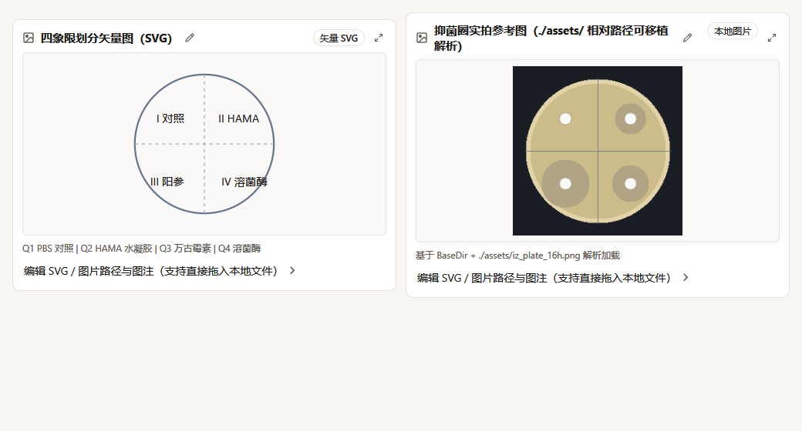

- **已修复并实图确认**：
  - ✅ `View.BaseDir` 与 `PortableFigureAssetPath`（在 [design_page.go](../../prototypes/mygo-run/design_page.go) 全链打通）在 Design 选取或拖入本地文件时，自动拷贝图片至 `.asterml` 同级 `assets/` 目录并以 `./assets/<文件名>` 写入源码，实现 `.asterml` + 媒体文件夹跨机器零断链便携打包。

---

### 5. `data_table@1` — 通用数据记录表（列表 + 2D 孔板矩阵双视图）

- **核心语义**：支持自定义列（`text` / `number` / `categorical` / `formula`）、列单位与质控范围警戒（`min` / `max`）；绑定 `container_ref` 后支持 `layout: matrix` 二维孔板对齐视图与全板 TSV/CSV 矩阵粘贴。
- **渲染与闭环实现**：[widget_tables.go](../../prototypes/mygo-run/internal/asterdoc/widget_tables.go#L297-L1085)

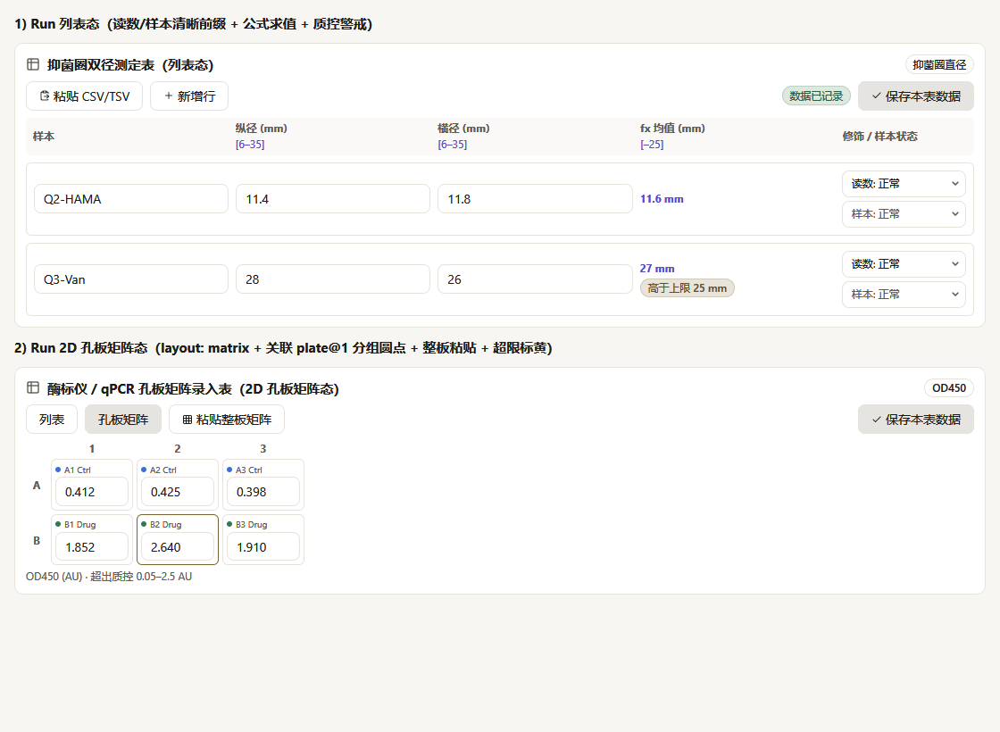

- **已修复并实图确认**：
  - ✅ Run 列表态右侧两个状态下拉明确标注 `读数: 正常` 与 `样本: 正常`，消除歧义；Design 态新增表头删除列图标按钮；
  - ✅ 关联 `container_ref` 时开放 `列表 | 孔板矩阵` 切换（Design 写回 `layout`）、`粘贴整板矩阵` 按钮（自动剥离酶标仪 `<>` / `1..C` 表头与 `A..P` 行标）与超质控区间金色边框提示（如 `B2 = 2.640` 超出 `0.05–2.5 AU`）。

---

### 6. `checklist@1` — 检查清单（支持必检与规则豁免）

- **核心语义**：步骤内可任意插入的操作核对单；支持 `required` 必检项与 `allow_rule_skip` + `skip_rule`（Run 可一键按规则豁免并记入事件追踪）。
- **渲染与闭环实现**：[widget_ops.go](../../prototypes/mygo-run/internal/asterdoc/widget_ops.go#L35-L141)

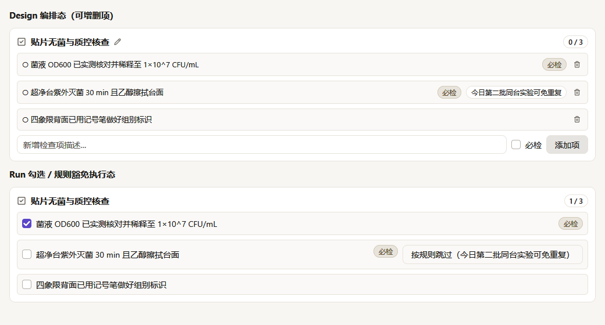

- **验收状态**：✅ Design 增删项与 Run 勾选/按规则豁免全链路通过。

---

### 7. `calculator@1` — 通用科学计算器（5 合 1 能力模式 + Design 写回）

- **核心语义**：用单一计算器契约收口 `dilution`、`serial_dilution`、`group_mastermix`（兼容 `container_ref` 与 `plate_ref`）、`sample_normalize`（`target_mass` / `volume_per_unit`）与 `formula`（自由公式 + 结果 `unit`），支持 `@actual.*` 自动代入上游实测值。
- **渲染与闭环实现**：[widget_ops.go](../../prototypes/mygo-run/internal/asterdoc/widget_ops.go#L143-L410) · [calc_eval.go](../../prototypes/mygo-run/internal/asterdoc/calc_eval.go)

- **已修复并实图确认**：
  - ✅ Design 态支持顶部 `计算模式` 下拉切换、`sample_normalize`/`formula` 全部参数可视化输入框与 `保存计算设定` 按钮（直接写回 `.asterml`）；
  - ✅ Go 与 Rust `group_mastermix` 双端兼容 `container_ref` / `plate_ref`；`formula` 模式支持无单位数值变量与结果 `unit`（图中实算 `(a + b) / 2 * factor = 18.8 mm`）。

---

### 8. `timer@1` — 通用实验计时器（4 种模型 · 中文运行状态 · Design 可编辑）

- **核心语义**：支持 `countdown`、`stopwatch`、`cycle`（多轮循环阶段）、`window`（相对 `t0` 时间窗提醒），Run 直接驱动 Core 持久化计时状态机。
- **渲染与闭环实现**：[widget_ops.go](../../prototypes/mygo-run/internal/asterdoc/widget_ops.go#L412-L595) · [asterdoc.go](../../prototypes/mygo-run/internal/asterdoc/asterdoc.go#L1028-L1035)

- **已修复并实图确认**：
  - ✅ Run 运行状态彻底中文化（`计时中` / `已暂停` / `已完成` / `待启动`，不再暴露英文 `"running"`）；
  - ✅ `window` 模式同时回退读取 `offset` 与 `duration`，主读数准确显示 `06:00:00`；Design 态新增模式、数值/单位、轮数与 `保存计时设定`。

---

### 9. `attachment@1` — 文件附件与容器多视野采图槽

- **核心语义**：统一步骤证据（`step_evidence`）、设计参考文档（`design_ref`）与按容器坐标组织的采图槽（`container_grid`）。
- **渲染与闭环实现**：[widget_ops.go](../../prototypes/mygo-run/internal/asterdoc/widget_ops.go#L597-L765)

- **已修复并实图确认**：
  - ✅ 通过 `resolveFigurePath(v.BaseDir, ...)` 支持 `./assets/...` 相对路径预览缩略图；
  - ✅ `container_grid` 在卡片内展示紧凑型孔位采图进度胶囊（`A1 2/6`、`A2 0/6`、`A3 0/6`），Run 态点击指定孔位胶囊可直接关联该孔图像。

---

### 10. `subflow@1` — 内联 / 共享子流程

- **核心语义**：支持在一个步骤内折叠或展开一组有序子操作明细；Design 支持内联增删条目并写回 `.asterml`，Run 可逐项勾选完成。
- **渲染与闭环实现**：[widget_ops.go](../../prototypes/mygo-run/internal/asterdoc/widget_ops.go#L767-L835)

- **已修复并实图确认**：✅ Design 态卡片支持每行删除按钮及底部 `新增子步骤描述 + 备注 + 添加子步` 表单直接写回 `.asterml`。

---

### 11. `plate@1` — 全仓唯一统一的实验容器、铺板与悬浮单框标注系统

- **核心语义**：以同一套 `plateui.View` + `ApplyUnifiedPlateAnnotation` 组件承接 4/6/12/24/48/96/384 孔板（细胞铺板、qPCR、ELISA、CCK-8 等共用统一语言，仅标题区分）、圆形四象限培养皿（`format: 4, topology: dish`）、1D 电泳泳道/8 联管（`rack_1d`）及动物笼位（`cohort`）。
- **渲染与交互实现**：[uikit/plate/plate.go](../../prototypes/mygo-run/internal/uikit/plate/plate.go) · [uikit/plate/export.go](../../prototypes/mygo-run/internal/uikit/plate/export.go) · [asterdoc/plate_ops.go](../../prototypes/mygo-run/internal/asterdoc/plate_ops.go) · [asterdoc/view.go](../../prototypes/mygo-run/internal/asterdoc/view.go)

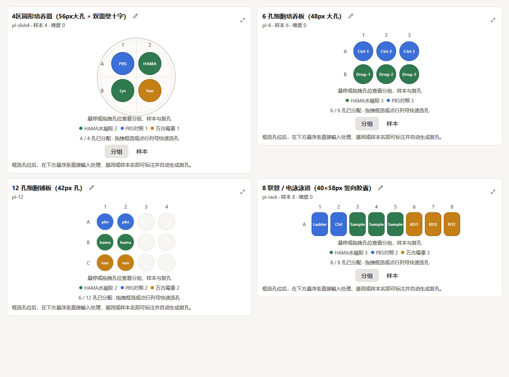

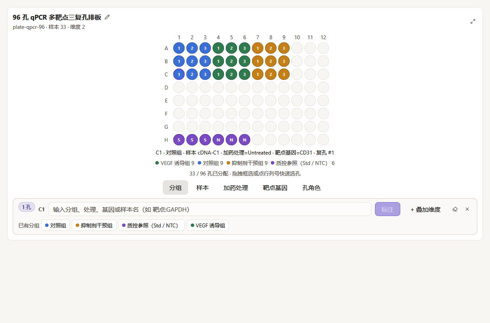

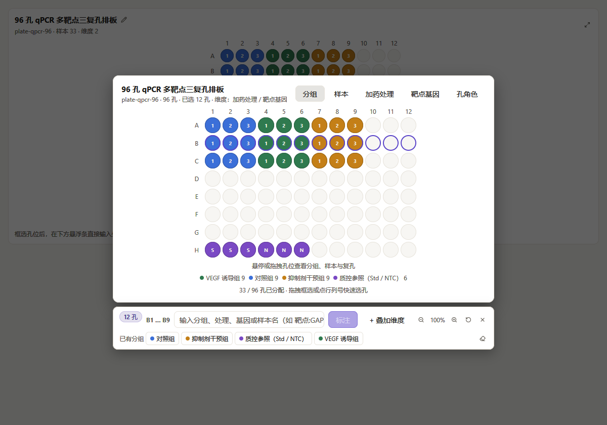

- **核心升级与闭环落地**：
  1. **支持 `format: 4` 与实时自适应孔径**：Go 与 Rust 双端注册 `4` (`2×2`) 孔规格；孔径随孔数动态缩放（`4` 孔 `56px` → `6` 孔 `48px` → `12` 孔 `42px` → `24` 孔 `36px` → `48` 孔 `28px` → `96` 孔 `26px` → `384` 孔 `17px`），`dish` 自动绘制双层圆形皿壁与十字分区线，`rack_1d` 渲染为 `40×58px` 竖向胶泳道/联管胶囊；
  2. **去掉冗余顶部按钮，升级为悬浮单框统一标注**：删掉原本多排的 `着色维度 | 按分组 | 按样本 | 按加药处理` 与两行复杂工具栏；内联画布与放大浮层均支持**鼠标拖拽框选 + 行列号点选**，选中后在下方弹出悬浮条，**单一输入框**统一处理：
     - 输入普通文本（如 `H2O2-100uM` / `NTC`）→ 自动匹配或新建分组、`samples[well]` 写入该名、识别 QC 角色（如 `NTC`/`Blank`/`Std`）；
     - 输入 `维度:值`（如 `靶点:GAPDH` 或梯级简写 `浓度:100/2 uM`）→ 写入正交 `factors`（支持多维度任意顺序叠加）；
     - 无论用户先标样本/处理还是先标因子，均按确定性键 `(sample_id, canonical_factor_signature)` 重算各组复孔序号 `1..k`（`ApplyUnifiedPlateAnnotation`），让 Agent 与源码 100% 无损还原交互意图；
  3. **全仓三端彻底统一 + SVG / PNG 高保真导出**：Design 内联孔板、放大编辑浮层、Notebook 只读视图与 `Tools -> 孔板速排` 全部共用同一 `asterdoc.View` / `plateui.View` 与顺序 8 色无冲突调色盘（图例经 `GroupLabels` 解析优先展示人类可读中文组名），并新增纯矢量 `RenderSVG` 与 2× Retina `RenderPNG` 导出引擎供科研汇报、PPT 与 Illustrator 使用。

---

## 第二部分：第二层科学原语与文档声明模块（10 类顶层结构模块）

包含 `experiment@1`、`group@1`、`assay@1`、`workflow@1`、`instrument_profile@1`、`material@1`、`sample@1`、`reference@1`、`step@1`、`readout@1`。

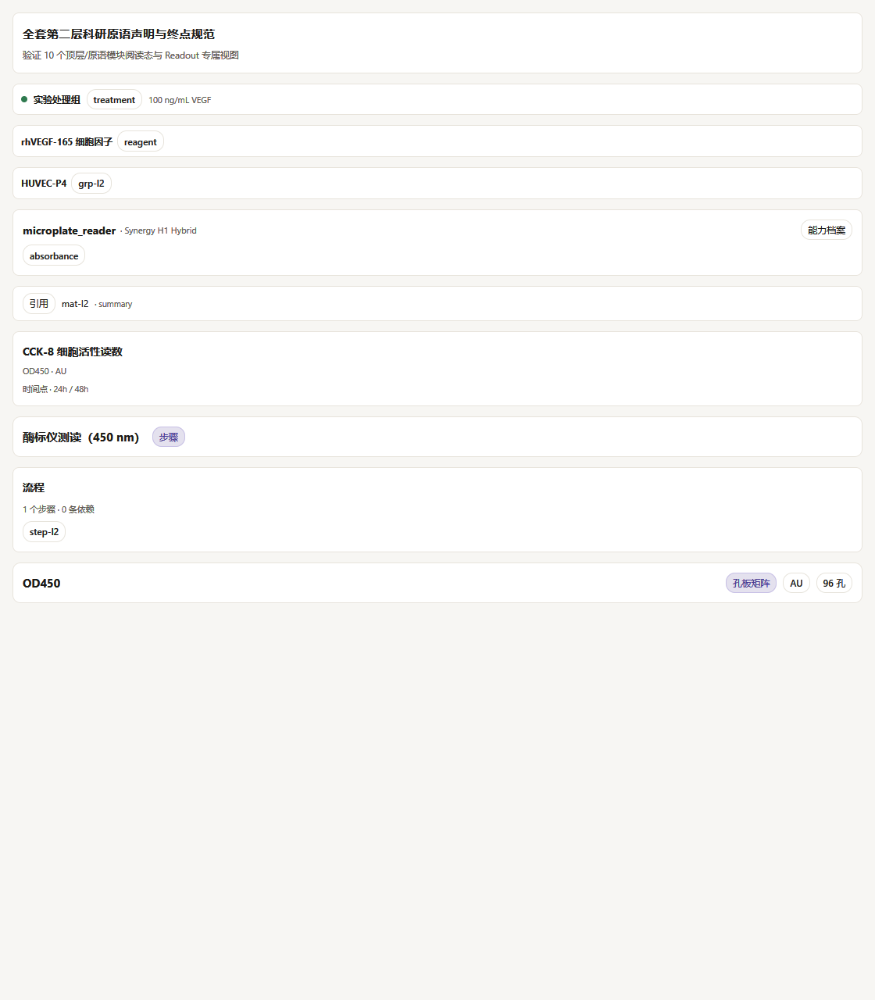

- **已修复并实图确认**：
  - ✅ 补齐 `readout@1` 的专属阅读态视图 `readout.viewer`（上图最末卡直接呈现终点 `OD450` + `[孔板矩阵]` `[AU]` `[96 孔]` 胶囊），全部 10 类第二层原语均具备专属结构化可读卡片。

---

## 第三部分：全仓前后端收口对照验证

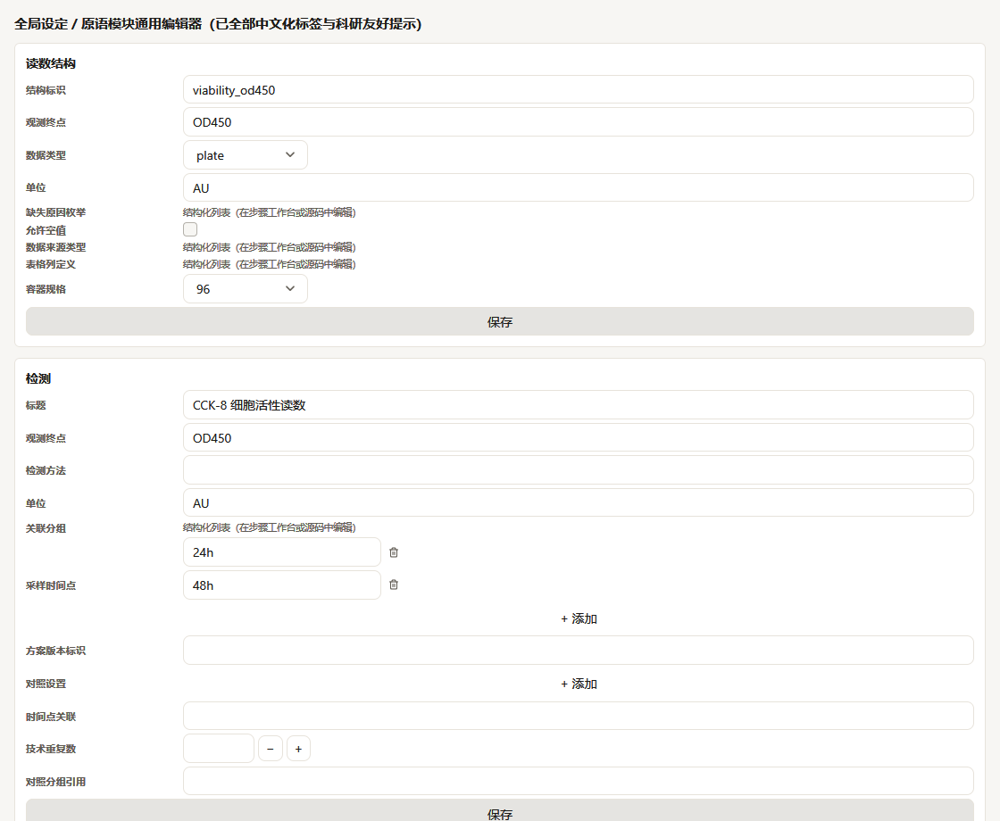

- **前后端收口实图确认**：
  1. `comp_15`：`GenericModuleEditor` 所有已声明端口均映射为中文科研字段名（如 `结构标识`、`观测终点`、`数据类型`、`容器规格`），复合端口不再显示英文 `"read-only"` 而改用 `结构化列表（在步骤工作台或源码中编辑）`；
  2. Notebook `@matrix(16h)`：无关联显微视野时展示清晰的中文空态指引（`当前时间点暂未挂载孔位图像（可在右侧实验模块或图板核对数据）`）。

---

## 第四部分：「孔板速排」独立工作台、悬浮面板复用、两列历史墙与 SVG/PNG 导出实图

已按产品反馈在 [internal/tools/plate_studio.go](../../prototypes/mygo-run/internal/tools/plate_studio.go) 与 [internal/uikit/plate/export.go](../../prototypes/mygo-run/internal/uikit/plate/export.go) 将工具栏中的孔板工具正式升级为 **「孔板速排」** 独立工作台，完整复用 `asterdoc.View` 交互底座并新增导出与历史组件墙：

1. **`① 选择孔板 → ② 悬浮单框选孔排板` 全景工作台 + 底部两列 `孔板历史` 缩略组件墙**：

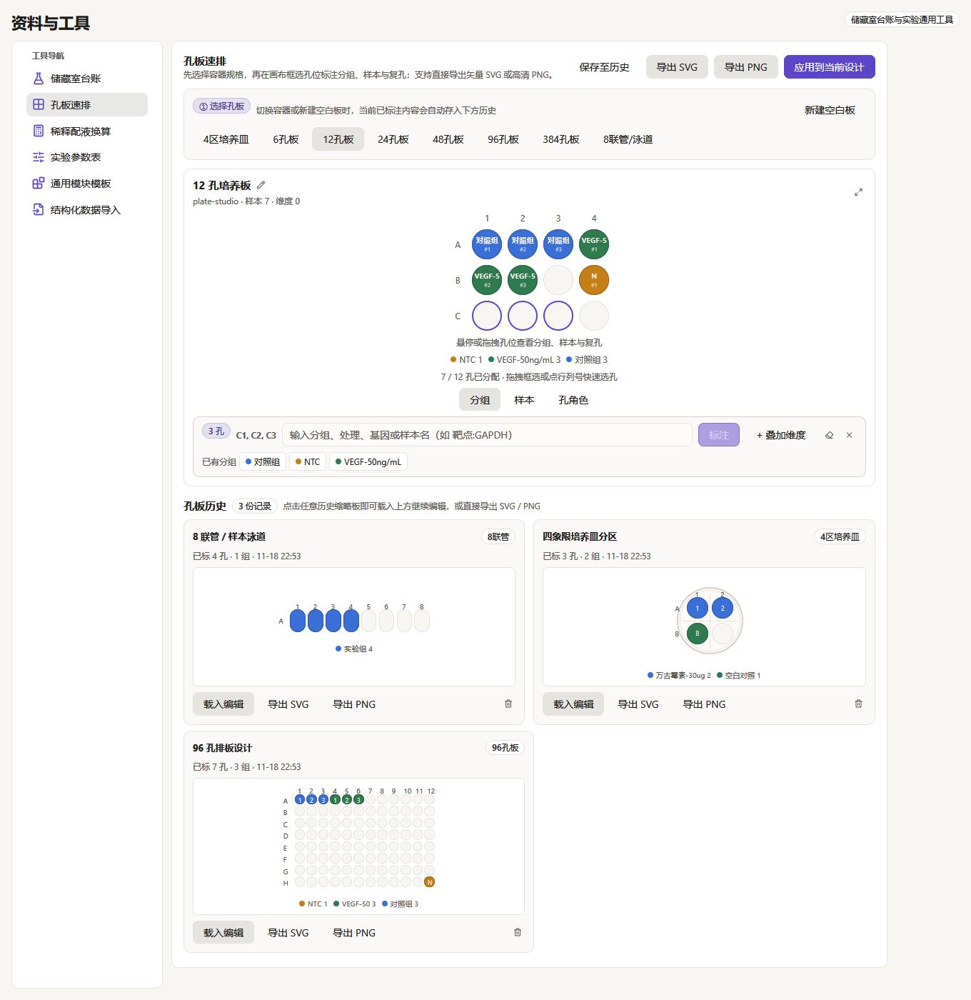

2. **点击下方历史卡片载入编辑 + 悬浮放大孔板编辑模态框（直接复用 `RenderPlateOverlay`）**：

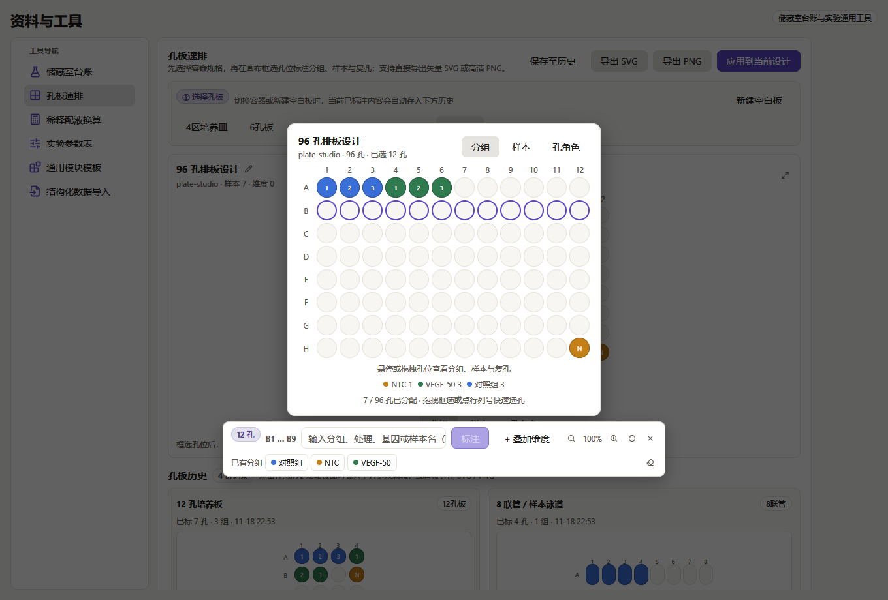

3. **真实导出成图效果（`导出 PNG` 生成的 2× Retina 高清卡片 / 同步支持 `导出 SVG` 纯矢量 `<svg>` 文件）**：

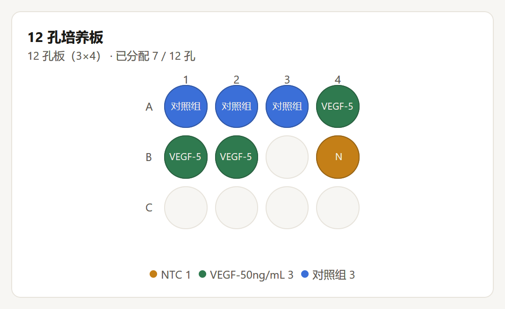

- **架构与交互核心特性**：
  - **先选规格再设计**：支持 `4区培养皿` / `6孔板` / `12孔板` / `24孔板` / `48孔板` / `96孔板` / `384孔板` / `8联管/泳道` 与 `新建空白板`；切换容器或载入历史前，自动将当前非空设计保存进下方 `孔板历史`（持久化至 `plate-history.json`）；
  - **100% 复用 `asterdoc` 交互与单输入悬浮条**：保留鼠标拖拽框选、行列号点击整行/整列选择、Shift 多选、内联铅笔重命名、`放大孔板` 浮层、多维 `维度:值` 与自动复孔序号计算，并支持 `应用到当前设计` 无损同步分组表与完整 `plate@1`；
  - **SVG & PNG 双格式导出**：`RenderSVG` 输出规范 `<svg>` 矢量源码（圆形孔位、皿壁十字、多维内环与换行图例），`RenderPNG` 通过独立离屏光栅器输出 2× 高清中文图卡；
  - **两列 `孔板历史` 组件墙**：按双列等宽布局展示历史微缩孔板（按孔数/拓扑自动等比缩放、中文群组名图例解析），点击缩略画布或「载入编辑」即刻回到上方编辑，也可卡片内直接导出 SVG / PNG 或删除。
