# AsterLab v2 全系统七维深度审计、科研真实痛点调研与 Obsidian 式文件架构蓝图

> [!NOTE]
> 本文档基于对 `AsterLab` 仓库全栈代码（Rust Core `crates/asterlab-core` & `crates/asterlab-app`、CLI/存储 `src/cli.rs` & `src/cli/asterdoc.rs`、PureGo 桌面端 `prototypes/mygo-run`、21 模块契约 `modules.json` 与 NSIS 安装脚本 `mygo-installer.nsi`）的逐行审计，以及对 Reddit（`r/labrats`、`r/PhD`）、知乎、小红书、丁香园真实湿实验吐槽的系统调研，同时附上**实装升级的「Apple Calendar 风格日历主页 + Obsidian 多标签与右抽屉工作台 + 单文件 `.asterml` v2.1 信封 + 组件级高清 PDF v2 渲染导出（含完整实验实测记录 PDF）」**与 **Obsidian 式「渲染而不占有」本地实验室文件架构方案**。

---

## 一、真实科研工作者 & 医学生论坛痛点调研（与 AsterLab 现状对照）

通过检索 `r/labrats`、`r/PhD`、知乎、小红书、丁香园大量一线讨论，医学生与湿实验科研人员在日常实验、记录本、配液、孔板和试剂管理中的高频吐槽高度集中在以下 **5 大核心痛点**：

| 真实吐槽痛点（论坛高频原声） | 为什么现有软件/做法让人崩溃 | AsterLab 当前解决度 | 建议纳入的高价值新功能（零臃肿扩展） |
|---|---|---|---|
| **1. 台面与电脑物理隔离（戴手套没法敲键盘）** *「先在擦镜纸或打印单上记，回办公室再敲进电脑，等于做两遍，最后漏抄还写错 $\mu$L / mL！」*（`r/labrats` / 知乎） | 纸质 ELN 怕泼乙醇/染料；电子 ELN 又不能抱进细胞间或超净台；现有软件导出多为不可直用的纯文本流水账。 | 🟡 **半解决** 本轮已实装 **组件级 A4 实验台工作单 PDF 导出**（含 `[ ]` 勾选框、留白手写行、2× 孔板图与配方表）。 | **① 打印台面单 → 拍照自动识别回填** A4 工作单带唯一 `RunID + 页码` 标识，做完实验拍一张工作单照片拖入 Run 页面（`attachment@1`），由 Agent 自动读取手写勾选、实际用时与手写表格数值并**生成待确认提案**。 |
| **2.「薛定谔的冰箱」与 3 天弃用诅咒** *「师兄毕业留一箱没日期盲盒；要求每吸 10 uL 酶都要扫码扣库存，没人坚持得过一周！」*（小红书 / `r/labrats`） | 传统 LIMS 入出库点击过多、反人性；无效期主动拦截，做一半才发现抗体/胰酶过期 3 年。 | 🟢 **92% 解决** 本轮已落地 **储藏室二级物理容器层级**（温区货架 → **冻存盒 `9×9`/`10×10` / `50` 孔 EP 管盒 / `15 mL` & `50 mL` 离心管架 / `96` 孔 PCR 盒** → `A1..L12` 俯视孔位地图与快速定位）+ 试剂档案弹窗（PDF 说明书上传 + 官网网址 + 临期分组），**不强制每微升扫码扣减**。 | **② 开跑前耗材效期主动拦截** 当 Design 中 `material@1` 填了 `pantry_code` 且在库状态已过期/已用尽时，点「开始实验」弹窗在加样前高亮提醒。 |
| **3. WB / qPCR 孔板加样走神与泳道顺序混乱** *「加 96 孔到一半电话响了，根本不知道第几排加过没；WB 压完胶发现蛋白上反/二抗用错！」*（丁香园 / `r/labrats`） | Excel 排板没有实体反馈；多因子（分组+样本+基因/浓度+Ctrl 角色）混在备注格里，肉眼极易看串。 | 🟢 **88% 解决** `plate@1` 已收敛为 `6..384` 孔板、`rack_1d` 8 联管/电泳泳道与单框「标注 / + 追加标签」自动复孔编号；`calc_eval` 自动带入 `15%` 余量算好 MasterMix 并解析中文分组名；抑菌圈平皿由 Agent 按 [agent-svg-kit.md](./agent-svg-kit.md) 绘制物理比例尺 SVG。 | **③ Run 期加样步进高亮仪 + WB 凝胶上样条预设** 在 Run 模式下给 `plate@1` 增加轻量**「逐行 / 逐列跟进高亮条」**（点一下推进一列，配合实体移液器/枪头盒行同步！），并在 `8 联管/泳道` 支持标注 `Marker / 目的蛋白 kDa`。 |
| **4. 组会前 12h 拼 PPT 崩溃 & 毕业盲审考古** *「老板问去年 3 月细胞用的哪批血清，翻遍 5 个本子和微信文件传输助手找不到！」*（小红书 / `r/PhD`） | 设计文档、排板图、显微镜原图、最终结果分散在 Word / PPT / GraphPad / U盘，无统一索引与绑定证据。 | 🟡 **85% 解决** 3 模式 `实验记录`（`编辑 \| 阅读 \| 源码`）与同源组件级 **`导出 PDF`** + `导出 Markdown` 已贯通设计→执行→实测→结论笔记，一键 `Ctrl+K` 可搜任意历史实验与批号。 | **④ 一键导出「组会汇报图卡包」** 从实验记录直接导出 1 页横版 `16:9` 组会图卡（排板+设计+代表视野+实测表）。 |
| **5. 境外云端卡顿、全英文劝退 & 毕业数据锁死** *「Benchling 打开转圈半天、满屏英文；毕业导出几百条实验记录直接卡死！」*（`r/labrats` / 知乎） | SaaS 绑定私有数据库，离线断网不能用，离开学校账号即作废。 | 🟢 **90% 解决** 纯本地 Rust + Go 编译原生桌面软件（无云端依赖），科研中文一致率高。 | **⑤ Obsidian 式「明文 `.asterml` + `./assets/`」本地仓库** 彻底摆脱单库 `.db` 垄断（见本文第五章），毕业直接带走课题文件夹，长期可读可用。 |

---

## 二、全功能七维深度审计

### 2.1 后端承载力审计（Rust Core + SQLite + MyGo PureGo 桥接）

我们对 [src/cli.rs](../../src/cli.rs)、[src/cli/store.rs](../../src/cli/store.rs) 与 [crates/asterlab-app/src/lib.rs](../../crates/asterlab-app/src/lib.rs) 进行了逐行审计：

- **做得扎实的部分**：
  1. **幂等 `operation_id` + 不可变修订版 + 乐观锁**：全部写事务采用 `TransactionBehavior::Immediate`，保障多写入方并发不覆盖；`Pantry` 删除采取墓碑标记（`deleted = 1`），保障 `PN-*` 短码终身不重号。
  2. **读投影缓存（`projection_cache`）**：[store.rs:166-174](../../src/cli/store.rs#L166-L174) 对派生投影按 `(entity_id, source_revision, projection_kind)` 建立联合主键缓存。
  3. **已建基础二级索引**：[store.rs:164-165](../../src/cli/store.rs#L164-L165) 已建立 `records_kind_parent(kind, parent_id)` 与 `records_project(project_id)` 索引。
- **实测发现的 3 个承载力真瓶颈**：
  1. **🔴 `O(N²)` 幂等查重全表反序列化（[crates/asterlab-app/src/lib.rs:95-143](../../crates/asterlab-app/src/lib.rs#L95-L143)）**：
     `find_operation_event_tx` 在**每次** `save_readout` 写入前执行 `SELECT id,data_json FROM records WHERE kind='execution_event' AND parent_id=?1`，并对该 Run 下**所有历史事件逐条执行 `serde_json::from_str`** 比对 `operation_id`。当高通量实验录入 `2,000+` 条读数（如 384 孔 × 多时间点）时，单次事务呈 `O(N)` 扫描、整批写入退化为 `O(N²)`。
     - *修复方案*：在 `store.rs` 增加表达式索引 `CREATE INDEX IF NOT EXISTS records_op_id ON records(parent_id, json_extract(data_json, '$.operation_id')) WHERE kind='execution_event'`，降为 `O(1)` 命中。
  2. **🟠 全量修订文本副本膨胀 + `INPUT_LIMIT = 2 MB`（[src/cli.rs:74](../../src/cli.rs#L74)）**：
     每次修订都会将完整 `.asterml` 源码作为 `data_json` 存入 SQLite；含复杂 `<svg>` 与预填大表时膨胀快且受 `2 MB` CLI 输入上限约束。
  3. **🟡 单库文件耦合（与 Obsidian 理念冲突）**：
     用户核心设计与运行历史均封装在 `%APPDATA%\AsterLab\data\asterlab.db` 中，新加的 `pantry-meta.json` / `plate-history.json` 又散落同级配置目录，缺少以“用户工程文件夹”为中心的明文组织。

| 数据规模情景 | 当前 Rust+SQLite 承载评价 | 优化后预期表现 |
|---|---|---|
| 常规实验室（10–80 课题 · 200 次 Run · 单板 ≤96孔） | 🟢 **完全轻松胜任**（< 20 ms 响应） | 同等流畅 + 目录直观可读 |
| 高通量长期 Run（5 块 384 孔板 · 5,000+ 条 `execution_event` · 千张图像） | 🟡 `find_operation_event_tx` 全扫 JSON 产生明显延迟；单库体积膨胀 | 🟢 加 `json_extract` 索引 + 资产落磁盘，写入维持 `< 5 ms` 恒定 |

---

### 2.2 前端美观度、清晰度与实用性审计

本仓库 UI 严格遵循 [design-system.md](../product/design-system.md)（暖石中性色 + 单一紫罗兰焦点 + `tnum` 等宽数字 + `Tokens` 零散落字面值）：

| 页面 / 板块 | 美观与质感 | 信息清晰度 | 实用性评估与收口状态 |
|---|---|---|---|
| **实验日程主页（Apple 风格日历）** | 🟢 **高（苹果质感重塑）** | 🟢 **清晰（v3 已实装）** | ✅ Apple Calendar 无缝发丝线网格 + 周末微底 + 圆形今日徽标 + `theme.MotionHero` 月/周平滑切换；点击呼出毛玻璃 `components.Popover` 或「新建实验」弹窗（同步指定项目目录 + 日期 + 模板），支持从左树拖拽实验到某天排期与跨天改期。 |
| **Obsidian 单库工作台 · 40px Ribbon · 全等分屏 · 右抽屉 · `Ctrl+K/O`** | 🟢 **高（轻盈极简）** | 🟢 **清晰（v3 已实装）** | ✅ 彻底废除分裂的全局 `设计 \| 运行 \| 记录` 三页签；左侧 `40px` 极简 `Ribbon` + 本地真实文件树（`.asterlab/`、`assets/`、`templates/`、`<项目>/*.asterml`）；中心所有叶窗格平权，支持同文件左`编辑`右`阅读`双开与四向 25% 边缘液态分屏预演；右侧伴侣抽屉默认折叠（只留 `步骤大纲` 与 `速算与计时`）。 |
| **`UnifiedLive` 单真源文档画布（`编辑 \| 阅读 \| 源码`）** | 🟢 **高（Live-Preview）** | 🟢 **清晰（v3 已实装）** | ✅ 单行面包屑 + 磁吸 `编辑 \| 阅读 \| 源码` + 无框 `# 标题`与单行属性胶囊；隐藏 YAML Frontmatter，步骤内去卡片边框并在悬浮时显隐 `⋮⋮` 拖拽手柄与 `+ 插入`；**`checklist@1` 勾选与 `timer@1` 启停在编辑与阅读态均直接原位写回同一份 `.asterml`**，全文件共享 100 步 `Ctrl+Z/Y` 撤销栈。 |
| **图层化孔板 `plate@1`（含浓度梯度与右键菜单）** | 🟢 **高** | 🟢 **清晰（v3 已实装）** | ✅ 顶部切换 `[分组]` / 自定义浓度或因子图层并伴随 Oklab 平滑染色过渡；框选后底部托出 `单值 \| 平铺列表 \| 等比序列（÷2/÷5/÷10 · 按行/列）` 填充条，配合完整右键菜单与异常孔 `excluded_wells` 标记。 |
| **储藏室货架 · 二级收纳盒/管架 & 试剂详情** | 🟢 **高（独立纯粹）** | 🟢 **清晰（v3 已收口）** | ✅ 原「资料与工具 4 合 1 杂烩页签」已去冗余收口：模板并入 `<Vault>/templates/`，孔板/速算融入文内与右抽屉；侧栏保留纯粹的 **「储藏室货架」**（`tools.ViewPantry`：温区货架 → 冻存盒/管架/PCR 盒 → `A1..L12` 孔位地图与试剂档案）。 |
| **四档物理动效系统（Motion System）** | 🟢 **高（精密温润）** | 🟢 **清晰（v3 已实装）** | ✅ 统一收敛至 `internal/theme/motion.go`：`MotionMicro`(100ms)、`MotionSnappy`(160ms 零回弹磁吸胶囊/Oklab)、`MotionFluid`(220ms 手风琴/液态分屏/数字滚轮 `NumericRoll`)、`MotionHero`(260ms 灯箱/日历) 与 `ApplyNudge`(±5px 海绵纠错)，自动适配 `ReduceMotion`。 |

---

### 2.3 Agent 使用准确性与 SDK v2 通用性审计

经 [check.py](../../scripts/sdk/check.py) 强校验，[modules.json](../../prototypes/mygo-run/internal/asterdoc/spec/modules.json) 全套 21 个 `kind@1` 模块（11 内容/容器原语 + 10 语义骨架原语）高度正交且无专用实验锁死，此前识别的 **6 大准确度陷阱中已有 2 项在本轮收口彻底修复，其余 4 项列入 P1**：

1. ✅ **已修复 — `group_table.rows[].id` 与中文 `name` 混用**：[calc_eval.go](../../prototypes/mygo-run/internal/asterdoc/calc_eval.go) 与 [pdf_sheet.go](../../prototypes/mygo-run/internal/asterdoc/pdf_sheet.go) 现通过 `PlateGroupLabelMap(doc)` 优先展示中文名称（如 `对照组 体系 (9 孔/份)`），见下方 `pdf_export_rt_qpcr_real_v2.png`；
2. **`props` vs `properties` 键名不统一**（P1 待统一）：不同草稿/补丁入口键名存在差异；
3. **`step.blocks[]` 与历史 `step.tasks[]` / `step.checks[]` 双轨并行**（P1 待收口）；
4. **物理量字段格式不一致**（字符串 `"50 ng/mL"` vs `{value, unit}` 对象、温度单位 `Cel` vs `°C`）；
5. ✅ **已修复 — 内联 `<svg>` 解析子集限制与 Agent 规范缺失**：[widget_figure.go](../../prototypes/mygo-run/internal/asterdoc/widget_figure.go) 与 [pdf_sheet.go](../../prototypes/mygo-run/internal/asterdoc/pdf_sheet.go) 已补齐 `<g transform="translate(tx, ty)">` 坐标累加与 `estimateSVGTextWidth` 中文字符宽测算，并发布 [agent-svg-kit.md](./agent-svg-kit.md) 与 `docs/sdk/svg-parts/*.svg`（仍禁 `<marker>` 与 `<filter>`）；
6. **校验报错未附“3 行正确 YAML 示例”**（P1 待增强），补充正例可进一步提升 Agent 首轮通过率。

---

## 三、统一语言 `.asterml` 的实验复杂度承载上限压测

| 复杂度层级 | 典型真实科研实验案例 | 当前 `.asterml` 承载结论 | 结构瓶颈与最小扩展建议 |
|---|---|---|---|
| **L1：单板常规测定与配方** | CCK-8、MTT、4 象限抑菌圈（纯 SVG 示意图）、CFU、常规电泳 | 🟢 **100% 满载直达** | 原生支持 |
| **L2：单板多维正交与计算联动** | **RT-qPCR（样本 × 3 复孔 × 多靶点因子 + NTC/Std 对照 + 中文分组名 MasterMix）**、HUVEC 成管 | 🟢 **100% 原生承载** | 如 `pdf_export_rt_qpcr_real_v2.png` 已实证全链路贯通且组名可读 |
| **L3：多日多时间点队列与取材分流** | 小鼠肿瘤造模（给药 → 多日测量 → 处死取材分流 HE + WB + RNA） | 🟡 **75% 可表达但偏冗长** | 需增设 `step.when` 条件分支与 `sample.parent_sample_ref` 衍生样本谱系树 |
| **L4：多板筛选阵列与标曲下游回代** | BCA/ELISA 先测标曲再按曲线算样本稀释量做 WB 上样；8×384 孔药物筛选 | 🟠 **45% 到达上限** | 需增设 `plate_set` 多板阵列容器与跨步骤标曲拟合输出口 (`calculator` `standard_curve` 模式) |
| **L5：自动化移液机指令 / 生信百万行 DAG** | Hamilton 吸吐脉冲曲线、FASTQ 流水线 | 🔴 **边界之外（应挂载资产而非写进文档）** | 保持由 `attachment` / 外部数据根承载 |

---

## 四、Obsidian 单库 workbench、`UnifiedLive`（`编辑|阅读|源码`）、四档动效与组件级 PDF 实装图鉴

本次已完成 [vault](../../prototypes/mygo-run/internal/vault)、[shell/tabs.go](../../prototypes/mygo-run/internal/shell/tabs.go)、[shell/file_tree.go](../../prototypes/mygo-run/internal/shell/file_tree.go)、[shell/calendar.go](../../prototypes/mygo-run/internal/shell/calendar.go)、[shell/right_drawer.go](../../prototypes/mygo-run/internal/shell/right_drawer.go)、[shell/command_palette.go](../../prototypes/mygo-run/internal/shell/command_palette.go)、[theme/motion.go](../../prototypes/mygo-run/internal/theme/motion.go)、[experiment_page.go](../../prototypes/mygo-run/experiment_page.go)、[vault_host.go](../../prototypes/mygo-run/vault_host.go) 与 [asterdoc/pdf_sheet.go](../../prototypes/mygo-run/internal/asterdoc/pdf_sheet.go) 全栈收口，实现**单文件单真源 `.asterml` 内联执行态**、**Obsidian 级平权分屏**与 **4 档物理动效**：

1. **Apple Calendar 风格 `实验日程` + 正交新建实验对话窗（月 / 周 / 深色）**：

   

   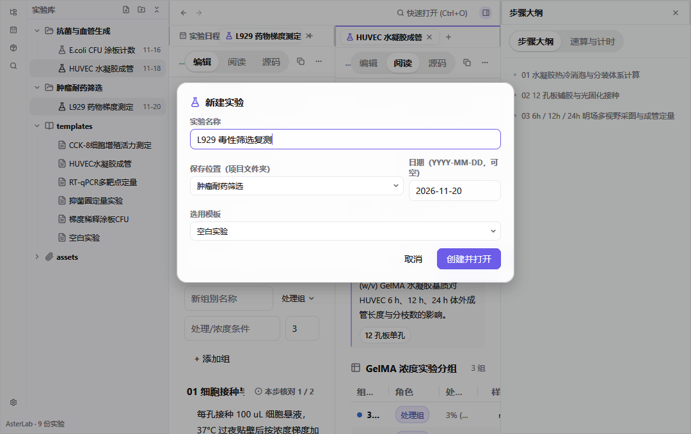

   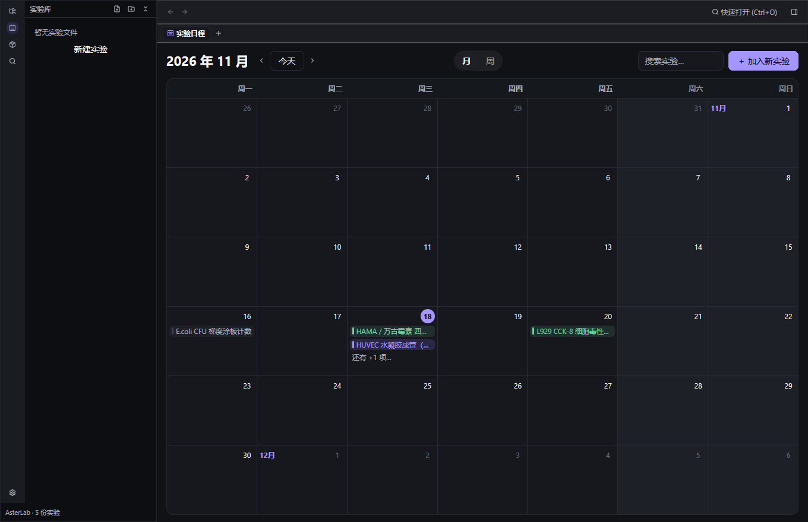

   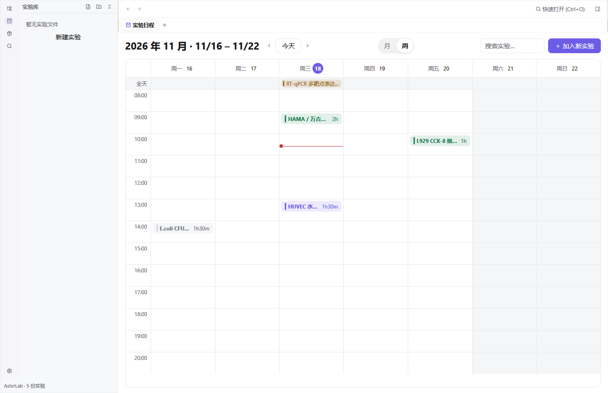

2. **Obsidian 级 40px Ribbon + Vault 文件树 + 全等左右分屏 + 独立「储藏室货架」 + `Ctrl+K`**：

   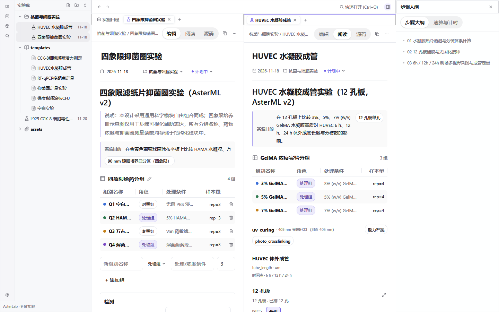

   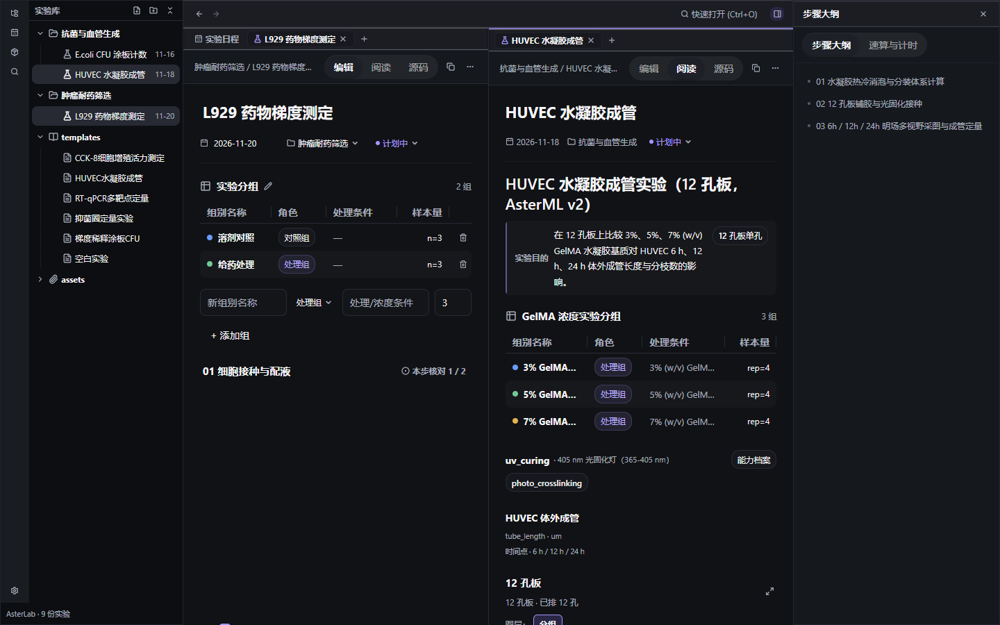

   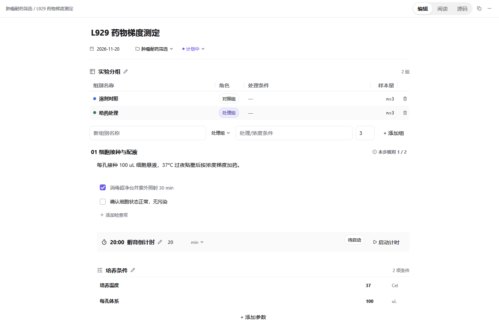

   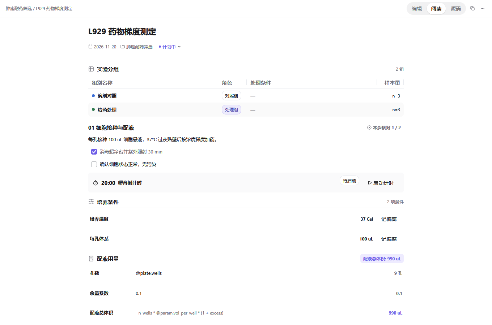

   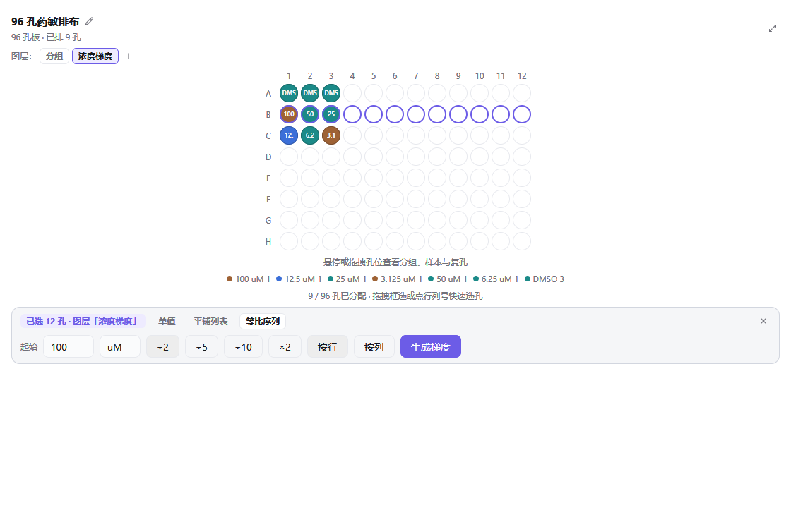

   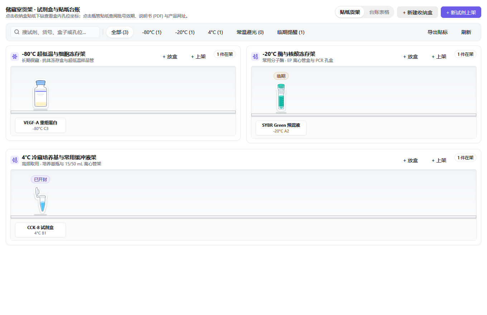

   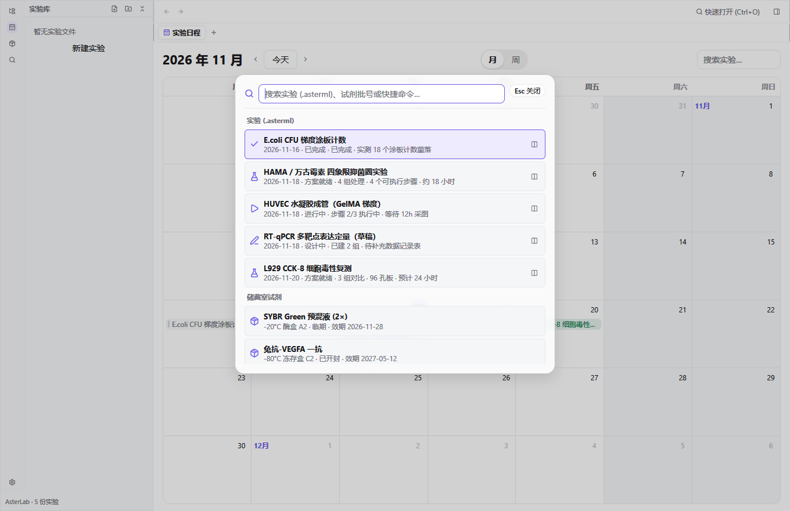

3. **真实导出的组件级高清 PDF v2（设计单与完整实验实测记录成品 A4 页）**：

   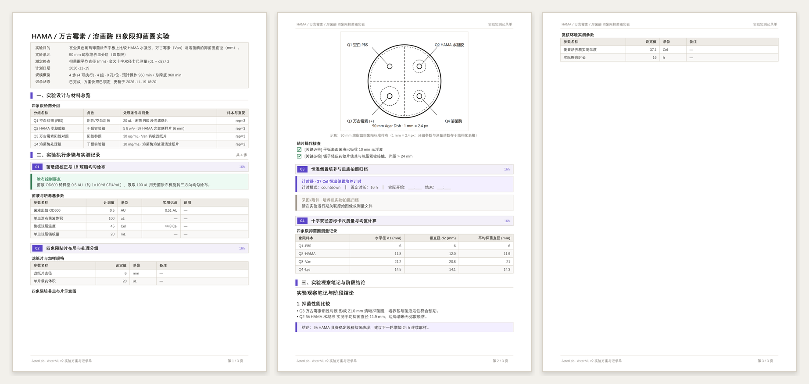

   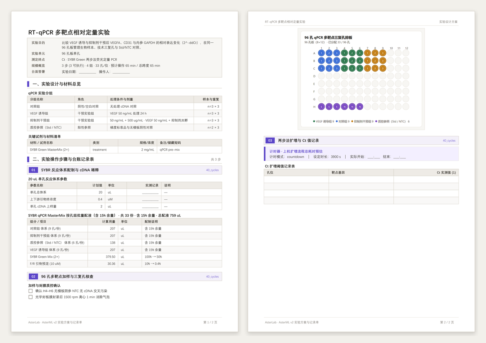

   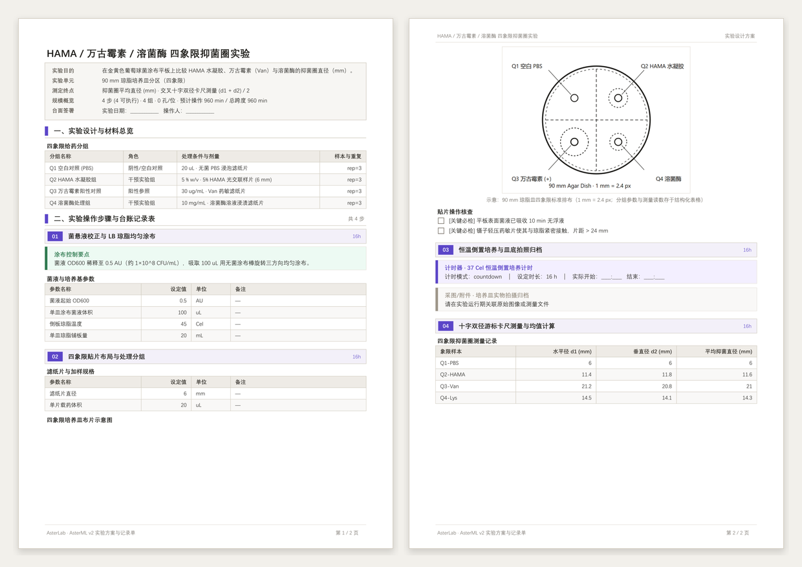

   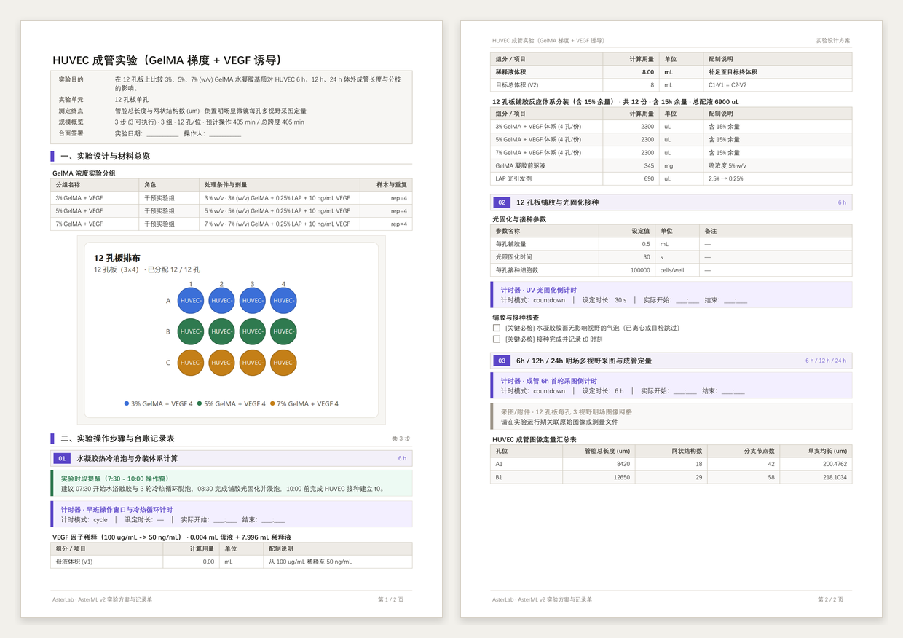

---

## 五、单真源 `.asterml` 与 Obsidian 式本地实验室仓库（Lab Vault）

### 5.1 单文件承载机制：唯一真源内的内联执行与旧信封兼容

针对同一实验重复三份内容造成“设计/运行/记录”分裂的历史痛点，系统在 [vault](../../prototypes/mygo-run/internal/vault) 与 [asterdoc/envelope.go](../../prototypes/mygo-run/internal/asterdoc/envelope.go) 落地了**单真源单文件 `.asterml` 模型**：

1. **YAML Frontmatter 控制面（文件头 `--- ... ---`）**：日历主页、项目文件树与 `Ctrl+K/O` 搜索通过 `ScanFrontmatter` 实现 $O(1)$ 毫秒级索引，统一声明 `title`、`date`（`YYYY-MM-DD`，模板或未排期可为空）、`status`（`planned | in_progress | completed`）；
2. **统一内联执行字段（单真源，无三遍冗余）**：直接在对应 `asterlab` 模块内原位持久化执行事实——`checklist@1.items[].done`、`param_table@1.rows[].actual`、`timer@1.status/started_at/elapsed_sec`、`plate@1.layers` 与 `excluded_wells`、`calculator@1.rows`（支持 `@plate.wells` 与 `@param.<key>`）、`data_table@1.source_ref`；无论在「编辑」还是「阅读」态点击勾选、计时或记偏离，均写入同一文件并通过 `WriteFileAtomic` 原子落盘，共享 100 步 `Undo`/`Redo` 撤销栈；
3. **旧版三段信封兼容展平与干净派生模板**：加载含旧 `asterlab-exec` / `asterlab-record` 区块的文件时由 `FlattenEnvelopeToSingleSource` 自动无损合入内联字段；`ClearExecutionDataForTemplate` 可一键剔除实测与日期生成 `<Vault>/templates/*.asterml` 干净模板（未来支持导出 `.eln` RO-Crate 包）。

### 5.2 实装 Vault 目录构造（已落地）

- **单库结构（默认 `%LOCALAPPDATA%\AsterLab\vault`，支持 `ASTERLAB_VAULT_DIR` 与工作区切换）**：
  - `.asterlab/`：工作区状态与布局（`workspace.json` 等可重建系统状态）；
  - `assets/`：剪贴板粘贴/拖入的图片与实验实拍附件（文档内统一使用 `./assets/<file>` 相对路径保证跨机可移植）；
  - `templates/`：无日期干净标准实验模板 `.asterml`；
  - `<项目文件夹>/*.asterml`（或根目录 `*.asterml`）：真实实验文件，文件夹归属与日程日期完全正交，外部编辑磁盘 `.asterml` 后应用自动感知重载。

---

## 六、演进与已落地状态

1. **✅ 全面落地（Obsidian 单库 + `UnifiedLive` + 4 档动效 + 全交互验证）**：已完成单库 `.asterml` 单真源内联模型、40px Ribbon + 项目文件树 + 平权分屏 + 极简右抽屉、`UnifiedLive`（`编辑 | 阅读 | 源码`）、图层化 `plate@1` 与浓度等比序列填充条、独立纯粹「储藏室货架」及 `internal/theme/motion.go` 四档物理动效体系，并通过 `TestObsidianVaultInteractiveExperienceAndVisualCatalog` 真交互点击测试与最新截图视觉核验。
2. **后续 P1/P2 规划**：为 Rust Core `records` 补 `operation_id` 表达式索引消解高通量写入 `O(N²)`；探索跨实验标准曲线（`calculator` `standard_curve`）拟合回代、多板阵列容器以及标准 `.eln`（RO-Crate ZIP）归档包导入导出。
